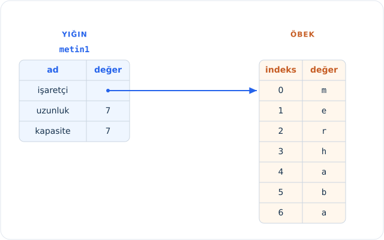
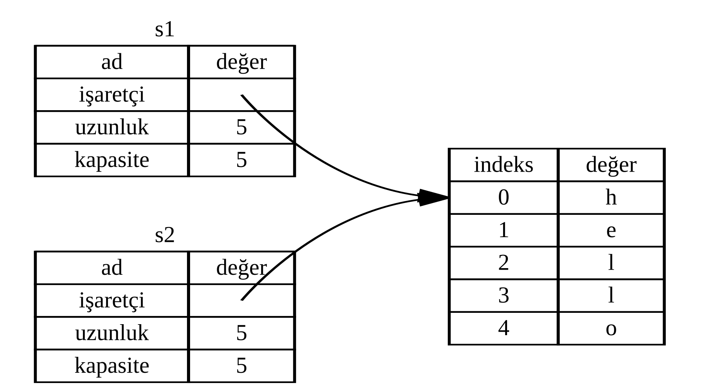
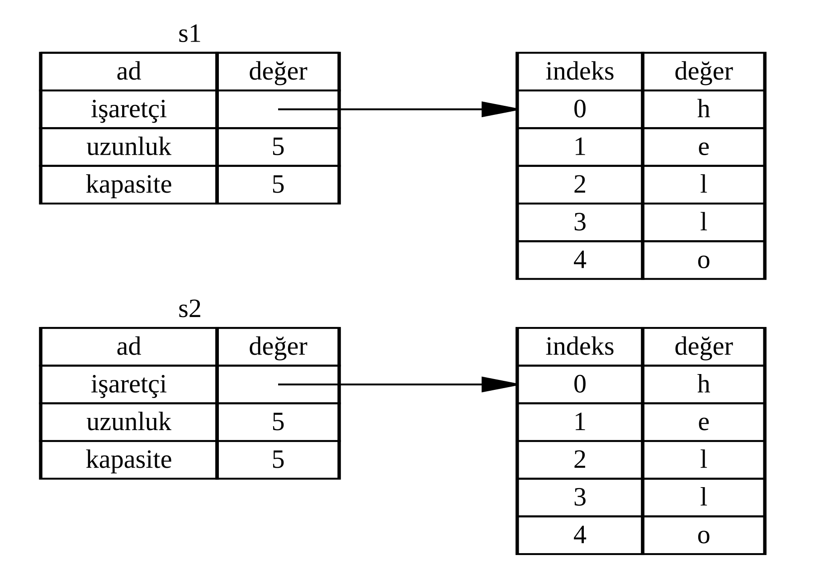
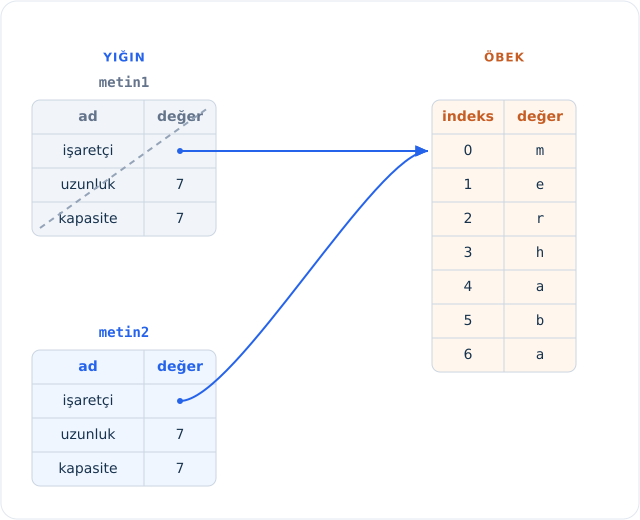
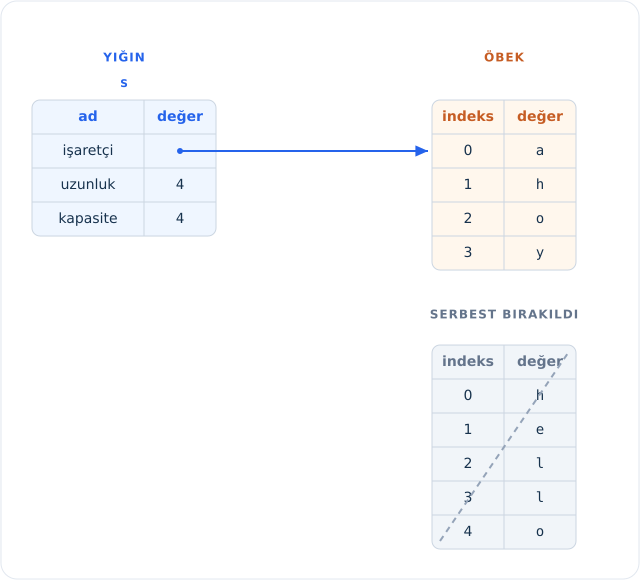

<!-- Old headings. Do not remove or links may break. -->
<a id="what-is-ownership"></a>

## Sahiplik Nedir?

_Sahiplik (ownership)_, bir Rust programının belleği nasıl yönettiğini belirleyen kurallar bütünüdür. Tüm programlar, çalışırken bilgisayarın belleğini nasıl kullandıklarını bir şekilde yönetmek zorundadır. Bazı dillerde program çalışırken artık kullanılmayan belleği düzenli olarak tarayıp temizleyen bir *çöp toplama (garbage collection)* mekanizması bulunur; bazı dillerde ise programcının belleği açıkça ayırması ve serbest bırakması gerekir. Rust üçüncü bir yaklaşım benimser: Bellek, derleyicinin derleme zamanında denetlediği kurallardan oluşan bir sahiplik sistemi aracılığıyla yönetilir. Bu kurallardan herhangi biri ihlal edilirse program derlenmez. Sahiplik sisteminin sunduğu özelliklerin hiçbiri, çalışırken programınızı yavaşlatmaz.

Sahiplik pek çok programcı için yeni bir kavram olduğundan buna alışmak biraz zaman alabilir. İyi haber şu ki Rust ve sahiplik sisteminin kuralları konusunda deneyim kazandıkça, güvenli ve verimli kodları doğal bir akışla geliştirmek sizin için giderek kolaylaşacaktır. Pes etmeden devam edin!

Sahipliği kavradığınızda, Rust'ı benzersiz kılan diğer özellikleri anlamak için sağlam bir temele sahip olacaksınız. Bu bölümde, çok yaygın bir veri yapısına odaklanan örnekler üzerinden sahipliği öğreneceksiniz: `String`'ler.

<!-- Old headings. Do not remove or links may break. -->
<a id="the-stack-and-the-heap"></a>
<a id="yığın-ve-öbek"></a>
<a id="yığın-ve-yığın-bellek-the-stack-and-the-heap"></a>

> ### Yığın ve Öbek
>
> Pek çok programlama dili, *yığın (stack)* ve *öbek (heap)* hakkında sık sık düşünmenizi gerektirmez. Ancak Rust gibi bir sistem programlama dilinde, bir değerin yığında mı yoksa öbekte mi tutulduğu dilin nasıl davrandığını ve neden belirli tasarım kararları almanız gerektiğini doğrudan etkiler. Bu bölümün ilerleyen kısımlarında sahipliğin bazı yönlerini yığın ve öbekle ilişkilendirerek açıklayacağımız için, ön hazırlık olarak burada kısa bir özet sunuyoruz.
>
> Hem yığın hem de öbek, kodunuzun çalışma zamanında kullanabileceği bellek bölümleridir; ancak farklı biçimlerde yapılandırılmışlardır. Yığın, değerleri aldığı sırayla saklar ve ters sırayla çıkarır. Bu çalışma biçimine _son giren ilk çıkar (last in, first out — LIFO)_ adı verilir. Üst üste dizilmiş tabakları düşünün: Yeni tabak eklediğinizde yığının en üstüne koyarsınız; bir tabağa ihtiyacınız olduğunda da yine en üstten alırsınız. Ortadan veya en alttan tabak eklemeye ya da çıkarmaya çalışmak pek iyi sonuç vermez! Yığına veri eklemeye _yığına itme (pushing onto the stack)_, veri çıkarmaya ise _yığından çıkarma (popping off the stack)_ denir. Yığında saklanan tüm verilerin derleme zamanında bilinen, sabit bir boyuta sahip olması gerekir. Derleme zamanında boyutu bilinmeyen veya çalışma zamanında boyutu değişebilecek veriler ise bunun yerine öbekte saklanmalıdır.
>
> Öbek daha az düzenlidir: Öbeğe veri koymak istediğinizde belirli miktarda alan talep edersiniz. Bellek ayırıcı (*memory allocator*), öbekte yeterince büyük boş bir alan bulur, burayı kullanımda olarak işaretler ve o konumun adresi olan bir _işaretçi (pointer)_ döndürür. Bu işleme _öbekte yer ayırma (allocating on the heap)_ denir ve bazen kısaca _yer ayırma (allocating)_ olarak adlandırılır (değerleri yığına itmek yer ayırma olarak kabul edilmez). Öbeğe işaret eden işaretçinin kendisi bilinen ve sabit bir boyuta sahip olduğundan bu işaretçiyi yığında saklayabilirsiniz; ancak asıl veriye ulaşmak istediğinizde işaretçiyi takip etmeniz gerekir. Bir restorana gittiğinizi düşünün: İçeri girdiğinizde grubunuzdaki kişi sayısını söylersiniz, görevli de herkese yetecek boş bir masa bulup sizi oraya yönlendirir. Grubunuzdan biri geç gelirse, sizi bulmak için hangi masaya oturtulduğunuzu sorması yeterlidir.
>
> Yığına veri itmek, öbekte yer ayırmaktan daha hızlıdır; çünkü ayırıcının yeni veriyi saklamak için asla boş yer araması gerekmez — bu konum her zaman yığının en üstüdür. Buna karşılık öbekte yer ayırmak daha fazla iş gerektirir; çünkü ayırıcı önce veriyi tutacak büyüklükte boş bir alan bulmalı, ardından bir sonraki ayırma işlemine hazırlanmak için gerekli kayıtları tutmalıdır.
>
> Öbekteki verilere erişmek, genellikle yığındaki verilere erişmekten daha yavaştır; çünkü hedefe ulaşmak için bir işaretçiyi takip etmeniz gerekir. Güncel işlemciler bellekte bir noktadan diğerine daha az atladıklarında çok daha hızlı çalışırlar. Restoran benzetmesine devam edersek, birden fazla masadan sipariş alan bir garsonu düşünün: En verimli yöntem, bir sonraki masaya geçmeden önce tek bir masadaki tüm siparişleri almaktır. Önce A masasından bir sipariş, sonra B masasından bir sipariş, ardından tekrar A'dan ve tekrar B'den sipariş almak süreci ciddi biçimde yavaşlatacaktır. Benzer şekilde bir işlemci de birbirinden uzakta duran veriler yerine (öbekte olabileceği gibi), birbirine yakın konumlanmış veriler üzerinde (yığında olduğu gibi) çalışırken görevini genellikle çok daha iyi yerine getirir.
>
> Kodunuz bir fonksiyon çağırdığında, fonksiyona aktarılan değerler (öbekteki verilere işaret eden olası işaretçiler de dahil) ve fonksiyonun yerel değişkenleri yığına itilir. Fonksiyon sona erdiğinde ise bu değerler yığından çıkarılır.
>
> Kodun hangi bölümlerinin öbekteki hangi verileri kullandığını takip etmek, öbekteki yinelenen veri miktarını en aza indirmek ve bellek alanınızın tükenmemesi için öbekte artık kullanılmayan verileri temizlemek; tümü sahiplik sisteminin çözdüğü sorunlardır. Sahipliği bir kez kavradığınızda yığın ve öbek üzerinde çok sık düşünmeniz gerekmeyecektir. Yine de sahipliğin temel amacının öbek verilerini yönetmek olduğunu bilmek, bu sistemin neden böyle çalıştığını anlamanıza büyük ölçüde yardımcı olur.

<!-- Old headings. Do not remove or links may break. -->
<a id="ownership-rules"></a>

### Sahiplik Kuralları

Öncelikle sahiplik kurallarına göz atalım. Bu kuralları somutlaştıran örnekler üzerinde çalışırken aşağıdaki üç maddeyi aklınızda bulundurun:

- Rust'taki her değerin bir _sahibi (owner)_ vardır.
- Aynı anda yalnızca tek bir sahip olabilir.
- Sahip kapsam dışına çıktığında değer _düşürülür_ (`drop` edilir).

<!-- Old headings. Do not remove or links may break. -->
<a id="variable-scope"></a>
<a id="değişken-kapsamı-variable-scope"></a>

### Değişken Kapsamı

Temel Rust sözdizimini geride bıraktığımıza göre, bundan sonraki örneklerin tamamına `fn main() {` kodunu dahil etmeyeceğiz; dolayısıyla örnekleri kendiniz deneyerek takip ediyorsanız kodları bir `main` fonksiyonunun içine yerleştirmeyi unutmayın. Böylece örneklerimiz daha özlü kalacak ve basmakalıp kodlar yerine doğrudan asıl ayrıntılara odaklanabileceğiz.

Sahipliğin ilk örneği olarak bazı değişkenlerin kapsamını (*scope*) inceleyeceğiz. _Kapsam_, bir öğenin program içinde geçerli olduğu aralıktır. Aşağıdaki değişkeni ele alalım:

```rust
let metin = "merhaba";
```

`metin` değişkeni, metin değerinin programımızın kaynak koduna doğrudan sabit olarak yazıldığı bir *string sabitini (string literal)* ifade eder. Bu değişken, tanımlandığı noktadan içinde bulunduğu kapsamın sonuna kadar geçerlidir. Liste 4-1, `metin` değişkeninin nerelerde geçerli olacağını yorum satırlarıyla gösteren bir programı sunmaktadır.

<Listing number="4-1" caption="Bir değişken ve geçerli olduğu kapsam">

```rust
{{#rustdoc_include ../listings/ch04-understanding-ownership/listing-04-01/src/main.rs:here}}
```

</Listing>

Başka bir deyişle, burada dikkat edilmesi gereken iki önemli an vardır:

- `metin` kapsama _girdiğinde_ geçerlidir.
- Kapsam dışına _çıkana_ kadar geçerliliğini korur.

Bu noktaya kadar kapsamlar ile değişkenlerin geçerlilik süresi arasındaki ilişki diğer programlama dillerindekine oldukça benzer. Şimdi `String` türünü tanıtarak bu temelin üzerine yeni kavramlar inşa edeceğiz.

<!-- Old headings. Do not remove or links may break. -->
<a id="the-string-type"></a>

### `String` Türü

Sahiplik kurallarını göstermek için Bölüm 3'teki ["Veri Türleri"][data-types]<!-- ignore --> bölümünde ele aldıklarımızdan daha karmaşık bir veri türüne ihtiyacımız var. Daha önce incelediğimiz türlerin hepsi bilinen bir boyuta sahiptir; yığında saklanabilir, kapsamları bittiğinde yığından çıkarılabilir ve kodun başka bir bölümü aynı değeri farklı bir kapsamda kullanmak istediğinde yeni ve bağımsız bir örnek oluşturmak üzere hızlıca kopyalanabilir. Biz ise öbekte saklanan verileri incelemek ve Rust'ın bu verileri ne zaman temizleyeceğini nasıl bildiğini keşfetmek istiyoruz; `String` türü bunun için harika bir örnektir.

Burada `String` türünün yalnızca sahiplikle ilgili yönlerine odaklanacağız. Bu özellikler, ister standart kütüphane tarafından sağlansın ister sizin tarafınızdan oluşturulsun, diğer karmaşık veri türleri için de geçerlidir. `String` türünün sahiplik dışındaki yönlerini [Bölüm 8][ch8]<!-- ignore -->'de ayrıntılı olarak ele alacağız.

Bir metin değerinin programımıza doğrudan yazıldığı string sabitlerini zaten görmüştük. String sabitleri kullanışlıdır ancak metinlerle çalışmak isteyebileceğimiz her durum için uygun değildir. Bunun bir nedeni değiştirilemez olmalarıdır. Bir diğer nedeni ise kodumuzu yazarken her metin değerini önceden bilemememizdir: Örneğin kullanıcıdan bir girdi alıp saklamak istediğimizde ne yapacağız? Rust, tam da bu gibi durumlar için `String` türüne sahiptir. Bu tür, öbek üzerinde ayrılan verileri yönetir ve bu sayede derleme zamanında boyutu bilinmeyen miktarda metni saklayabilir. Aşağıdaki gibi `from` fonksiyonunu kullanarak bir string sabitinden `String` oluşturabilirsiniz:

```rust
let metin = String::from("merhaba");
```

Çift iki nokta üst üste (`::`) operatörü, `string_from` gibi bir isim kullanmak yerine bu özel `from` fonksiyonunu `String` türünün isim uzayı (*namespace*) altında çağırmamıza olanak tanır. Bu sözdizimini Bölüm 5'teki ["Metotlar"][methods]<!-- ignore --> bölümünde ve Bölüm 7'de modüllerle isim uzaylarını incelerken ["Modül Ağacındaki Bir Öğeye Başvurmak İçin Yollar"][paths-module-tree]<!-- ignore --> bölümünde daha ayrıntılı ele alacağız.

Bu tür bir string _değiştirilebilir_:

```rust
{{#rustdoc_include ../listings/ch04-understanding-ownership/no-listing-01-can-mutate-string/src/main.rs:here}}
```

Peki buradaki fark nedir? Neden `String` değiştirilebilirken string sabitleri değiştirilemez? Aradaki fark, bu iki türün belleği ele alış biçiminden kaynaklanır.

<!-- Old headings. Do not remove or links may break. -->
<a id="memory-and-allocation"></a>
<a id="bellek-ve-ayırma-memory-and-allocation"></a>

### Bellek ve Ayırma

Bir string sabitinde içeriği derleme zamanında bildiğimiz için metin doğrudan son çalıştırılabilir ikili dosyaya gömülür. String sabitlerinin hızlı ve verimli olmasının nedeni budur. Ancak bu özellikler yalnızca string sabitinin değiştirilemezliğinden gelir. Ne yazık ki derleme zamanında boyutu bilinmeyen ve program çalışırken boyutu değişebilecek her bir metin parçası için ikili dosyanın içine sabit bir bellek bloğu koyamayız.

`String` türünde ise değiştirilebilir ve büyüyebilir bir metin parçasını desteklemek amacıyla, içeriği tutmak üzere öbekte derleme zamanında bilinmeyen miktarda bellek ayırmamız gerekir. Bu durum iki gereklilik doğurur:

- Bellek, çalışma zamanında bellek ayırıcıdan talep edilmelidir.
- `String` ile işimiz bittiğinde bu belleği ayırıcıya iade etmenin bir yoluna ihtiyacımız vardır.

İlk kısım bizim tarafımızdan başlatılır: `String::from` fonksiyonunu çağırdığımızda, arka plandaki uygulaması ihtiyaç duyduğu belleği talep eder. Bu kısım programlama dillerinin neredeyse tamamında ortaktır.

Ancak ikinci kısım dilden dile farklılaşır. Bir _çöp toplayıcıya (garbage collector — GC)_ sahip dillerde GC, artık kullanılmayan belleği takip edip temizler ve bizim bunu düşünmemiz gerekmez. Çöp toplayıcısı olmayan çoğu dilde ise belleğin ne zaman artık kullanılmadığını tespit etmek ve tıpkı talep ederken yaptığımız gibi açıkça kod çağırarak onu serbest bırakmak bizim sorumluluğumuzdadır. Bunu hatasız yapmak tarihsel olarak zorlu bir programlama problemi olmuştur. Unutursak belleği boşa harcarız. Çok erken serbest bırakırsak elimizde geçersiz bir değişken kalır. İki kez serbest bırakırsak bu da ayrı bir hatadır. Tam olarak bir `allocate` (ayırma) işlemini tam olarak bir `free` (serbest bırakma) işlemiyle eşleştirmemiz gerekir.

Rust ise farklı bir yol izler: Bellek, kendisine sahip olan değişken kapsam dışına çıktığı anda otomatik olarak iade edilir. İşte Liste 4-1'deki kapsam örneğimizin string sabiti yerine `String` kullanan sürümü:

```rust
{{#rustdoc_include ../listings/ch04-understanding-ownership/no-listing-02-string-scope/src/main.rs:here}}
```

`String` değerimizin kullandığı belleği ayırıcıya iade edebileceğimiz doğal bir nokta vardır: `metin` değişkeni kapsam dışına çıktığı an. Bir değişken kapsam dışına çıktığında Rust bizim yerimize özel bir fonksiyon çağırır. `drop` adı verilen bu fonksiyon, `String` türünün yazarının belleği iade edecek kodu yerleştirdiği yerdir. Rust, kapanış süslü parantezinde `drop` fonksiyonunu otomatik olarak çağırır.

> Not: C++ dilinde, bir öğenin ömrünün sonunda kaynakları serbest bırakma kalıbına kimi zaman _Kaynak Edinimi İlklendirmedir (Resource Acquisition Is Initialization — RAII)_ adı verilir. Daha önce RAII kalıplarını kullandıysanız Rust'taki `drop` fonksiyonu size oldukça tanıdık gelecektir.

Bu kalıbın Rust kodunun yazılma biçimi üzerinde derin bir etkisi vardır. Şu an basit görünebilir; ancak öbekte ayırdığımız veriyi birden fazla değişkenin kullanmasını istediğimiz daha karmaşık durumlarda kodun davranışı beklenmedik gelebilir. Gelin şimdi bu durumları yakından inceleyelim.

<!-- Old headings. Do not remove or links may break. -->
<a id="ways-variables-and-data-interact-move"></a>
<a id="variables-and-data-interacting-with-move"></a>
<a id="değişkenlerin-ve-verilerin-move-taşıma-ile-etkileşimi"></a>

#### Değişkenlerin ve Verilerin Taşıma ile Etkileşimi

Rust'ta birden fazla değişken aynı veriyle farklı biçimlerde etkileşime girebilir. Liste 4-2, tam sayılar kullanan bir örneği göstermektedir.

<Listing number="4-2" caption="`x` değişkeninin tam sayı değerini `y` değişkenine atama">

```rust
{{#rustdoc_include ../listings/ch04-understanding-ownership/listing-04-02/src/main.rs:here}}
```

</Listing>

Bu kodun ne yaptığını muhtemelen tahmin edebiliriz: "`5` değerini `x` değişkenine bağla; ardından `x` içindeki değerin bir kopyasını oluşturup `y` değişkenine bağla." Artık elimizde `x` ve `y` olmak üzere iki değişken vardır ve ikisi de `5` değerine eşittir. Gerçekleşen şey de tam olarak budur; çünkü tam sayılar bilinen, sabit bir boyuta sahip basit değerlerdir ve bu iki `5` değeri doğrudan yığına itilir.

Şimdi aynı işlemin `String` sürümüne bakalım:

```rust
{{#rustdoc_include ../listings/ch04-understanding-ownership/no-listing-03-string-move/src/main.rs:here}}
```

Bu kod önceki örneğe çok benzediği için çalışma şeklinin de aynı olacağını varsayabiliriz: Yani ikinci satırın `metin1` içindeki değerin bir kopyasını oluşturup `metin2` değişkenine bağlayacağını düşünebiliriz. Ancak burada gerçekleşen şey tam olarak bu değildir.

`String` için perde arkasında neler olup bittiğini görmek üzere Şekil 4-1'e göz atın. Bir `String`, solda gösterildiği gibi üç bileşenden oluşur: metnin içeriğini tutan belleğe işaret eden bir işaretçi (`ptr`), bir uzunluk (`len`) ve bir kapasite (`capacity`). Bu veri grubu yığında saklanır. Sağda ise metnin asıl içeriğini barındıran öbek belleği yer alır.



<span class="caption">Şekil 4-1: `s1` (`metin1`) değişkenine bağlı `"hello"` değerini tutan bir `String`'in bellekteki temsili</span>

Uzunluk (`len`), `String` içeriğinin o anda bayt cinsinden ne kadar bellek kullandığını belirtir. Kapasite (`capacity`) ise `String`'in bellek ayırıcıdan aldığı toplam bellek miktarının bayt cinsinden değeridir. Uzunluk ile kapasite arasındaki fark önemlidir, ancak bu bağlamda belirleyici olmadığından şimdilik kapasiteyi göz ardı edebiliriz.

> Not: Kitabın orijinal bellek diyagramlarında (`Şekil 4-1` – `Şekil 4-5`), İngilizce koddaki değişken adları (`metin1`, `metin2`, `metin` yerine `s1`, `s2`, `s`) ve `"hello"` (5 bayt) ile `"ahoy"` (4 bayt) metinleri yer almaktadır. Türkçe kodumuzdaki `String::from("merhaba")` örneğinde ise `"merhaba"` 7 ASCII karakterden oluştuğu için yığındaki `len` ve `capacity` değerleri `7` olur. Ayrıca `len` alanının karakter sayısını değil **bayt sayısını** tuttuğuna dikkat edin: Örneğin UTF-8 kodlamasında `'ç'`, `'ğ'`, `'ı'`, `'ö'`, `'ş'`, `'ü'` gibi Türkçe harfler 2 bayt yer kapladığından `String::from("dünya")` bellekte 5 değil **6 bayt** (`len = 6`) uzunluğundadır.

`metin1`'i `metin2`'ye atadığımızda `String`'in yığın verisi kopyalanır; yani yığında bulunan işaretçiyi, uzunluğu ve kapasiteyi kopyalarız. İşaretçinin gösterdiği öbek üzerindeki veriyi ise kopyalamayız. Başka bir deyişle, bellekteki veri yerleşimi Şekil 4-2'deki gibi görünür.



<span class="caption">Şekil 4-2: `s1` (`metin1`) değişkeninin işaretçi, uzunluk ve kapasite değerlerinin kopyasına sahip olan `s2` (`metin2`) değişkeninin bellekteki temsili</span>

Bellekteki görünüm, Rust öbek verisini de kopyalasaydı ortaya çıkacak olan Şekil 4-3'teki gibi _değildir_. Eğer Rust böyle davransaydı, öbekteki verinin büyük olduğu durumlarda `metin2 = metin1` ataması çalışma zamanı performansı açısından son derece maliyetli olabilirdi.



<span class="caption">Şekil 4-3: Rust öbek verisini de kopyalasaydı `s2 = s1` (`metin2 = metin1`) işleminin oluşturacağı alternatif bellek görünümü</span>

Daha önce, bir değişken kapsam dışına çıktığında Rust'ın otomatik olarak `drop` fonksiyonunu çağırdığını ve o değişkene ait öbek belleğini temizlediğini belirtmiştik. Ancak Şekil 4-2'de her iki veri işaretçisinin de aynı bellek konumunu gösterdiğini görüyoruz. Bu ciddi bir sorundur: `metin2` ve `metin1` kapsam dışına çıktığında her ikisi de aynı belleği serbest bırakmaya çalışacaktır. Bu durum _çift serbest bırakma (double free)_ hatası olarak bilinir ve daha önce değindiğimiz bellek güvenliği hatalarından biridir. Aynı belleği iki kez serbest bırakmak bellek bozulmasına (*memory corruption*) ve bunun sonucunda güvenlik açıklarına yol açabilir.

Bellek güvenliğini sağlamak amacıyla `let metin2 = metin1;` satırından sonra Rust, `metin1` değişkenini artık geçerli kabul etmez. Dolayısıyla `metin1` kapsam dışına çıktığında Rust'ın herhangi bir şeyi serbest bırakması gerekmez. `metin2` oluşturulduktan sonra `metin1`'i kullanmaya çalıştığınızda ne olduğuna bakın; kod derlenmeyecektir:

```rust,ignore,does_not_compile
{{#rustdoc_include ../listings/ch04-understanding-ownership/no-listing-04-cant-use-after-move/src/main.rs:here}}
```

Rust geçersiz kılınmış değişkeni kullanmanızı engellediği için şuna benzer bir hata alırsınız:

```console
{{#include ../listings/ch04-understanding-ownership/no-listing-04-cant-use-after-move/output.txt}}
```

> Not: Derleyicinin ürettiği `` error[E0382]: borrow of moved value: `metin1` `` (*taşınmış değerin ödünç alınması*) hatasını adım adım okumak oldukça öğreticidir: Derleyici önce `String` türünün `Copy` trait'ini uygulamadığını, bu yüzden `let metin2 = metin1;` satırında değerin `metin2`'ye taşındığını (`value moved here`) belirtir. Ardından `println!` makrosunun `metin1` değerini ekrana yazdırmak için ödünç almaya çalıştığı noktayı (`value borrowed here after move`) işaret eder. Ödünç alma (*borrowing*) kavramını bir sonraki bölümde ayrıntılı olarak inceleyeceğiz.

Diğer programlama dilleriyle çalışırken _sığ kopya (shallow copy)_ ve _derin kopya (deep copy)_ terimlerini duyduysanız; öbekteki veriyi kopyalamadan yalnızca işaretçiyi, uzunluğu ve kapasiteyi kopyalama fikri kulağa sığ kopya yapmak gibi gelebilir. Ancak Rust aynı zamanda ilk değişkeni geçersiz kıldığı için bu işlem sığ kopya olarak değil, _taşıma (move)_ olarak adlandırılır. Bu örnekte `metin1`'in `metin2`'ye _taşındığını_ söyleriz. Dolayısıyla bellekte gerçekte olan durum Şekil 4-4'te gösterilmiştir.



<span class="caption">Şekil 4-4: `s1` (`metin1`) geçersiz kılındıktan sonra bellekteki temsil</span>

Bu yaklaşım sorunumuzu tamamen çözer! Yalnızca `metin2` geçerli kaldığından, kapsam dışına çıktığında belleği yalnızca o serbest bırakır ve çift serbest bırakma tehlikesi ortadan kalkar.

Buna ek olarak bu mekanizmanın ortaya koyduğu önemli bir tasarım tercihi daha vardır: Rust, verilerinizin "derin" kopyalarını asla kendiliğinden oluşturmaz. Dolayısıyla Rust'ta gerçekleşen her türlü _otomatik_ kopyalamanın çalışma zamanı performansı açısından düşük maliyetli olduğu güvenle varsayılabilir.

<!-- Old headings. Do not remove or links may break. -->
<a id="scope-and-assignment"></a>
<a id="kapsam-ve-atama-scope-and-assignment"></a>

#### Kapsam ve Atama

Kapsam, sahiplik ve belleğin `drop` fonksiyonu aracılığıyla serbest bırakılması arasındaki ilişkinin tersi de geçerlidir. Mevcut bir değişkene tamamen yeni bir değer atadığınızda Rust, önceki değer üzerinde derhal `drop` fonksiyonunu çağırır ve o değerin belleğini anında serbest bırakır. Örneğin şu kodu inceleyelim:

```rust
{{#rustdoc_include ../listings/ch04-understanding-ownership/no-listing-04b-replacement-drop/src/main.rs:here}}
```

Başlangıçta `metin` adında bir değişken tanımlıyor ve ona `"merhaba"` değerini tutan bir `String` bağlıyoruz. Hemen ardından `"selam"` değerine sahip yeni bir `String` oluşturup `metin` değişkenine atıyoruz. Bu noktada öbekteki ilk değere başvuran hiçbir değişken kalmamıştır. Şekil 4-5, bu atama sonrasında yığın ve öbek verilerinin durumunu göstermektedir:



<span class="caption">Şekil 4-5: Başlangıçtaki değer bütünüyle yenisiyle değiştirildikten sonra bellekteki temsil</span>

Böylece ilk string anında kapsam dışına çıkmış olur. Rust bu değer üzerinde `drop` fonksiyonunu çalıştırır ve belleği hemen serbest bırakılır. Son satırda değeri yazdırdığımızda ekranda `"selam, dünya!"` çıktısını görürüz.

<!-- Old headings. Do not remove or links may break. -->
<a id="ways-variables-and-data-interact-clone"></a>
<a id="variables-and-data-interacting-with-clone"></a>

#### Değişkenlerin ve Verilerin Clone ile Etkileşimi

Yalnızca yığın verisini değil, `String`'in öbek verisini de _gerçekten_ derinlemesine kopyalamak istiyorsak `clone` adındaki yaygın metodu kullanabiliriz. Metot sözdizimini Bölüm 5'te ele alacağız; ancak metotlar pek çok programlama dilinde ortak bir özellik olduğundan muhtemelen daha önce karşılaşmışsınızdır.

İşte `clone` metodunun çalışırkenki bir örneği:

```rust
{{#rustdoc_include ../listings/ch04-understanding-ownership/no-listing-05-clone/src/main.rs:here}}
```

Bu kod sorunsuzca çalışır ve öbek verisinin _gerçekten_ kopyalandığı Şekil 4-3'teki davranışı açıkça üretir.

Kodda bir `clone` çağrısı gördüğünüzde, arka planda isteğe bağlı bir kopyalama kodunun çalıştırıldığını ve bu işlemin performans açısından maliyetli olabileceğini bilirsiniz. Bu çağrı, sıradan bir atamadan farklı bir işlem yapıldığının açık bir görsel göstergesidir.

<!-- Old headings. Do not remove or links may break. -->
<a id="stack-only-data-copy"></a>
<a id="sadece-stack-verisi-stack-only-data-copy"></a>

#### Yalnızca Yığındaki Veri: Copy

Henüz değinmediğimiz bir ayrıntı daha var. Bir kısmını Liste 4-2'de gördüğümüz, tam sayılar kullanan şu kod derlenir ve tamamen geçerlidir:

```rust
{{#rustdoc_include ../listings/ch04-understanding-ownership/no-listing-06-copy/src/main.rs:here}}
```

Ancak bu kod az önce öğrendiklerimizle çelişiyor gibi görünmektedir: `clone` çağrısı yapmadığımız hâlde `x` hâlâ geçerlidir ve `y` içine taşınmamıştır.

Bunun nedeni, tam sayılar gibi derleme zamanında boyutu bilinen türlerin bütünüyle yığında saklanması ve dolayısıyla asıl değerlerin kopyasını oluşturmanın çok hızlı olmasıdır. Yani `y` değişkenini oluşturduktan sonra `x` değişkeninin geçerliliğini yitirmesini gerektirecek hiçbir neden yoktur. Başka bir deyişle, burada derin kopyalama ile sığ kopyalama arasında hiçbir fark bulunmaz; bu yüzden `clone` çağırmak olağan sığ kopyalamadan farklı bir iş yapmayacağı için ona gerek duymayız.

Rust, tam sayılar gibi yığında saklanan türlerin üzerine yerleştirebileceğimiz `Copy` adında özel bir trait sunar (trait'leri [Bölüm 10][traits]<!-- ignore -->'da ayrıntılı olarak inceleyeceğiz). Bir tür `Copy` trait'ini uyguluyorsa onu kullanan değişkenler taşınmaz; bunun yerine önemsiz bir maliyetle kopyalanır ve başka bir değişkene atandıktan sonra da geçerli kalmaya devam eder.

Bir türün kendisi ya da parçalarından herhangi biri `Drop` trait'ini uygulamışsa Rust o türü `Copy` ile işaretlememize izin vermez. Değer kapsam dışına çıktığında özel bir temizlik işlemi yapılması gereken bir türe `Copy` trait'ini eklemeye çalışırsak derleme zamanı hatası alırız. Kendi türlerinizde bu trait'i uygulamak üzere ilgili türetme özniteliğini (`#[derive(Copy)]`) nasıl ekleyeceğinizi öğrenmek için Ek C'deki ["Türetilebilir Trait'ler"][derivable-traits]<!-- ignore --> bölümüne bakabilirsiniz.

Peki hangi türler `Copy` trait'ini uygular? Emin olmak için ilgili türün dokümantasyonunu kontrol edebilirsiniz; ancak genel kural olarak basit skaler değerlerden oluşan her grup `Copy` uygulayabilirken, öbekte bellek ayırma gerektiren veya bir sistem kaynağını temsil eden hiçbir tür `Copy` uygulayamaz. `Copy` trait'ini uygulayan başlıca türler şunlardır:

- `u32` gibi tüm tam sayı türleri.
- `true` ve `false` değerlerine sahip Boolean türü `bool`.
- `f64` gibi tüm kayan noktalı sayı türleri.
- Karakter türü `char`.
- Yalnızca `Copy` uygulayan türleri barındırmaları koşuluyla demetler (*tuples*). Örneğin `(i32, i32)` türü `Copy` trait'ini uygular, ancak `(i32, String)` uygulamaz.

> Not: Özetle Rust'ta `=` ile yapılan her atama işlemi yığındaki bitleri hızlıca kopyalar; fark derleyicinin kaynak değişkene nasıl davrandığındadır: Tür `Copy` ise (`i32`, `bool`, `(i32, f64)` gibi) kaynak değişken geçerli kalır; `Copy` değilse (`String`, `Vec<T>` gibi) sahiplik yeni değişkene **taşınır** ve kaynak değişken geçersiz kılınır. Öbekteki verinin de kopyalanması istendiğinde ise `.clone()` açıkça çağrılmalıdır.

<!-- Old headings. Do not remove or links may break. -->
<a id="ownership-and-functions"></a>
<a id="sahiplik-ve-fonksiyonlar-ownership-and-functions"></a>

### Sahiplik ve Fonksiyonlar

Bir değeri fonksiyona aktarmanın çalışma mekaniği, bir değeri değişkene atamakla oldukça benzerdir. Bir değişkeni fonksiyona geçirmek, tıpkı atama işleminde olduğu gibi değeri ya taşır ya da kopyalar. Liste 4-3, değişkenlerin nerelerde kapsama girip çıktığını gösteren açıklamalarla bu durumu örneklemektedir.

<Listing number="4-3" file-name="src/main.rs" caption="Sahiplik ve kapsam açıklamaları eklenmiş fonksiyonlar">

```rust
{{#rustdoc_include ../listings/ch04-understanding-ownership/listing-04-03/src/main.rs}}
```

</Listing>

`sahipligi_alir` çağrısından sonra `metin` değişkenini kullanmaya çalışsaydık Rust derleme zamanı hatası verirdi. Bu statik kontroller bizi çalışma zamanı hatalarından korur. `metin` ve `x` değişkenlerini nerelerde kullanabileceğinizi ve sahiplik kurallarının sizi nerelerde engellediğini bizzat görmek için `main` fonksiyonuna bu değişkenleri kullanan kodlar eklemeyi deneyin.

<!-- Old headings. Do not remove or links may break. -->
<a id="return-values-and-scope"></a>
<a id="dönüş-değerleri-ve-kapsam-return-values-and-scope"></a>

### Dönüş Değerleri ve Kapsam

Fonksiyonlardan değer döndürmek de sahipliği aktarabilir. Liste 4-4, bir değer döndüren fonksiyon örneğini Liste 4-3'tekine benzer kapsam açıklamalarıyla göstermektedir.

<Listing number="4-4" file-name="src/main.rs" caption="Dönüş değerlerinin sahipliğini aktarma">

```rust
{{#rustdoc_include ../listings/ch04-understanding-ownership/listing-04-04/src/main.rs}}
```

</Listing>

Bir değişkenin sahipliği her seferinde aynı kalıbı izler: Bir değeri başka bir değişkene atamak onu taşır. Öbekte veri barındıran bir değişken kapsam dışına çıktığında, verinin sahipliği başka bir değişkene taşınmadığı sürece söz konusu değer `drop` tarafından temizlenir.

Bu yöntem çalışsa da her fonksiyonda sahipliği alıp ardından tekrar geri döndürmek biraz yorucudur. Bir fonksiyonun değeri kullanmasına izin vermek ama sahipliğini devralmasını istemiyorsak ne yapacağız? Fonksiyona gönderdiğimiz her şeyi daha sonra tekrar kullanabilmek için — fonksiyon gövdesinde üretilen asıl sonuç verilerinin yanı sıra — bir de geri döndürmek zorunda kalmak epey zahmetlidir.

Rust, Liste 4-5'te gösterildiği gibi bir demet kullanarak birden fazla değer döndürmemize olanak tanır.

<Listing number="4-5" file-name="src/main.rs" caption="Parametrelerin sahipliğini demet ile geri döndürme">

```rust
{{#rustdoc_include ../listings/ch04-understanding-ownership/listing-04-05/src/main.rs}}
```

</Listing>

Ancak bu yaklaşım, çok sık karşılaşılacak bir ihtiyaç için gereğinden fazla zahmet ve kalabalık kod demektir. Neyse ki Rust, sahipliği devretmeden bir değeri kullanabilmemiz için özel bir özelliğe sahiptir: *referanslar*.

[data-types]: ch03-02-veri-turleri.html#data-types
[ch8]: ch08-02-stringler.html
[traits]: ch10-02-traitler.html
[derivable-traits]: ekler-03-turetilebilir-traitler.html
[methods]: ch05-03-metotlar.html#metotlar-methods
[paths-module-tree]: ch07-03-oge-yollari.html
