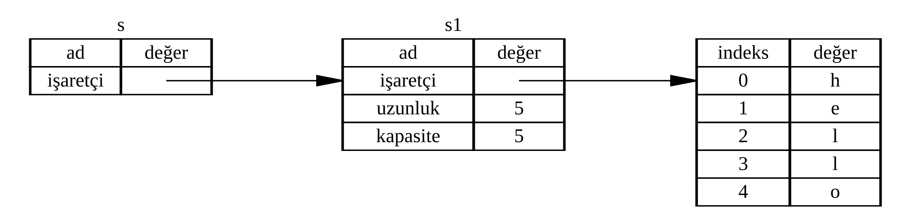

<!-- Old headings. Do not remove or links may break. -->
<a id="references-and-borrowing"></a>
<a id="referanslar-ve-ödünç-alma-references-and-borrowing"></a>

## Referanslar ve Ödünç Alma

Liste 4-5'teki demet kullanan kodun temel sorunu şudur: `String` değeri `uzunlugu_hesapla` fonksiyonuna taşındığı için, fonksiyon çağrısından sonra bu `String`'i hâlâ kullanabilmek adına onu çağıran fonksiyona geri döndürmek zorunda kalırız. Bunun yerine, `String` değerine bir referans verebiliriz. _Referans (reference)_, bellekteki bir adreste saklanan veriye ulaşmak için takip edebileceğimiz bir adres olması bakımından işaretçiye (*pointer*) benzer; ancak o adresteki verinin sahibi başka bir değişkendir. Sıradan bir işaretçiden farklı olarak referansın, kendi ömrü boyunca belirli bir türden geçerli bir değere işaret edeceği garanti edilir.

Değerin sahipliğini devralmak yerine parametre olarak bir nesneye referans kabul eden `uzunlugu_hesapla` fonksiyonunu şu şekilde tanımlayıp kullanabilirsiniz:

<Listing file-name="src/main.rs">

```rust
{{#rustdoc_include ../listings/ch04-understanding-ownership/no-listing-07-reference/src/main.rs:all}}
```

</Listing>

Öncelikle, değişken bildirimindeki ve fonksiyonun dönüş değerindeki tüm demet kodlarının ortadan kalktığına dikkat edin. İkinci olarak, `uzunlugu_hesapla` fonksiyonuna `&metin1` aktardığımıza ve fonksiyon tanımında `String` yerine `&String` kullandığımıza bakın. Bu `&` işaretleri (ampersand) referansları temsil eder ve bir değerin sahipliğini üstlenmeden ona başvurmanıza olanak tanır. Şekil 4-6 bu kavramı görselleştirmektedir.



<span class="caption">Şekil 4-6: `String` türündeki `s1` (`metin1`) değişkenine işaret eden `&String` türündeki `s` (`metin`) diyagramı</span>

> Not: `&` kullanarak referans oluşturmanın tam tersi _başvuru çözme (dereferencing)_ işlemidir ve bu işlem başvuru çözme operatörü olan `*` ile gerçekleştirilir. Başvuru çözme operatörünün bazı kullanımlarını Bölüm 8'de görecek, başvuru çözmenin ayrıntılarını ise Bölüm 15'te inceleyeceğiz.

Şimdi buradaki fonksiyon çağrısına daha yakından bakalım:

```rust
{{#rustdoc_include ../listings/ch04-understanding-ownership/no-listing-07-reference/src/main.rs:here}}
```

`&metin1` sözdizimi, `metin1`'in değerine _başvuran_ ancak onun sahibi olmayan bir referans oluşturmamızı sağlar. Referans bu değerin sahibi olmadığından, kullanımı sona erdiğinde işaret ettiği değer düşürülmez (`drop` edilmez).

Benzer şekilde fonksiyon imzası da `metin` parametresinin türünün bir referans olduğunu belirtmek için `&` kullanır. Şimdi koda açıklayıcı yorumlar ekleyelim:

```rust
{{#rustdoc_include ../listings/ch04-understanding-ownership/no-listing-08-reference-with-annotations/src/main.rs:here}}
```

`metin` değişkeninin geçerli olduğu kapsam herhangi bir fonksiyon parametresinin kapsamıyla aynıdır; ancak `metin` değerin sahibi olmadığı için, kullanımı bittiğinde referansın işaret ettiği değer düşürülmez. Fonksiyonlar asıl değerler yerine referansları parametre olarak aldığında, sahipliği geri vermek amacıyla değerleri döndürmemize gerek kalmaz; çünkü sahipliği zaten hiç devralmamışızdır.

Referans oluşturma eylemine _ödünç alma (borrowing)_ adını veririz. Tıpkı günlük hayatta olduğu gibi, bir başkasının sahip olduğu bir eşyayı ondan ödünç alabilirsiniz. İşiniz bittiğinde ise onu geri vermeniz gerekir; eşyanın sahibi siz değilsinizdir.

Peki ödünç aldığımız bir şeyi değiştirmeye çalışırsak ne olur? Liste 4-6'daki kodu deneyin. Şimdiden söyleyelim: Çalışmayacaktır!

<Listing number="4-6" file-name="src/main.rs" caption="Ödünç alınan bir değeri değiştirmeye çalışmak">

```rust,ignore,does_not_compile
{{#rustdoc_include ../listings/ch04-understanding-ownership/listing-04-06/src/main.rs}}
```

</Listing>

İşte hata:

```console
{{#include ../listings/ch04-understanding-ownership/listing-04-06/output.txt}}
```

Değişkenler varsayılan olarak nasıl değiştirilemez ise referanslar da öyledir. Yalnızca sıradan bir referansına sahip olduğumuz değeri değiştirmemize izin verilmez (hata mesajındaki `*bir_metin` ifadesi `bir_metin` referansının işaret ettiği asıl değeri temsil eder; derleyici, bu değer bir `&` referansı arkasında olduğu için değiştirilebilir olarak ödünç alınamayacağını bildirir).

<!-- Old headings. Do not remove or links may break. -->
<a id="mutable-references"></a>
<a id="değiştirilebilir-referanslar-mutable-references"></a>

### Değiştirilebilir Referanslar

Liste 4-6'daki kodu, ödünç alınan değeri değiştirmemize izin verecek şekilde birkaç küçük dokunuşla — bir _değiştirilebilir referans (mutable reference)_ kullanarak — düzeltebiliriz:

<Listing file-name="src/main.rs">

```rust
{{#rustdoc_include ../listings/ch04-understanding-ownership/no-listing-09-fixes-listing-04-06/src/main.rs}}
```

</Listing>

İlk olarak `metin` değişkenini `mut` olarak tanımlarız. Ardından `degistir` fonksiyonunu çağırdığımız yerde `&mut metin` ifadesiyle değiştirilebilir bir referans oluşturur ve fonksiyon imzasını da `bir_metin: &mut String` yazarak değiştirilebilir referans kabul edecek biçimde güncelleriz. Bu imza, `degistir` fonksiyonunun ödünç aldığı değeri değiştireceğini açıkça ortaya koyar.

Değiştirilebilir referansların çok önemli bir kısıtlaması vardır: Bir değere ait etkin bir değiştirilebilir referansınız varsa, o değere başka hiçbir referansınız olamaz. `metin` değişkenine iki ayrı değiştirilebilir referans oluşturmayı deneyen aşağıdaki kod derlenmeyecektir:

<Listing file-name="src/main.rs">

```rust,ignore,does_not_compile
{{#rustdoc_include ../listings/ch04-understanding-ownership/no-listing-10-multiple-mut-not-allowed/src/main.rs:here}}
```

</Listing>

İşte hata:

```console
{{#include ../listings/ch04-understanding-ownership/no-listing-10-multiple-mut-not-allowed/output.txt}}
```

Bu hata mesajı, `metin` değişkenini aynı anda birden fazla kez değiştirilebilir olarak ödünç alamayacağımız (`cannot borrow 'metin' as mutable more than once at a time`) için kodun geçersiz olduğunu belirtir. İlk değiştirilebilir ödünç alma işlemi `r1` içindedir ve `println!` satırında kullanılana kadar geçerliliğini korumak zorundadır; ancak biz bu değiştirilebilir referansın oluşturulması ile kullanılması arasında, `r1` ile aynı veriyi ödünç alan `r2` içinde ikinci bir değiştirilebilir referans oluşturmaya çalıştık.

Aynı veriye aynı anda birden fazla değiştirilebilir referans oluşturulmasını engelleyen bu kısıtlama, veri değiştirmeye izin verir ancak bunu son derece kontrollü bir biçimde yapar. Çoğu programlama dili verileri dilediğiniz zaman değiştirmenize izin verdiğinden, Rust'a yeni başlayan geliştiricilerin (*Rustaceans*) alışmakta zorlandığı konulardan biri budur. Bu kısıtlamanın en büyük getirisi ise Rust'ın derleme zamanında veri yarışlarını önleyebilmesidir. _Veri yarışı (data race)_, _yarış koşuluna (race condition)_ benzer ve şu üç davranış bir arada gerçekleştiğinde ortaya çıkar:

- İki veya daha fazla işaretçi aynı veriye aynı anda erişir.
- İşaretçilerden en az biri veriye yazmak için kullanılır.
- Veriye erişimi senkronize edecek herhangi bir mekanizma kullanılmaz.

Veri yarışları _tanımsız davranışa (undefined behavior)_ yol açar ve çalışma zamanında izlerini sürüp teşhis etmek ve düzeltmek son derece güç olabilir. Rust ise veri yarışı barındıran kodları derlemeyi reddederek bu sorunu henüz ortaya çıkmadan engeller!

Her zaman olduğu gibi, süslü parantezler kullanarak yeni bir kapsam oluşturabilir ve böylece _eşzamanlı_ olmamak kaydıyla birden fazla değiştirilebilir referans tanımlayabiliriz:

```rust
{{#rustdoc_include ../listings/ch04-understanding-ownership/no-listing-11-muts-in-separate-scopes/src/main.rs:here}}
```

Rust, değiştirilebilir ve değiştirilemez referansların bir arada kullanılması için de benzer bir kural uygular. Aşağıdaki kod derleme hatasıyla sonuçlanır:

```rust,ignore,does_not_compile
{{#rustdoc_include ../listings/ch04-understanding-ownership/no-listing-12-immutable-and-mutable-not-allowed/src/main.rs:here}}
```

İşte hata:

```console
{{#include ../listings/ch04-understanding-ownership/no-listing-12-immutable-and-mutable-not-allowed/output.txt}}
```

Gördüğünüz gibi, aynı değere ait değiştirilemez bir referansımız varken _aynı zamanda_ değiştirilebilir bir referansımız da olamaz!

Değiştirilemez bir referansı kullanan kod bölümleri, ellerindeki değerin bir anda altlarından kayıp değişmesini beklemez. Buna karşılık, birden fazla değiştirilemez referansa izin verilir; çünkü veriyi yalnızca okuyan hiçbir referansın, diğerlerinin okuduğu veriyi etkileme imkânı yoktur.

Bir referansın kapsamının tanımlandığı noktada başladığına ve o referansın son kez kullanıldığı noktaya kadar devam ettiğine dikkat edin. Örneğin aşağıdaki kod sorunsuzca derlenir; çünkü değiştirilemez referansların son kullanımı, değiştirilebilir referans tanımlanmadan hemen önceki `println!` satırındadır:

```rust
{{#rustdoc_include ../listings/ch04-understanding-ownership/no-listing-13-reference-scope-ends/src/main.rs:here}}
```

Değiştirilemez `r1` ve `r2` referanslarının kapsamları, son kez kullanıldıkları `println!` çağrısından hemen sonra sona erer; bu da değiştirilebilir `r3` referansı oluşturulmadan öncedir. Bu kapsamlar birbiriyle çakışmadığından koda izin verilir: Derleyici, süslü parantezle belirlenen blok sonuna henüz gelinmemiş olsa bile referansın o noktadan sonra artık kullanılmadığını anlayabilir.

> Not: Rust derleyicisinin _ödünç alma denetleyicisi (borrow checker)_, bir referansın geçerlilik süresini yalnızca süslü parantezlerin (`{ ... }`) oluşturduğu sözcüksel blok sınırlarına göre değil, referansın kod akışı içinde gerçekte son kullanıldığı yere göre hesaplar. Rust dünyasında **Sözcüksel Olmayan Ömürler** (*Non-Lexical Lifetimes — NLL*) olarak adlandırılan bu özellik sayesinde, işi biten referanslar için fazladan iç içe `{ ... }` blokları açmanıza gerek kalmaz. Yukarıdaki örnekte `let r3 = &mut metin;` satırından _sonra_ `println!("{r1}");` gibi bir satır daha ekleseydik, `r1`'in kapsamı o satıra kadar uzayacak, `r3` ile çakışacak ve derleyici `E0502` hatası üretecekti.

Ödünç alma hataları zaman zaman zorlayıcı görünse de bunların aslında Rust derleyicisinin olası bir hatayı erkenden (çalışma zamanı yerine derleme zamanında) yakalayıp sorunun tam olarak nerede olduğunu size göstermesinden kaynaklandığını unutmayın. Bu sayede, programınız çalışırken verilerinizin neden beklediğiniz gibi görünmediğinin izini sürmek zorunda kalmazsınız.

<!-- Old headings. Do not remove or links may break. -->
<a id="dangling-references"></a>
<a id="sarkan-referanslar-dangling-references"></a>

### Sarkan Referanslar

İşaretçilerin doğrudan kullanıldığı dillerde, bellekteki bir alanı serbest bırakırken o alana yönelen işaretçiyi korumaya devam ederek yanlışlıkla bir _sarkan işaretçi (dangling pointer)_ — yani artık bir başkasına tahsis edilmiş olabilecek geçersiz bir bellek konumunu gösteren işaretçi — oluşturmak oldukça kolaydır. Rust'ta ise derleyici, referansların hiçbir zaman _sarkan referans (dangling reference)_ haline gelmeyeceğini garanti eder: Bir veriye referansınız varsa derleyici, referansın kendisi kapsam dışına çıkmadan önce verinin kapsam dışına çıkmamasını sağlar.

Rust'ın bunları derleme zamanı hatasıyla nasıl engellediğini görmek için sarkan bir referans oluşturmayı deneyelim:

<Listing file-name="src/main.rs">

```rust,ignore,does_not_compile
{{#rustdoc_include ../listings/ch04-understanding-ownership/no-listing-14-dangling-reference/src/main.rs}}
```

</Listing>

İşte hata:

```console
{{#include ../listings/ch04-understanding-ownership/no-listing-14-dangling-reference/output.txt}}
```

Bu hata mesajı henüz ele almadığımız bir özelliğe değinmektedir: _ömürler (lifetimes)_. Ömürleri Bölüm 10'da ayrıntılı olarak inceleyeceğiz. Ancak ömürlerle ilgili kısımları şimdilik bir kenara bırakırsanız, mesaj bu kodun neden sorunlu olduğuna dair temel ipucunu açıkça verir:

```text
this function's return type contains a borrowed value, but there is no value
for it to be borrowed from
```

Başka bir deyişle derleyici, bu fonksiyonun dönüş türünün ödünç alınmış bir değer içerdiğini ancak kendisinden ödünç alınabilecek hiçbir değer bulunmadığını bildirir (`sarkan_isaretci` fonksiyonu hiçbir parametre almadığından, döndürülen referansın dışarıdaki geçerli bir veriden ödünç alınmış olması imkânsızdır).

`sarkan_isaretci` kodumuzun her aşamasında tam olarak neler olup bittiğine daha yakından bakalım:

<Listing file-name="src/main.rs">

```rust,ignore,does_not_compile
{{#rustdoc_include ../listings/ch04-understanding-ownership/no-listing-15-dangling-reference-annotated/src/main.rs:here}}
```

</Listing>

`metin` değişkeni `sarkan_isaretci` fonksiyonunun içinde oluşturulduğu için, `sarkan_isaretci` kodu tamamlandığında `metin` değişkeninin belleği serbest bırakılacaktır. Ancak biz ona ait bir referansı döndürmeye çalıştık. Bu durum, döndürülen referansın geçersiz bir `String`'e işaret edeceği anlamına gelir. Bu hiç iyi bir durum değildir ve Rust bunu yapmamıza izin vermez.

Buradaki çözüm, referans yerine doğrudan `String` değerini döndürmektir:

```rust
{{#rustdoc_include ../listings/ch04-understanding-ownership/no-listing-16-no-dangle/src/main.rs:here}}
```

Bu kod hiçbir sorun olmadan çalışır. Sahiplik dışarı taşınır ve hiçbir bellek alanı serbest bırakılmaz.

<!-- Old headings. Do not remove or links may break. -->
<a id="the-rules-of-references"></a>

### Referans Kuralları

Referanslar hakkında ele aldıklarımızı özetleyelim:

- Herhangi bir anda, bir veriye ait _ya_ yalnızca bir tane değiştirilebilir referansa _ya da_ istediğiniz sayıda değiştirilemez referansa sahip olabilirsiniz.
- Referanslar her zaman geçerli olmalıdır.

> Not: İlk kuralı akılda tutmanın en sezgisel yolu onu **paylaşımlı okuma _veya_ tekelci yazma** ilkesi olarak düşünmektir: Bir veriyi aynı anda dilediğiniz kadar referans üzerinden güvenle okuyabilirsiniz (`&T`); ancak veriyi değiştirmek istediğinizde (`&mut T`), değişiklik süresince o veriye erişebilen tek etkin referans sizinki olmalıdır. Ayrıca bir değişkenden `&mut` ile değiştirilebilir referans alabilmek için, önce asıl değişkenin kendisinin `let mut` ile değiştirilebilir olarak tanımlanmış olması gerektiğini unutmayın.

Sırada, farklı bir referans türüne bakacağız: dilimler.
