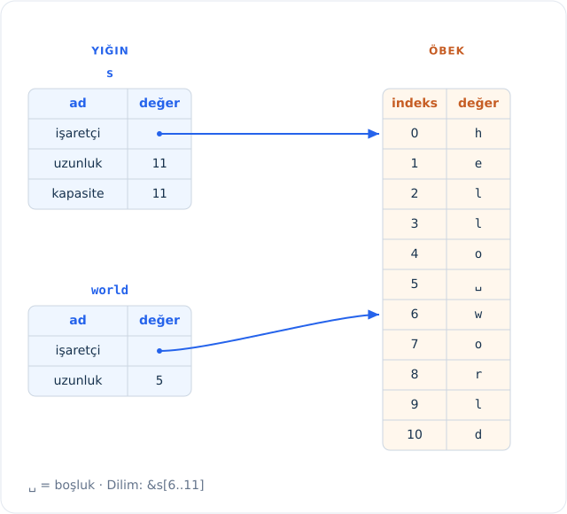

<!-- Old headings. Do not remove or links may break. -->
<a id="the-slice-type"></a>
<a id="dilim-türü-the-slice-type"></a>

## Dilim (Slice) Türü

_Dilimler (slices)_, bir [koleksiyon](ch08-00-yaygin-koleksiyonlar.html)<!-- ignore --> içindeki bitişik bir eleman dizisine referans vermenizi sağlar. Dilim bir tür referanstır; dolayısıyla verinin sahipliğini üstlenmez.

Küçük bir programlama problemi düşünelim: Boşluklarla ayrılmış kelimelerden oluşan bir string alan ve bu string içinde bulduğu ilk kelimeyi döndüren bir fonksiyon yazın. Fonksiyon string içinde hiç boşluk bulamazsa tüm string tek bir kelime demektir; bu durumda string'in tamamı döndürülmelidir.

> Not: Dilimleri tanıtmak amacıyla bu bölümde metinlerin yalnızca ASCII karakterlerden oluştuğunu varsayıyoruz; UTF-8 işleme konusunu Bölüm 8'deki ["String'lerle UTF-8 Kodlanmış Metin Saklama"][strings]<!-- ignore --> bölümünde kapsamlı biçimde ele alacağız.

Dilimlerin hangi sorunu çözdüğünü anlamak için bu fonksiyonun imzasını dilim kullanmadan nasıl yazacağımız üzerinde düşünelim:

```rust,ignore
fn ilk_kelime(metin: &String) -> ?
```

`ilk_kelime` fonksiyonu `&String` türünde bir parametre alır. Sahipliğe ihtiyacımız olmadığı için bu tercih gayet uygundur. (İdiyomatik Rust'ta fonksiyonlar gerçekten gerekmedikçe argümanlarının sahipliğini almaz; bunun nedenleri ilerledikçe netleşecektir.) Peki bu fonksiyondan ne döndürmeliyiz? Bir string'in *bir kısmını* ifade etmenin henüz doğrudan bir yolu yoktur. Bununla birlikte, kelimenin sonunu belirten boşluğun indeksini döndürebiliriz. Gelin bunu Liste 4-7'de gösterildiği gibi deneyelim.

<Listing number="4-7" file-name="src/main.rs" caption="`String` parametresi içindeki bir bayt indeksini döndüren `ilk_kelime` fonksiyonu">

```rust
{{#rustdoc_include ../listings/ch04-understanding-ownership/listing-04-07/src/main.rs:here}}
```

</Listing>

`String` değerini eleman eleman tarayıp her bir değerin boşluk olup olmadığını kontrol etmemiz gerektiğinden, `as_bytes` metodunu kullanarak `String` değerimizi bir bayt dizisine dönüştürürüz:

```rust,ignore
{{#rustdoc_include ../listings/ch04-understanding-ownership/listing-04-07/src/main.rs:as_bytes}}
```

Ardından `iter` metodunu kullanarak bu bayt dizisi üzerinde bir *iteratör (iterator)* oluştururuz:

```rust,ignore
{{#rustdoc_include ../listings/ch04-understanding-ownership/listing-04-07/src/main.rs:iter}}
```

İteratörleri [Bölüm 13][ch13]<!-- ignore -->'te ayrıntılı olarak inceleyeceğiz. Şimdilik `iter` metodunun bir koleksiyondaki her elemanı sırayla döndürdüğünü, `enumerate` metodunun ise `iter` sonucunu sarmalayarak her elemanı bunun yerine bir demetin parçası olarak döndürdüğünü bilmeniz yeterlidir. `enumerate` çağrısından dönen demetin ilk elemanı indeks, ikinci elemanı ise ilgili elemana ait referanstır. Bu yöntem, indeksi kendi başımıza hesaplamaktan biraz daha pratiktir.

`enumerate` metodu bir demet döndürdüğü için bu demeti parçalarına ayırmak (*destructure*) amacıyla desenleri (*patterns*) kullanabiliriz. Desenleri [Bölüm 6][ch6]<!-- ignore -->'da daha ayrıntılı ele alacağız. `for` döngüsünde, demetteki indeks için `i` ve demetteki tekil bayt için `&oge` içeren bir desen belirtiriz. `.iter().enumerate()` çağrısından elemana bir referans elde ettiğimiz için desende `&` kullanırız.

`for` döngüsünün içinde, *bayt sabiti (byte literal)* sözdizimini (`b' '`) kullanarak boşluğu temsil eden baytı ararız. Bir boşluk bulursak bu konumu döndürürüz. Aksi takdirde `metin.len()` çağrısıyla string'in uzunluğunu döndürürüz:

```rust,ignore
{{#rustdoc_include ../listings/ch04-understanding-ownership/listing-04-07/src/main.rs:inside_for}}
```

Artık string içindeki ilk kelimenin bittiği yerin indeksini bulabiliyoruz, ancak önemli bir sorun var. Tek başına bir `usize` döndürüyoruz; oysa bu sayı yalnızca `&String` bağlamında anlamlıdır. Başka bir deyişle, `String`'den bağımsız ayrı bir değer olduğu için gelecekte hâlâ geçerli kalacağının hiçbir garantisi yoktur. Liste 4-7'deki `ilk_kelime` fonksiyonunu kullanan Liste 4-8'deki programı inceleyelim.

<Listing number="4-8" file-name="src/main.rs" caption="`ilk_kelime` fonksiyonu çağrısından dönen sonucu saklayıp ardından `String` içeriğini değiştirmek">

```rust
{{#rustdoc_include ../listings/ch04-understanding-ownership/listing-04-08/src/main.rs:here}}
```

</Listing>

Bu program hiçbir hata vermeden derlenir; hatta `metin.clear()` çağrısından sonra `kelime` değişkenini kullansaydık bile derlenirdi. `kelime` değişkeni `metin`'in durumuna hiçbir şekilde bağlı olmadığından hâlâ `7` değerini tutar. İlk kelimeyi çıkarmak amacıyla `metin` değişkeniyle birlikte bu `7` değerini kullanmaya çalışabilirdik; ancak biz `7` sayısını `kelime` değişkenine kaydettikten sonra `metin`'in içeriği değiştiği için bu bir mantık hatası (*bug*) olurdu.

`kelime` içindeki indeksin `metin` içindeki veriyle uyumunun bozulabileceği konusunda sürekli endişelenmek yorucu ve hataya açıktır! Bir `ikinci_kelime` fonksiyonu yazdığımızda bu indeksleri yönetmek daha da kırılgan bir hâl alır. Böyle bir fonksiyonun imzası şuna benzemek zorunda kalırdı:

```rust,ignore
fn ikinci_kelime(metin: &String) -> (usize, usize) {
```

Şimdi hem bir başlangıç _hem de_ bir bitiş indeksini takip ediyoruz; üstelik verinin belirli bir durumundan hesaplanmış ama o duruma hiçbir biçimde bağlı olmayan daha da fazla değerimiz var. Artık ortalıkta dolaşan ve birbiriyle uyumlu tutulması gereken üç ilişkisiz değişken bulunuyor.

Neyse ki Rust'ın bu soruna bir çözümü vardır: string dilimleri.

<!-- Old headings. Do not remove or links may break. -->
<a id="string-slices"></a>
<a id="string-dilimleri-string-slices"></a>

### String Dilimleri

Bir _string dilimi (string slice)_, bir `String` içindeki elemanların bitişik bir dizisine referanstır ve şöyle görünür:

```rust
{{#rustdoc_include ../listings/ch04-understanding-ownership/no-listing-17-slice/src/main.rs:here}}
```

`merhaba` değişkeni tüm `String`'e referans vermek yerine, fazladan eklenen `[0..7]` kısmında belirtilen `String` bölümüne referans verir. Dilimleri köşeli parantezler içinde `[başlangıç_indeksi..bitiş_indeksi]` biçiminde bir aralık belirterek oluştururuz; burada _`başlangıç_indeksi`_ dilimdeki ilk konumu, _`bitiş_indeksi`_ ise dilimdeki son konumun bir fazlasını ifade eder. Dilim veri yapısı dahili olarak dilimin başlangıç konumunu ve uzunluğunu saklar; bu uzunluk _`bitiş_indeksi`_ eksi _`başlangıç_indeksi`_ değerine karşılık gelir. Dolayısıyla `let dunya = &metin[8..13];` örneğinde `dunya`, `metin` değişkeninin 8. indeksindeki bayta yönelen bir işaretçi ve `5` uzunluk değerini barındıran bir dilim olur. (Bu örnekte `"dünya"` yerine bilerek yalnızca ASCII karakterlerden oluşan `"dunya"` yazdık; nedenini aşağıdaki UTF-8 notunda göreceksiniz.)

Şekil 4-7 bu bellek yapısını bir diyagramla göstermektedir.



<span class="caption">Şekil 4-7: Bir `String`'in belirli bir parçasına başvuran string dilimi (diyagramda İngilizce `s = "hello world"` ve `&s[6..11]` karşılığı olan `world` gösterilmektedir)</span>

Rust'ın `..` aralık sözdiziminde 0. indeksten başlamak istiyorsanız iki noktadan önceki sayıyı yazmayabilirsiniz. Başka bir deyişle, aşağıdaki iki satır birbirine eşdeğerdir:

```rust
let metin = String::from("merhaba");

let dilim = &metin[0..2];
let dilim = &metin[..2];
```

Aynı mantıkla, diliminiz `String`'in son baytını da içeriyorsa sondaki sayıyı yazmayabilirsiniz. Yani şu iki satır da birbirine eşdeğerdir:

```rust
let metin = String::from("merhaba");

let uzunluk = metin.len();

let dilim = &metin[3..uzunluk];
let dilim = &metin[3..];
```

Tüm string'in bir dilimini almak için her iki değeri de atlayabilirsiniz. Dolayısıyla şunlar da eşdeğerdir:

```rust
let metin = String::from("merhaba");

let uzunluk = metin.len();

let dilim = &metin[0..uzunluk];
let dilim = &metin[..];
```

> Not: String dilimi aralık indeksleri geçerli UTF-8 karakter sınırlarına denk gelmelidir. Çok baytlı (*multibyte*) bir karakterin tam ortasından string dilimi oluşturmaya çalışırsanız programınız çalışma zamanında bir panik hatasıyla sonlanır.
>
> Türkçe metinlerle çalışırken bu kural özellikle önemlidir: UTF-8 kodlamasında ASCII karakterler 1 bayt yer kaplarken `'ç'`, `'ğ'`, `'ı'`, `'ö'`, `'ş'`, `'ü'` (ve büyük harf karşılıkları olan `'Ç'`, `'Ğ'`, `'İ'`, `'Ö'`, `'Ş'`, `'Ü'`) bellekte **2 bayt** yer kaplar. Örneğin `let metin = String::from("çalışma");` tanımladığınızda ilk harf olan `'ç'` bellekte `0` ve `1` numaralı baytlara yayılır (`0..2`). Bu nedenle `&metin[0..1]` yazarak yalnızca ilk baytı dilimlemeye çalışırsanız Rust, karakter bütünlüğünün bozulmasını önlemek için çalışma zamanında `end byte index 1 is not a char boundary; it is inside 'ç' (bytes 0..2 of string)` hatasıyla panikler; `"ç"` harfini dilimlemek için `&metin[0..2]` kullanmanız gerekir. Benzer şekilde `"dünya"` kelimesi 5 harfli olmasına rağmen `'ü'` 2 bayt tuttuğundan bellekte 6 bayt (`len = 6`) uzunluğundadır.

Tüm bu bilgileri göz önünde bulundurarak `ilk_kelime` fonksiyonunu bir dilim döndürecek biçimde yeniden yazalım. "String dilimi" anlamına gelen tür `&str` şeklinde yazılır:

<Listing file-name="src/main.rs">

```rust
{{#rustdoc_include ../listings/ch04-understanding-ownership/no-listing-18-first-word-slice/src/main.rs:here}}
```

</Listing>

Kelimenin bitiş indeksini tıpkı Liste 4-7'de yaptığımız gibi ilk boşluk karakterini arayarak buluruz. Bir boşluk bulduğumuzda, başlangıç ve bitiş indeksleri olarak sırasıyla string'in başlangıcını ve boşluğun indeksini kullanarak bir string dilimi döndürürüz; boşluk bulamazsak da `&metin[..]` ile string'in tamamını dilim olarak döndürürüz.

Artık `ilk_kelime` fonksiyonunu çağırdığımızda, arka plandaki asıl veriye doğrudan bağlı tek bir değer elde ederiz. Bu değer, dilimin başlangıç noktasına yönelen bir referanstan ve dilimdeki eleman (bayt) sayısından oluşur.

Bir dilim döndürmek `ikinci_kelime` fonksiyonu için de aynı şekilde işe yarar:

```rust,ignore
fn ikinci_kelime(metin: &String) -> &str {
```

Derleyici `String` içine yönelen referansların geçerli kalmasını güvence altına alacağından, artık yanlış kullanılması çok daha zor ve yalın bir API'ye sahibiz. Liste 4-8'deki programda ilk kelimenin bitiş indeksini aldıktan sonra string'i temizlediğimiz ve elimizdeki indeksin geçersiz kaldığı hatayı hatırlıyor musunuz? O kod mantıksal açıdan hatalıydı ama anında hiçbir hata vermemişti; sorun ancak boşaltılmış bir string üzerinde ilk kelime indeksini kullanmaya devam ettiğimizde sonradan ortaya çıkacaktı. Dilimler bu hatayı imkânsız kılar ve kodumuzda bir sorun olduğunu çok daha erken fark etmemizi sağlar. `ilk_kelime`'nin dilim döndüren sürümünü aynı senaryoda kullanmak derleme zamanı hatası üretir:

<Listing file-name="src/main.rs">

```rust,ignore,does_not_compile
{{#rustdoc_include ../listings/ch04-understanding-ownership/no-listing-19-slice-error/src/main.rs:here}}
```

</Listing>

İşte derleyici hatası:

```console
{{#include ../listings/ch04-understanding-ownership/no-listing-19-slice-error/output.txt}}
```

Ödünç alma kurallarını hatırlayalım: Bir değere ait değiştirilemez bir referansımız varken, aynı değere değiştirilebilir bir referans alamayız. `clear` metodunun `String`'i kısaltıp boşaltması gerektiği için değiştirilebilir bir referans alması gerekir. (Kodda açıkça `&mut metin` yazmadığımıza dikkat edin: `clear` gibi metotlar `&mut self` imzasıyla tanımlandığından Rust, `metin.clear()` çağrısında bu değiştirilebilir ödünç almayı sizin yerinize otomatik olarak yapar; metot sözdizimini Bölüm 5'te ele alacağız.) `clear` çağrısından sonraki `println!` satırı ise `kelime` içindeki referansı kullanır; dolayısıyla değiştirilemez referansın o noktada hâlâ etkin olması zorunludur. Rust, `clear` çağrısındaki değiştirilebilir referans (`mutable borrow occurs here`) ile `kelime` içindeki değiştirilemez referansın (`immutable borrow occurs here`) aynı anda var olmasına izin vermez ve derleme başarısız olur. Rust yalnızca API'mizi kullanımı daha kolay bir hâle getirmekle kalmamış, koskoca bir hata sınıfını daha derleme zamanında ortadan kaldırmıştır!

<!-- Old headings. Do not remove or links may break. -->
<a id="string-literals-are-slices"></a>
<a id="string-literals-as-slices"></a>
<a id="dilim-olarak-sabit-metinler-string-literals-as-slices"></a>

#### Dilim Olarak String Sabitleri

Daha önce string sabitlerinin derlenen ikili dosyanın (*binary*) içinde saklandığından söz ettiğimizi hatırlayın. Artık dilimleri tanıdığımıza göre string sabitlerini tam olarak anlayabiliriz:

```rust
let metin = "Merhaba, dünya!";
```

Buradaki `metin` değişkeninin türü `&str`'dir: İkili dosyanın tam o noktasına işaret eden bir dilimdir. String sabitlerinin değiştirilemez olmasının nedeni de budur; `&str` değiştirilemez bir referanstır.

<!-- Old headings. Do not remove or links may break. -->
<a id="string-slices-as-parameters"></a>

#### Parametre Olarak String Dilimleri

Hem string sabitlerinin hem de `String` değerlerinin dilimlerini alabileceğimizi bilmek, bizi `ilk_kelime` fonksiyonunda yapabileceğimiz bir iyileştirmeye daha — fonksiyonun imzasına — götürür:

```rust,ignore
fn ilk_kelime(metin: &String) -> &str {
```

Daha deneyimli bir Rust geliştiricisi bunun yerine Liste 4-9'da gösterilen imzayı yazar; çünkü bu imza aynı fonksiyonu hem `&String` değerleri hem de `&str` değerleri üzerinde kullanmamıza olanak tanır.

<Listing number="4-9" caption="`metin` parametresinin türü olarak string dilimi kullanarak `ilk_kelime` fonksiyonunu iyileştirmek">

```rust,ignore
{{#rustdoc_include ../listings/ch04-understanding-ownership/listing-04-09/src/main.rs:here}}
```

</Listing>

Elimizde bir string dilimi varsa onu doğrudan argüman olarak geçirebiliriz. Elimizde bir `String` varsa ya bu `String`'in bir dilimini ya da doğrudan `String`'e ait bir referansı geçirebiliriz. Bu esneklik, Bölüm 15'teki ["Fonksiyon ve Metotlarda Deref Zorlaması Kullanmak"][deref-coercions]<!-- ignore --> bölümünde ele alacağımız *deref zorlaması (deref coercion)* özelliğinden yararlanır.

> Not: Özetle *deref zorlaması*, derleyicinin `&String` türündeki bir referansı gerektiğinde hiçbir ek çalışma zamanı maliyeti veya bellek kopyalaması olmadan otomatik olarak `&str` dilimine dönüştürmesidir (`&benim_metnim` ifadesi `&benim_metnim[..]` ile aynı sonucu verir). Bu nedenle günlük Rust kodlarında, bir fonksiyon metnin sahipliğini almak veya onu değiştirmek zorunda değilse parametre türü olarak `&String` yerine her zaman `&str` tercih edilir.

Bir fonksiyonu `String` referansı yerine string dilimi alacak şekilde tanımlamak, hiçbir işlevsellik kaybı yaşatmadan API'mizi daha genel ve kullanışlı hâle getirir:

<Listing file-name="src/main.rs">

```rust
{{#rustdoc_include ../listings/ch04-understanding-ownership/listing-04-09/src/main.rs:usage}}
```

</Listing>

<!-- Old headings. Do not remove or links may break. -->
<a id="other-slices"></a>
<a id="diğer-dilimler-other-slices"></a>

### Diğer Dilimler

String dilimleri, tahmin edebileceğiniz gibi stringlere özgüdür. Ancak daha genel bir dilim türü de vardır. Şu diziyi ele alalım:

```rust
let d = [1, 2, 3, 4, 5];
```

Tıpkı bir string'in belirli bir bölümüne başvurmak isteyebileceğimiz gibi, bir dizinin belirli bir bölümüne de başvurmak isteyebiliriz. Bunu şu şekilde yaparız:

```rust
let d = [1, 2, 3, 4, 5];

let dilim = &d[1..3];

assert_eq!(dilim, &[2, 3]);
```

Bu dilim `&[i32]` türündedir. İlk elemana yönelen bir referansı ve bir uzunluk bilgisini yığında saklayarak tıpkı string dilimleri gibi çalışır. Bu tür dilimleri diğer pek çok koleksiyon türüyle birlikte sıkça kullanacaksınız. Bu koleksiyonları Bölüm 8'de vektörleri incelerken ayrıntılı olarak ele alacağız.

<!-- Old headings. Do not remove or links may break. -->
<a id="summary"></a>

## Özet

Sahiplik, ödünç alma ve dilim kavramları Rust programlarında bellek güvenliğini derleme zamanında güvence altına alır. Rust dili, tıpkı diğer sistem programlama dilleri gibi bellek kullanımınız üzerinde size tam denetim verir; ancak verinin sahibi kapsam dışına çıktığında veriyi otomatik olarak temizlemesi sayesinde bu denetimi elde etmek için fazladan bellek yönetimi kodu yazmak ve bu kodların hatalarını ayıklamak zorunda kalmazsınız.

Sahiplik kavramı Rust'ın diğer pek çok parçasının nasıl çalıştığını doğrudan etkiler; bu nedenle kitabın geri kalanı boyunca bu kavramlara sık sık geri döneceğiz. Şimdi Bölüm 5'e geçelim ve birbiriyle ilişkili veri parçalarını bir `struct` içinde gruplandırmaya bakalım.

[ch13]: ch13-02-iteratorler.html
[ch6]: ch06-02-match-kontrol-akisi.html#değerlere-bağlanan-desenler
[strings]: ch08-02-stringler.html#stringlerle-utf-8-kodlanmış-metin-depolamak
[deref-coercions]: ch15-02-deref.html#fonksiyon-ve-metotlarda-deref-zorlaması-kullanmak
