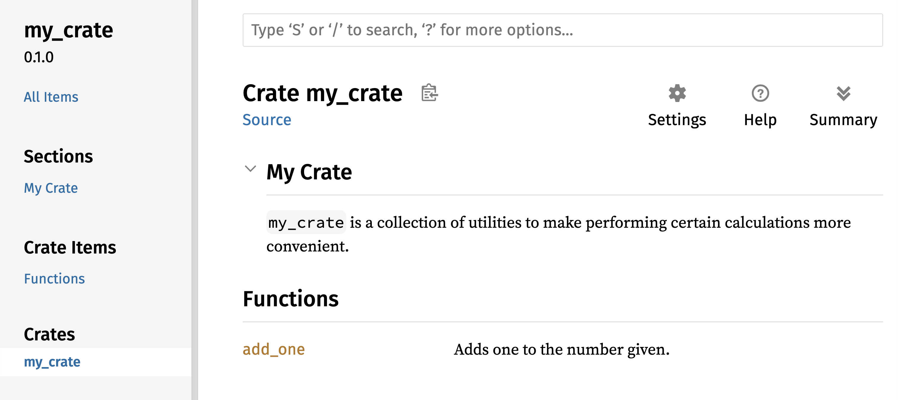

<!-- Old headings. Do not remove or links may break. -->
<a id="publishing-a-crate-to-cratesio"></a>
<a id="bir-cratei-cratesioda-yayımlamak"></a>
<a id="bir-cratei-cratesioda-yayimlamak"></a>

## Crates.io'da Bir Crate Yayınlama

Projelerimizde bağımlılık olarak [crates.io](https://crates.io/)<!-- ignore -->
üzerindeki paketleri kullandık; ancak kendi paketlerinizi yayınlayarak kodunuzu
başka geliştiricilerle de paylaşabilirsiniz. [crates.io](https://crates.io/)<!--
ignore --> üzerindeki crate kayıt sistemi paketlerinizin kaynak kodunu dağıtır;
dolayısıyla ağırlıklı olarak açık kaynaklı kodlara ev sahipliği yapar.

Rust ve Cargo, yayınladığınız paketin başkaları tarafından daha kolay
keşfedilmesini ve kullanılmasını sağlayan çeşitli özellikler sunar. Önce bu
özelliklerden bazılarını ele alacak, ardından bir paketin nasıl yayınlanacağını
adım adım açıklayacağız.

<!-- Old headings. Do not remove or links may break. -->
<a id="making-useful-documentation-comments"></a>
<a id="yararlı-belgelendirme-yorumları-yazmak"></a>

### Yararlı Belgelendirme Yorumları Yazma

Paketlerinizi doğru ve eksiksiz biçimde belgelendirmek, diğer kullanıcıların
onları ne zaman ve nasıl kullanacağını anlamasına yardımcı olur; bu nedenle
belgelendirme yazmaya zaman ayırmaya değer. Bölüm 3'te iki eğik çizgi (`//`)
kullanarak Rust koduna nasıl yorum ekleneceğini görmüştük. Rust'ta ayrıca HTML
belgelendirmesi üreten ve amacına uygun biçimde _belgelendirme yorumu
(documentation comment)_ olarak adlandırılan özel bir yorum türü de vardır.
Üretilen HTML çıktısı, crate'inizin içeride _nasıl uygulandığından_ ziyade
_nasıl kullanılacağını_ öğrenmek isteyen programcılara yönelik açık API
öğelerinin belgelendirme yorumlarını görüntüler.

Belgelendirme yorumları iki yerine üç eğik çizgi (`///`) kullanır ve metni
biçimlendirmek için Markdown sözdizimini destekler. Belgelendirme yorumlarını,
belgeledikleri öğenin hemen üstüne yerleştirin. Liste 14-1, `benim_crate` adlı
bir crate içinde yer alan `bir_ekle` fonksiyonu için yazılmış belgelendirme
yorumlarını göstermektedir.

<Listing number="14-1" file-name="src/lib.rs" caption="Bir fonksiyon için belgelendirme yorumu">

```rust,ignore
{{#rustdoc_include ../listings/ch14-more-about-cargo/listing-14-01/src/lib.rs}}
```

</Listing>

Burada `bir_ekle` fonksiyonunun ne yaptığını açıklıyor, `Örnekler` başlığıyla
bir bölüm başlatıyor ve `bir_ekle` fonksiyonunun nasıl kullanılacağını gösteren
örnek kodu paylaşıyoruz. Bu belgelendirme yorumundan HTML belgelendirmesi
üretmek için `cargo doc` komutunu çalıştırabiliriz. Bu komut, Rust ile birlikte
dağıtılan `rustdoc` aracını çalıştırır ve üretilen HTML dosyalarını _target/doc_
dizinine yerleştirir.

Kolaylık sağlaması açısından `cargo doc --open` komutunu çalıştırmak, mevcut
crate'inizin (ve tüm crate bağımlılıklarınızın) HTML belgelendirmesini derleyip
sonucu doğrudan web tarayıcınızda açar. `bir_ekle` fonksiyonuna gittiğinizde,
belgelendirme yorumlarındaki metnin Şekil 14-1'deki gibi işlendiğini görürsünüz.


<span class="caption">Şekil 14-1: `bir_ekle` (`add_one`) fonksiyonu için üretilen
HTML belgelendirmesi</span>

<!-- Old headings. Do not remove or links may break. -->
<a id="commonly-used-sections"></a>

#### Sık Kullanılan Bölümler

Liste 14-1'de HTML çıktısında "Örnekler" (`Examples`) başlıklı bir bölüm
oluşturmak için `# Örnekler` Markdown başlığını kullandık. Crate yazarlarının
belgelendirmelerinde sıkça kullandığı diğer standart bölümler şunlardır:

- **Panics** (*Panik Durumları*): Belgelenen fonksiyonun hangi senaryolarda
  panikleyebileceğini açıklar. Programlarının paniklemesini istemeyen çağıranlar,
  fonksiyonu bu durumlarda çağırmadıklarından emin olmalıdır.
- **Errors** (*Hatalar*): Fonksiyon bir `Result` döndürüyorsa, oluşabilecek hata
  türlerini ve hangi koşulların bu hataların döndürülmesine yol açabileceğini
  açıklamak çağıranlara büyük kolaylık sağlar; böylece farklı hata türlerini
  farklı şekillerde ele alan kodlar yazabilirler.
- **Safety** (*Güvenlik*): Fonksiyonu çağırmak `unsafe` ise (güvensiz kodları
  Bölüm 20'de ele alacağız), fonksiyonun neden `unsafe` olduğunu açıklayan ve
  çağıranların sağlamasını beklediği değişmez koşulları (*invariants*) kapsayan
  bir bölüm bulunmalıdır.

Çoğu belgelendirme yorumunda bu bölümlerin tümüne ihtiyaç duyulmaz; ancak bu
liste, kullanıcıların kodunuz hakkında bilmek isteyeceği yönleri size hatırlatan
iyi bir kontrol listesidir.

<!-- Old headings. Do not remove or links may break. -->
<a id="documentation-comments-as-tests"></a>
<a id="belgelendirme-yorumlarını-test-olarak-kullanmak"></a>

#### Belgelendirme Yorumlarını Test Olarak Kullanma

Belgelendirme yorumlarınıza örnek kod blokları eklemek, kütüphanenizin nasıl
kullanılacağını göstermenin yanı sıra çok değerli bir ek avantaj sağlar:
`cargo test` komutunu çalıştırdığınızda, belgelendirmenizdeki kod örnekleri
test olarak çalıştırılır! Örneklerle desteklenen bir belgelendirmeden daha iyisi
yoktur; ancak belgelendirme yazıldıktan sonra kod değiştiği için artık çalışmayan
örneklerden daha kötüsü de yoktur. Liste 14-1'deki `bir_ekle` fonksiyonunun
belgelendirmesiyle `cargo test` çalıştırırsak test sonuçlarında şuna benzer bir
bölüm görürüz:

<!-- manual-regeneration
cd listings/ch14-more-about-cargo/listing-14-01/
cargo test
copy just the doc-tests section below
-->

```text
   Doc-tests benim_crate

running 1 test
test src/lib.rs - bir_ekle (line 5) ... ok

test result: ok. 1 passed; 0 failed; 0 ignored; 0 measured; 0 filtered out; finished in 0.27s
```

Şimdi fonksiyonu ya da örneği, örnekteki `assert_eq!` makrosunun paniklemesine
yol açacak şekilde değiştirip `cargo test` komutunu yeniden çalıştırırsak,
belge testlerinin örnek ile kod arasındaki uyumsuzluğu anında yakaladığını
görürüz!

> Not: Belgelendirme testlerindeki kod bloklarında, satır başına `# ` (diyez ve
> boşluk) koyduğunuz satırlar `cargo doc` ile üretilen HTML belgesinde
> okuyucudan gizlenir; ancak `cargo test` çalıştırıldığında derlemeye ve teste
> eksiksiz dahil edilir. Bu ipucu, özellikle hazırlık kodlarını gizleyip
> okuyucunun dikkatini doğrudan asıl API çağrısına odaklamak ya da örnek içinde
> `?` operatörünü kullanabilmek için gereken sarmalayıcı fonksiyonu gizlemek
> istediğinizde çok kullanışlıdır:
>
> ```rust,ignore
> /// # Örnekler
> ///
> /// ```
> /// # fn ornek() -> Result<(), std::num::ParseIntError> {
> /// let sayi: i32 = "42".parse()?;
> /// assert_eq!(sayi, 42);
> /// # Ok(())
> /// # }
> /// # ornek().unwrap();
> /// ```
> ```
>
> Ayrıca kod bloğunun açılış satırına ekleyebileceğiniz `no_run` (kodu derler
> ama ağ isteği veya dosya yazma gibi yan etkileri çalıştırmaz), `should_panic`
> (örnek kodun paniklemesini bekler) ve `compile_fail` (hatalı kullanımın derleme
> zamanında reddedildiğini doğrular) öznitelikleriyle belge testlerinizi farklı
> senaryolara uyarlayabilirsiniz.

<!-- Old headings. Do not remove or links may break. -->
<a id="commenting-contained-items"></a>
<a id="contained-item-comments"></a>
<a id="kapsayıcı-öğeye-yazılan-yorumlar"></a>

#### Kapsayıcı Öğeyi Belgeleyen Yorumlar

`//!` biçimindeki belgelendirme yorumları, yorumun *ardından gelen* öğelere
değil, yorumu *içeren* öğeye belgelendirme ekler. Bu belgelendirme yorumlarını
genellikle crate kök dosyasında (geleneksel olarak _src/lib.rs_) veya bir
modülün içinde, crate'i ya da modülü bir bütün olarak belgelendirmek için
kullanırız.

Örneğin `bir_ekle` fonksiyonunu barındıran `benim_crate` crate'inin amacını
açıklayan bir belgelendirme eklemek için, Liste 14-2'de gösterildiği gibi
_src/lib.rs_ dosyasının başına `//!` ile başlayan belgelendirme yorumları
yazarız.

<Listing number="14-2" file-name="src/lib.rs" caption="`benim_crate` crate'inin bütünü için yazılan belgelendirme">

```rust,ignore
{{#rustdoc_include ../listings/ch14-more-about-cargo/listing-14-02/src/lib.rs:here}}
```

</Listing>

`//!` ile başlayan son satırdan sonra herhangi bir kod gelmediğine dikkat edin.
Yorumları `///` yerine `//!` ile başlattığımız için, bu yorumu izleyen bir öğeyi
değil, bu yorumu barındıran öğeyi belgelendiriyoruz. Bu örnekte söz konusu öğe,
crate kökü olan _src/lib.rs_ dosyasıdır. Bu yorumlar crate'in tamamını açıklar.

`cargo doc --open` komutunu çalıştırdığımızda bu yorumlar, Şekil 14-2'de
gösterildiği gibi `benim_crate` belgelendirmesinin ana sayfasında, crate
içindeki açık öğeler listesinin hemen üstünde görüntülenir.

Öğelerin içinde yer alan belgelendirme yorumları özellikle crate'leri ve
modülleri açıklamak için çok yararlıdır. Kapsayıcının genel amacını anlatmak ve
kullanıcılarınızın crate organizasyonunu anlamasına yardımcı olmak için bunları
kullanabilirsiniz.



<span class="caption">Şekil 14-2: Crate'i bir bütün olarak açıklayan yorumu da
içeren `benim_crate` (`my_crate`) belgelendirmesi</span>

> Not: Rust'taki iki belgelendirme yorumu biçimi arasındaki fark, öznitelik
> (*attribute*) sözdizimiyle birebir aynı kuralı izler:
>
> - **`///` (Dış belgelendirme yorumu — *outer doc comment*):** Hemen *ardından
>   gelen* öğeyi (fonksiyon, `struct`, `enum`, `trait` veya `mod` bildirimi)
>   belgeler ve derleyici tarafından `#[doc = "..."]` özniteliğine dönüştürülür.
>   Ardında belgelenecek bir öğe bulunmazsa derleme hatası oluşur.
> - **`//!` (İç belgelendirme yorumu — *inner doc comment*):** İçinde *bulunduğu*
>   kapsayıcıyı (_src/lib.rs_ crate kökünü ya da bir `mod` bloğunu) belgeler ve
>   `#![doc = "..."]` özniteliğine dönüştürülür. Bu yüzden dosyanın veya modülün
>   en başında, diğer öğelerden önce yer almalıdır.
>
> Crates.io üzerinde yayınladığınız her açık kaynaklı kütüphanenin `//!` ve `///`
> yorumları, [docs.rs](https://docs.rs/)<!-- ignore --> tarafından otomatik
> olarak derlenip çevrimiçi API kılavuzu olarak sunulur.

<!-- Old headings. Do not remove or links may break. -->
<a id="exporting-a-convenient-public-api-with-pub-use"></a>
<a id="exporting-a-convenient-public-api"></a>
<a id="kullanışlı-bir-açık-api-dışa-aktarmak"></a>

### Kullanışlı Bir Açık API Dışa Aktarma

Bir crate yayınlarken açık API'nizin yapısı büyük önem taşır. Crate'inizi
kullanan kişiler modül yapısına sizin kadar aşina değildir; dolayısıyla
crate'iniz geniş bir modül hiyerarşisine sahipse kullanmak istedikleri parçaları
bulmakta zorlanabilirler.

Bölüm 7'de `pub` anahtar kelimesiyle öğeleri nasıl açık hâle getireceğimizi ve
`use` anahtar kelimesiyle öğeleri nasıl kapsama dahil edeceğimizi ele almıştık.
Ancak bir crate geliştirirken size mantıklı gelen iç yapı, kullanıcılarınız için
pek kullanışlı olmayabilir. Struct'larınızı birden fazla katmandan oluşan bir
hiyerarşi içinde düzenlemek isteyebilirsiniz; fakat bu durumda hiyerarşinin
derinliklerinde tanımladığınız bir türü kullanmak isteyen kişiler, o türün var
olduğunu keşfetmekte bile güçlük çekebilir. Ayrıca `use
benim_crate::FaydaliTur;` yazmak yerine `use
benim_crate::bir_modul::baska_modul::FaydaliTur;` yazmak zorunda kalmak da
can sıkıcı olabilir.

İyi haber şu ki bu yapı, crate'inizi başka bir kütüphaneden kullanacak kişiler
için _kullanışlı değilse_ iç organizasyonunuzu değiştirmek zorunda değilsiniz: Bunun
yerine `pub use` kullanarak öğeleri yeniden dışa aktarabilir ve gizli iç
yapınızdan farklı bir açık API yapısı oluşturabilirsiniz. *Yeniden dışa aktarma
(re-exporting)*, bir konumdaki açık bir öğeyi alır ve sanki diğer konumda
tanımlanmış gibi başka bir konumda da açık hâle getirir.

Örneğin sanatsal kavramları modellemek üzere `sanat` adında bir kütüphane
oluşturduğumuzu varsayalım. Bu kütüphanenin içinde Liste 14-3'te gösterildiği
gibi iki modül bulunuyor: `BirincilRenk` ve `IkincilRenk` adlı iki enum içeren
bir `turler` modülü ile `karistir` adlı bir fonksiyon içeren bir `yardimcilar`
modülü.

<Listing number="14-3" file-name="src/lib.rs" caption="Öğeleri `turler` ve `yardimcilar` modüllerinde düzenlenmiş bir `sanat` kütüphanesi">

```rust,noplayground,test_harness
{{#rustdoc_include ../listings/ch14-more-about-cargo/listing-14-03/src/lib.rs:here}}
```

</Listing>

Şekil 14-3, `cargo doc` tarafından bu crate için üretilen belgelendirmenin ana
sayfasının nasıl görüneceğini göstermektedir.


<span class="caption">Şekil 14-3: `sanat` (`art`) belgelendirmesinin `turler`
(`kinds`) ve `yardimcilar` (`utils`) modüllerini listeleyen ana sayfası</span>

`BirincilRenk` ve `IkincilRenk` türlerinin ana sayfada listelenmediğine, aynı
şekilde `karistir` fonksiyonunun da burada yer almadığına dikkat edin. Onları
görebilmek için `turler` ve `yardimcilar` bağlantılarına tıklamamız gerekir.

Bu kütüphaneye bağımlı olan başka bir crate'in, `sanat` içindeki öğeleri kapsama
dahil etmek için mevcut modül yapısını açıkça belirten `use` deyimlerine
ihtiyacı olacaktır. Liste 14-4, `sanat` crate'inden `BirincilRenk` ve `karistir`
öğelerini kullanan bir crate örneğini göstermektedir.

<Listing number="14-4" file-name="src/main.rs" caption="İç yapısı dışa aktarılmış haldeyken `sanat` crate'inin öğelerini kullanan bir crate">

```rust,ignore
{{#rustdoc_include ../listings/ch14-more-about-cargo/listing-14-04/src/main.rs}}
```

</Listing>

`sanat` crate'ini kullanan Liste 14-4'teki kodun yazarı, `BirincilRenk` türünün
`turler` modülünde ve `karistir` fonksiyonunun `yardimcilar` modülünde yer
aldığını bulmak zorunda kalmıştır. `sanat` crate'inin modül yapısı, bu crate'i
kullananlardan çok onun üzerinde çalışan geliştiricileri ilgilendirir. İç yapı,
`sanat` crate'inin nasıl kullanılacağını anlamaya çalışan biri için yararlı bir
bilgi taşımaz; aksine geliştiricilerin nereye bakacaklarını bulmak ve `use`
deyimlerinde modül adlarını belirtmek zorunda kalmaları nedeniyle kafa
karışıklığına yol açar.

İç organizasyonu açık API'den soyutlamak için Liste 14-3'teki `sanat` crate'i
kodunu değiştirip Liste 14-5'te gösterildiği gibi öğeleri en üst düzeyde yeniden
dışa aktaran `pub use` deyimleri ekleyebiliriz.

<Listing number="14-5" file-name="src/lib.rs" caption="Öğeleri yeniden dışa aktarmak için `pub use` deyimleri ekleme">

```rust,ignore
{{#rustdoc_include ../listings/ch14-more-about-cargo/listing-14-05/src/lib.rs:here}}
```

</Listing>

`cargo doc` aracının bu crate için ürettiği API belgelendirmesi artık yeniden
dışa aktarımları Şekil 14-4'te gösterildiği gibi ana sayfada listeleyecek ve
bağlantılayacaktır; böylece `BirincilRenk` ve `IkincilRenk` türleri ile
`karistir` fonksiyonunu bulmak çok daha kolay hâle gelecektir.


<span class="caption">Şekil 14-4: Yeniden dışa aktarımları listeleyen `sanat`
(`art`) belgelendirmesinin ana sayfası</span>

`sanat` crate'inin kullanıcıları isterlerse Liste 14-3'teki iç yapıyı Liste
14-4'te gösterildiği biçimde görmeye ve kullanmaya devam edebilir, isterlerse
Liste 14-6'da gösterildiği gibi Liste 14-5'teki daha kullanışlı yapıyı tercih
edebilirler.

<Listing number="14-6" file-name="src/main.rs" caption="`sanat` crate'inden yeniden dışa aktarılan öğeleri kullanan bir program">

```rust,ignore
{{#rustdoc_include ../listings/ch14-more-about-cargo/listing-14-06/src/main.rs:here}}
```

</Listing>

Çok sayıda iç içe modülün bulunduğu durumlarda, türleri `pub use` ile en üst
düzeyde yeniden dışa aktarmak crate'i kullanan kişilerin deneyiminde büyük fark
yaratabilir. `pub use` deyiminin bir diğer yaygın kullanım alanı ise bir
bağımlılığın tanımlarını mevcut crate içinde yeniden dışa aktararak söz konusu
crate'in tanımlarını kendi crate'inizin açık API'sinin bir parçası hâline
getirmektir.

Kullanışlı bir açık API yapısı oluşturmak bilimden çok bir sanattır ve
kullanıcılarınız için en iyi çalışan API'yi bulmak üzere zaman içinde
iyileştirmeler yapabilirsiniz. `pub use` kullanmak, crate'inizi içeride nasıl
yapılandıracağınız konusunda size esneklik kazandırır ve bu iç yapıyı
kullanıcılarınıza sunduğunuz arayüzden ayırır. İç yapılarının açık API'lerinden
farklı olup olmadığını görmek için kurduğunuz bazı crate'lerin kaynak kodlarını
inceleyebilirsiniz.

<!-- Old headings. Do not remove or links may break. -->
<a id="setting-up-a-cratesio-account"></a>
<a id="cratesio-hesabı-açmak"></a>

### Crates.io Hesabı Oluşturma

Herhangi bir crate yayınlayabilmeniz için önce
[crates.io](https://crates.io/)<!-- ignore --> üzerinde bir hesap oluşturmanız
ve bir API belirteci (*API token*) almanız gerekir. Bunun için
[crates.io](https://crates.io/)<!-- ignore --> ana sayfasını ziyaret edin ve bir
GitHub hesabıyla oturum açın. (GitHub hesabı şu an için zorunludur, ancak site
gelecekte hesap oluşturmak için başka yöntemleri de destekleyebilir.) Oturum
açtıktan sonra [https://crates.io/me/](https://crates.io/me/)<!-- ignore -->
adresindeki hesap ayarlarınıza gidin ve API belirtecinizi alın. Ardından
`cargo login` komutunu çalıştırın ve istendiğinde API belirtecinizi şu şekilde
yapıştırın:

```console
$ cargo login
abcdefghijklmnopqrstuvwxyz012345
```

Bu komut Cargo'yu API belirtecinizden haberdar eder ve onu yerel olarak
_~/.cargo/credentials.toml_ dosyasında saklar. Bu belirtecin gizli bir bilgi
olduğunu unutmayın: Başka hiç kimseyle paylaşmayın. Herhangi bir nedenle birisiyle
paylaşırsanız, belirteci derhal iptal etmeli ve
[crates.io](https://crates.io/)<!-- ignore --> üzerinde yeni bir belirteç
oluşturmalısınız.

<!-- Old headings. Do not remove or links may break. -->
<a id="adding-metadata-to-a-new-crate"></a>
<a id="yeni-bir-cratee-meta-veri-eklemek"></a>

### Yeni Bir Crate'e Meta Veri Ekleme

Yayınlamak istediğiniz bir crate'iniz olduğunu düşünelim. Yayınlamadan önce
crate'in _Cargo.toml_ dosyasındaki `[package]` bölümüne bazı meta veriler
eklemeniz gerekir.

Crate'inizin benzersiz bir adı olmalıdır. Yerelde bir crate üzerinde çalışırken
crate'e dilediğiniz adı verebilirsiniz. Ancak
[crates.io](https://crates.io/)<!-- ignore --> üzerindeki crate adları "ilk
gelen alır" ilkesine göre tahsis edilir. Bir crate adı alındıktan sonra başka
hiç kimse o adla bir crate yayınlayamaz. Bir crate yayınlamaya çalışmadan önce
kullanmak istediğiniz adı sitede aratın. Ad daha önce kullanılmışsa başka bir ad
bulmanız ve yayınlamak üzere yeni adı kullanmak için _Cargo.toml_ dosyasındaki
`[package]` bölümünün altında yer alan `name` alanını şu şekilde düzenlemeniz
gerekir:

<span class="filename">Dosya adı: Cargo.toml</span>

```toml
[package]
name = "tahmin_oyunu"
```

Benzersiz bir ad seçmiş olsanız bile, bu aşamada crate'i yayınlamak için
`cargo publish` komutunu çalıştırdığınızda önce bir uyarı, ardından bir hata
alırsınız:

<!-- manual-regeneration
Create a new package with an unregistered name, making no further modifications
  to the generated package, so it is missing the description and license fields.
cargo publish
copy just the relevant lines below
-->

```console
$ cargo publish
    Updating crates.io index
warning: manifest has no description, license, license-file, documentation, homepage or repository.
See https://doc.rust-lang.org/cargo/reference/manifest.html#package-metadata for more info.
--snip--
error: failed to publish to registry at https://crates.io

Caused by:
  the remote server responded with an error (status 400 Bad Request): missing or empty metadata fields: description, license. Please see https://doc.rust-lang.org/cargo/reference/manifest.html for more information on configuring these fields
```

Bazı kritik bilgiler eksik olduğu için bu işlem hatayla sonuçlanır: İnsanların
crate'inizin ne işe yaradığını ve onu hangi koşullar altında
kullanabileceklerini bilmeleri için bir açıklama (`description`) ve bir lisans
(`license`) alanı zorunludur. _Cargo.toml_ dosyasına, arama sonuçlarında
crate'inizle birlikte görüneceği için yalnızca bir iki cümleden oluşan kısa bir
açıklama ekleyin. `license` alanı için bir _lisans tanımlayıcı değeri_
vermeniz gerekir. [Linux Foundation'ın Software Package Data Exchange
(SPDX)][spdx] standardı, bu değer için kullanabileceğiniz tanımlayıcıları
listeler. Örneğin crate'inizi MIT Lisansı ile lisansladığınızı belirtmek için
`MIT` tanımlayıcısını ekleyin:

<span class="filename">Dosya adı: Cargo.toml</span>

```toml
[package]
name = "tahmin_oyunu"
license = "MIT"
```

SPDX listesinde yer almayan bir lisans kullanmak istiyorsanız, o lisansın
metnini bir dosyaya yerleştirmeli, dosyayı projenize dahil etmeli ve `license`
anahtarı yerine o dosyanın adını belirtmek üzere `license-file` alanını
kullanmalısınız.

Projeniz için hangi lisansın uygun olduğuna dair rehberlik bu kitabın kapsamı
dışındadır. Rust topluluğundaki pek çok kişi, projelerini Rust ile aynı şekilde
`MIT OR Apache-2.0` ikili lisansını kullanarak lisanslar. Bu uygulama, projenizde
birden fazla lisansa sahip olmak için `OR` ile ayrılmış birden çok lisans
tanımlayıcısı belirtebileceğinizi de gösterir.

Benzersiz bir ad, sürüm numarası, açıklama ve lisans eklendiğinde,
yayınlanmaya hazır bir projenin _Cargo.toml_ dosyası şöyle görünebilir:

<span class="filename">Dosya adı: Cargo.toml</span>

```toml
[package]
name = "tahmin_oyunu"
version = "0.1.0"
edition = "2024"
description = "Bilgisayarın seçtiği sayıyı tahmin ettiğiniz eğlenceli bir oyun."
license = "MIT OR Apache-2.0"

[dependencies]
```

[Cargo belgeleri](https://doc.rust-lang.org/cargo/), başkalarının crate'inizi
daha kolay keşfedip kullanabilmesini sağlamak için belirtebileceğiniz diğer meta
verileri de ayrıntılı olarak açıklar.

<!-- Old headings. Do not remove or links may break. -->
<a id="publishing-to-cratesio"></a>
<a id="cratesioya-yayımlamak"></a>

### Crates.io'da Yayınlama

Artık bir hesap oluşturduğunuza, API belirtecinizi kaydettiğinize, crate'iniz
için bir ad seçtiğinize ve gerekli meta verileri belirttiğinize göre yayınlamaya
hazırsınız! Bir crate yayınlamak, belirli bir sürümü başkalarının kullanabilmesi
için [crates.io](https://crates.io/)<!-- ignore --> üzerine yükler.

Dikkatli olun, çünkü yayınlama işlemi _kalıcıdır_. Bir sürümün üzerine asla
yazılamaz ve belirli istisnai durumlar dışında kod silinemez. Crates.io'nun en
önemli hedeflerinden biri, [crates.io](https://crates.io/)<!-- ignore -->
üzerindeki crate'lere bağımlı olan tüm projelerin derlemelerinin gelecekte de
çalışmaya devam etmesi için kalıcı bir kod arşivi görevi görmektir. Sürümlerin
silinmesine izin vermek bu hedefin gerçekleştirilmesini imkânsız kılardı. Öte
yandan yayınlayabileceğiniz crate sürümlerinin sayısında herhangi bir üst sınır
yoktur.

`cargo publish` komutunu tekrar çalıştırın. Bu kez başarılı olması gerekir:

<!-- manual-regeneration
go to some valid crate, publish a new version
cargo publish
copy just the relevant lines below
-->

```console
$ cargo publish
    Updating crates.io index
   Packaging tahmin_oyunu v0.1.0 (file:///projects/tahmin_oyunu)
    Packaged 6 files, 1.2KiB (895.0B compressed)
   Verifying tahmin_oyunu v0.1.0 (file:///projects/tahmin_oyunu)
   Compiling tahmin_oyunu v0.1.0
(file:///projects/tahmin_oyunu/target/package/tahmin_oyunu-0.1.0)
    Finished `dev` profile [unoptimized + debuginfo] target(s) in 0.19s
   Uploading tahmin_oyunu v0.1.0 (file:///projects/tahmin_oyunu)
    Uploaded tahmin_oyunu v0.1.0 to registry `crates-io`
note: waiting for `tahmin_oyunu v0.1.0` to be available at registry
`crates-io`.
You may press ctrl-c to skip waiting; the crate should be available shortly.
   Published tahmin_oyunu v0.1.0 at registry `crates-io`
```

Tebrikler! Artık kodunuzu Rust topluluğuyla paylaştınız ve isteyen herkes
crate'inizi kendi projesine kolayca bağımlılık olarak ekleyebilir.

> Not: Yayınlanan sürümler kalıcı olduğundan, gerçek `cargo publish` komutunu
> çalıştırmadan önce `cargo publish --dry-run` komutuyla yerel bir deneme
> yapmanız iyi bir alışkanlıktır. Bu komut meta verileri denetler, kaynak
> dosyalarını arşivler ve paketi _target/package_ dizininde yalıtılmış bir
> ortamda sıfırdan derleyerek doğrular; ancak Crates.io sunucusuna hiçbir şey
> yüklemez. Pakete hangi dosyaların dahil edildiğini önceden listelemek için
> `cargo package --list` komutunu da kullanabilir, test verileri veya büyük
> görseller gibi gereksiz dosyaları dışarıda bırakmak üzere _Cargo.toml_
> dosyasındaki `[package]` bölümünde `exclude` ya da `include` alanlarını
> tanımlayabilirsiniz.

<!-- Old headings. Do not remove or links may break. -->
<a id="publishing-a-new-version-of-an-existing-crate"></a>
<a id="var-olan-bir-cratein-yeni-sürümünü-yayımlamak"></a>

### Var Olan Bir Crate'in Yeni Sürümünü Yayınlama

Crate'inizde değişiklikler yaptığınızda ve yeni bir sürüm yayınlamaya hazır
olduğunuzda, _Cargo.toml_ dosyanızda belirtilen `version` değerini değiştirip
yeniden yayınlarsınız. Yaptığınız değişikliklerin türüne göre bir sonraki uygun
sürüm numarasının ne olacağına karar vermek için [Semantik Sürümleme
kurallarını][semver] kullanın. Ardından yeni sürümü yüklemek için
`cargo publish` komutunu çalıştırın.

<!-- Old headings. Do not remove or links may break. -->
<a id="removing-versions-from-cratesio-with-cargo-yank"></a>
<a id="deprecating-versions-from-cratesio-with-cargo-yank"></a>
<a id="deprecating-versions-from-cratesio"></a>
<a id="cratesioda-sürümleri-kullanımdan-kaldırmak"></a>

### Crates.io'da Sürümleri Kullanımdan Kaldırma

Bir crate'in önceki sürümlerini silemeseniz de gelecekteki projelerin onları
yeni bir bağımlılık olarak eklemesini engelleyebilirsiniz. Bu özellik, bir crate
sürümü herhangi bir nedenle kusurlu çıktığında oldukça işe yarar. Böyle
durumlarda Cargo, bir crate sürümünü _geri çekmeyi (yanking)_ destekler.

Bir sürümü _geri çekmek (`yank`)_, mevcut bağımlı projelerin çalışmaya devam
etmesine izin verirken yeni projelerin o sürüme bağımlı olmasını engeller.
Özünde geri çekme işlemi, hâlihazırda bir _Cargo.lock_ dosyasına sahip olan tüm
projelerin bozulmayacağı, ancak gelecekte üretilecek yeni _Cargo.lock_
dosyalarının geri çekilen bu sürümü kullanmayacağı anlamına gelir.

Bir crate'in belirli bir sürümünü geri çekmek için, daha önce yayınladığınız
crate'in dizininde `cargo yank` komutunu çalıştırır ve hangi sürümü geri çekmek
istediğinizi belirtirsiniz. Örneğin `tahmin_oyunu` adlı bir crate'in `1.0.1`
sürümünü yayınladıysak ve onu geri çekmek istiyorsak, `tahmin_oyunu` proje
dizininde şu komutu çalıştırırız:

<!-- manual-regeneration:
cargo yank carol-test --version 2.1.0
cargo yank carol-test --version 2.1.0 --undo
-->

```console
$ cargo yank --vers 1.0.1
    Updating crates.io index
        Yank tahmin_oyunu@1.0.1
```

Komuta `--undo` seçeneğini ekleyerek bir geri çekme işlemini iptal edebilir ve
projelerin ilgili sürüme yeniden bağımlı olmasına izin verebilirsiniz:

```console
$ cargo yank --vers 1.0.1 --undo
    Updating crates.io index
      Unyank tahmin_oyunu@1.0.1
```

Geri çekme işlemi _hiçbir kodu silmez_. Örneğin yanlışlıkla yüklenmiş gizli
anahtarları veya parolaları ortadan kaldıramaz. Böyle bir durum yaşanırsa söz
konusu gizli bilgileri derhal sıfırlamanız ve yenilemeniz gerekir.

[spdx]: https://spdx.org/licenses/
[semver]: https://semver.org/
