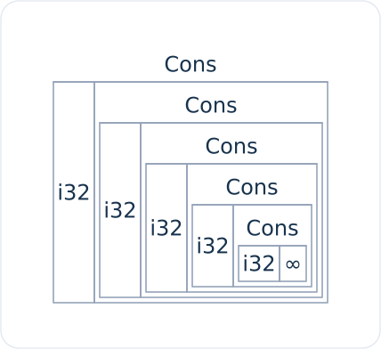
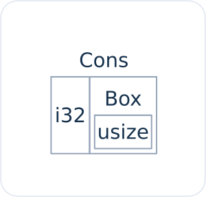

<!-- Old headings. Do not remove or links may break. -->

<a id="using-boxt-to-point-to-data-on-the-heap"></a>
<a id="öbekteki-veriyi-işaret-etmek-için-boxt-kullanmak"></a>
<a id="obekteki-veriyi-isaret-etmek-icin-boxt-kullanmak"></a>
<a id="yığındaki-veriyi-işaret-etmek-için-boxt-kullanımı"></a>
<a id="yığındaki-veriyi-işaret-etmek-için-boxt-kullanmak"></a>
<a id="yigindaki-veriyi-isaret-etmek-icin-boxt-kullanimi"></a>

## Öbekteki Veriyi İşaret Etmek İçin `Box<T>` Kullanımı

En yalın akıllı işaretçi, türü `Box<T>` biçiminde yazılan bir kutudur. _Kutular
(boxes)_, verileri *yığın (stack)* yerine *öbekte (heap)* saklamanıza olanak
tanır. Yığında kalan şey ise öbekteki veriye işaret eden işaretçinin kendisidir.
Yığın ile öbek arasındaki farkları yeniden gözden geçirmek için Bölüm 4'e
bakabilirsiniz.

Kutuların, verilerini yığın yerine öbekte saklamak dışında ek bir performans
maliyeti yoktur. Öte yandan çok fazla ekstra yetenek de sunmazlar. Kutuları en
sık şu durumlarda kullanırsınız:

- Boyutu derleme zamanında bilinemeyen bir türünüz olduğunda ve bu türden bir
  değeri kesin boyut gerektiren bir bağlamda kullanmak istediğinizde
- Büyük miktarda veriniz olduğunda ve bu verinin sahipliğini aktarırken
  kopyalanmadığından emin olmak istediğinizde
- Bir değerin sahibi olmak istediğinizde ve bu değerin belirli bir somut türde
  olmasından ziyade yalnızca belirli bir trait'i uygulayan bir tür olmasını
  önemsediğinizde

İlk durumu [“Kutularla Özyineli Türleri Mümkün Kılmak”](#enabling-recursive-types-with-boxes)<!-- ignore -->
alt bölümünde göstereceğiz. İkinci durumda, büyük miktarda verinin sahipliğini
aktarmak uzun sürebilir; çünkü veri yığın üzerinde kopyalanarak taşınır. Bu
durumda performansı artırmak için büyük miktardaki veriyi bir kutu içinde
öbekte saklayabiliriz. Böylece yığın üzerinde yalnızca küçük boyutlu işaretçi
verisi kopyalanırken, başvurulan asıl veri öbekte tek bir yerde sabit kalır.
Üçüncü durum ise _trait nesnesi (trait object)_ olarak bilinir ve Bölüm 18'deki
[“Ortak Davranışı Soyutlamak İçin Trait Nesnelerini Kullanma”][trait-objects]<!-- ignore -->
bölümü tamamen bu konuya ayrılmıştır. Dolayısıyla burada öğrendiklerinizi o
bölümde yeniden uygulayacaksınız!

<!-- Old headings. Do not remove or links may break. -->

<a id="using-boxt-to-store-data-on-the-heap"></a>
<a id="storing-data-on-the-heap"></a>
<a id="veriyi-yığında-saklamak"></a>

### Veriyi Öbekte Saklamak

`Box<T>` türünün öbekte veri saklama kullanım senaryosunu ele almadan önce,
sözdizimini ve bir `Box<T>` içinde saklanan değerlerle nasıl etkileşim
kurulduğunu inceleyelim.

Liste 15-1, bir `i32` değerini öbekte saklamak için kutunun nasıl kullanıldığını
göstermektedir.

<Listing number="15-1" file-name="src/main.rs" caption="Bir `i32` değerini kutu kullanarak öbekte saklamak">

```rust
{{#rustdoc_include ../listings/ch15-smart-pointers/listing-15-01/src/main.rs}}
```

</Listing>

Burada `k` değişkenini, öbekte ayrılmış `5` değerine işaret eden bir `Box`
değerine sahip olacak şekilde tanımlıyoruz. Bu program ekrana `k = 5` yazdırır;
bu örnekte kutudaki veriye, sanki bu veri yığındaymış gibi erişebiliriz. Sahip
olunan her değerde olduğu gibi, bir kutu da kapsam dışına çıktığında — tıpkı `k`
değişkeninin `main` fonksiyonunun sonunda çıktığı gibi — bellekten serbest
bırakılır. Bellekten serbest bırakma işlemi hem (yığında saklanan) kutunun
kendisi hem de (öbekte saklanan) işaret ettiği veri için gerçekleşir.

Tek bir değeri öbeğe koymak pek kullanışlı değildir; bu nedenle kutuları tek
başlarına bu şekilde çok sık kullanmazsınız. Tek bir `i32` gibi değerlerin
varsayılan olarak saklandıkları yer olan yığında tutulması, durumların büyük
çoğunluğunda çok daha uygundur. Gelin şimdi, kutular olmasaydı tanımlamamıza
izin verilmeyecek türleri kutular sayesinde nasıl tanımlayabildiğimiz bir duruma
bakalım.

<!-- Old headings. Do not remove or links may break. -->

<a id="enabling-recursive-types-with-boxes"></a>
<a id="kutularla-özyineli-türleri-mümkün-kılmak"></a>
<a id="kutularla-ozyineli-turleri-mumkun-kilmak"></a>

### Kutularla Özyineli Türleri Mümkün Kılmak

_Özyineli bir türün (recursive type)_ değeri, kendi parçası olarak aynı türden
başka bir değere sahip olabilir. Özyineli türler bir sorun oluşturur; çünkü
Rust'ın bir türün bellekte ne kadar yer kapladığını derleme zamanında bilmesi
gerekir. Ne var ki özyineli türlerde değerlerin iç içe geçmesi kuramsal olarak
sonsuza dek sürebileceğinden, Rust değerin ne kadar alana ihtiyaç duyduğunu
bilemez. Kutular bilinen bir boyuta sahip olduğu için, özyineli tür tanımının
içine bir kutu yerleştirerek özyineli türleri mümkün kılabiliriz.

Özyineli bir tür örneği olarak *cons listesini (cons list)* inceleyelim. Bu,
fonksiyonel programlama dillerinde yaygın olarak karşılaşılan bir veri türüdür.
Tanımlayacağımız cons listesi türü özyineleme dışında oldukça yalındır;
dolayısıyla üzerinde çalışacağımız örnekteki kavramlar, özyineli türler içeren
daha karmaşık durumlarla her karşılaştığınızda işinize yarayacaktır.

<!-- Old headings. Do not remove or links may break. -->

<a id="more-information-about-the-cons-list"></a>
<a id="understanding-the-cons-list"></a>
<a id="cons-listeyi-anlamak"></a>

#### Cons Listesini Anlamak

_Cons listesi_, Lisp programlama dili ve lehçelerinden gelen, iç içe geçmiş
çiftlerden oluşan ve bağlı listenin (*linked list*) Lisp dünyasındaki karşılığı
olan bir veri yapısıdır. Adını, Lisp'te iki argümanından yeni bir çift oluşturan
`cons` fonksiyonundan (_construct function_ ifadesinin kısaltması) alır. Bir
değer ve başka bir çiftten oluşan bir çift üzerinde `cons` fonksiyonunu
çağırarak özyineli çiftlerden oluşan cons listeleri kurabiliriz.

Örneğin `1, 2, 3` listesini içeren bir cons listesinin her çiftin parantez
içinde gösterildiği sözde kod gösterimi şöyledir:

```text
(1, (2, (3, Nil)))
```

Bir cons listesindeki her öğe iki eleman içerir: mevcut öğenin değeri ve bir
sonraki öğe. Listedeki son öğe ise bir sonraki öğe olmaksızın yalnızca `Nil`
adlı bir değer içerir. Cons listesi, `cons` fonksiyonunun özyineli biçimde
çağrılmasıyla üretilir. Özyinelemenin taban durumunu (*base case*) belirtmek
için kullanılan geleneksel ad `Nil`'dir. Bunun, Bölüm 6'da ele aldığımız
geçersiz veya mevcut olmayan bir değeri ifade eden “null” ya da “nil” kavramıyla
aynı şey olmadığına dikkat edin.

Cons listesi Rust'ta sık kullanılan bir veri yapısı değildir. Rust'ta bir öğe
listesine sahip olduğunuz çoğu durumda `Vec<T>` kullanmak daha iyi bir
seçenektir. Diğer, daha karmaşık özyineli veri türleri çeşitli senaryolarda
_gerçekten_ kullanışlıdır; ancak bu bölümde cons listesiyle başlayarak, dikkat
dağıtıcı ayrıntılara boğulmadan kutuların özyineli bir veri türünü tanımlamamıza
nasıl olanak tanıdığını keşfedebiliriz.

Liste 15-2, bir cons listesi için enum tanımı içermektedir (burada Lisp'teki
`Cons` çiftini `Dugum`, `Nil` taban durumunu ise `Bos` varyantıyla temsil
ediyoruz). Bu kodun henüz derlenmeyeceğine dikkat edin; çünkü birazdan
göstereceğimiz üzere `Liste` türünün bilinen bir boyutu yoktur.

<Listing number="15-2" file-name="src/main.rs" caption="`i32` değerlerinden oluşan bir cons listesi veri yapısını temsil etmek için ilk enum tanımlama denemesi">

```rust,ignore,does_not_compile
{{#rustdoc_include ../listings/ch15-smart-pointers/listing-15-02/src/main.rs:here}}
```

</Listing>

> Not: Bu örneğin amacı doğrultusunda yalnızca `i32` değerlerini tutan bir cons
> listesi uyguluyoruz. Bölüm 10'da ele aldığımız gibi jenerikleri kullanarak her
> türden değeri saklayabilen bir cons listesi türü de tanımlayabilirdik.

`1, 2, 3` listesini saklamak için `Liste` türünü kullanmak, Liste 15-3'teki kod
gibi görünürdü.

<Listing number="15-3" file-name="src/main.rs" caption="`1, 2, 3` listesini saklamak için `Liste` enum'ını kullanmak">

```rust,ignore,does_not_compile
{{#rustdoc_include ../listings/ch15-smart-pointers/listing-15-03/src/main.rs:here}}
```

</Listing>

İlk `Dugum` değeri `1` sayısını ve başka bir `Liste` değerini tutar. Bu `Liste`
değeri, `2` sayısını ve bir başka `Liste` değerini tutan yeni bir `Dugum`
değeridir. Bu `Liste` değeri ise `3` sayısını ve bir `Liste` değeri daha tutan
bir diğer `Dugum` değeridir; en içteki bu son `Liste` değeri de listenin
bittiğini belirten, özyineli olmayan `Bos` varyantıdır.

Liste 15-3'teki kodu derlemeye çalışırsak Liste 15-4'te gösterilen hatayı alırız.

<Listing number="15-4" caption="Özyineli bir enum tanımlamaya çalışırken aldığımız hata">

```console
{{#include ../listings/ch15-smart-pointers/listing-15-03/output.txt}}
```

</Listing>

Hata mesajı bu türün “sonsuz boyuta sahip olduğunu” (`has infinite size`)
belirtir. Bunun nedeni, `Liste` türünü özyineli bir varyantla tanımlamış
olmamızdır: Varyant, kendi türünden başka bir değeri doğrudan içinde tutar. Bu
yüzden Rust, bir `Liste` değerini saklamak için ne kadar alana ihtiyaç duyduğunu
hesaplayamaz. Bu hatayı neden aldığımızı adım adım inceleyelim. Öncelikle
Rust'ın özyineli olmayan bir türün değerini saklamak için ne kadar alana ihtiyaç
duyduğuna nasıl karar verdiğine bakalım.

<!-- Old headings. Do not remove or links may break. -->

<a id="computing-the-size-of-a-non-recursive-type"></a>
<a id="özyineli-olmayan-türün-boyutunu-hesaplamak"></a>

#### Özyineli Olmayan Bir Türün Boyutunu Hesaplamak

Bölüm 6'da enum tanımlarını ele alırken Liste 6-2'de tanımladığımız `Mesaj`
enum'ını hatırlayın:

```rust
{{#rustdoc_include ../listings/ch06-enums-and-pattern-matching/listing-06-02/src/main.rs:here}}
```

Bir `Mesaj` değeri için ne kadar alan ayıracağını belirlemek amacıyla Rust,
varyantların her birini tek tek inceler ve hangisinin en fazla alana ihtiyaç
duyduğunu kontrol eder. Derleyici, `Mesaj::Cik` varyantının hiç alana ihtiyaç
duymadığını, `Mesaj::Tasi` varyantının iki `i32` değerini saklayacak kadar
alana ihtiyaç duyduğunu ve diğer varyantların gereksinimlerini görür. Aynı anda
yalnızca tek bir varyant kullanılacağı için, bir `Mesaj` değerinin ihtiyaç
duyacağı en fazla alan, varyantlarının en büyüğünü saklamak için gereken alan
kadardır.

Şimdi bunu, Rust derleyicisi Liste 15-2'deki `Liste` enum'ı gibi özyineli bir
türün ne kadar alana ihtiyaç duyduğunu belirlemeye çalıştığında olanlarla
karşılaştırın. Derleyici işe `Dugum` varyantına bakarak başlar; bu varyant `i32`
türünde bir değer ile `Liste` türünde bir değer tutmaktadır. Dolayısıyla `Dugum`,
bir `i32` boyutu artı bir `Liste` boyutu kadar alana ihtiyaç duyar. `Liste`
türünün ne kadar belleğe ihtiyaç duyduğunu bulmak için derleyici varyantlara
yeniden `Dugum` varyantından başlayarak bakar. `Dugum` varyantı yine `i32`
türünde bir değer ve `Liste` türünde bir değer tutar; bu süreç Şekil 15-1'de
gösterildiği gibi sonsuza dek devam eder.



<span class="caption">Şekil 15-1: Sonsuz `Dugum` (görselde `Cons`) varyantlarından oluşan sonsuz bir `Liste`</span>

<!-- Old headings. Do not remove or links may break. -->

<a id="using-boxt-to-get-a-recursive-type-with-a-known-size"></a>
<a id="getting-a-recursive-type-with-a-known-size"></a>
<a id="boyutu-bilinen-özyineli-tür-elde-etmek"></a>

#### Boyutu Bilinen Özyineli Bir Tür Elde Etmek

Rust özyineli olarak tanımlanmış türler için ne kadar alan ayıracağını
hesaplayamadığından, derleyici şu yararlı öneriyi içeren bir hata verir:

<!-- manual-regeneration
after doing automatic regeneration, look at listings/ch15-smart-pointers/listing-15-03/output.txt and copy the relevant line
-->

```text
help: insert some indirection (e.g., a `Box`, `Rc`, or `&`) to break the cycle
  |
2 |     Dugum(i32, Box<Liste>),
  |                ++++     +
```

Bu önerideki _dolaylılık (`indirection`)_ terimi, bir değeri doğrudan kendi
içinde saklamak yerine veri yapısını değiştirerek o değere işaret eden bir
işaretçi saklamak ve böylece değeri dolaylı yoldan tutmak anlamına gelir.

`Box<T>` bir işaretçi olduğu için Rust bir `Box<T>` değerinin ne kadar alana
ihtiyaç duyduğunu her zaman bilir: Bir işaretçinin boyutu, işaret ettiği verinin
miktarına bağlı olarak değişmez. Bu da `Dugum` varyantının içine doğrudan başka
bir `Liste` değeri koymak yerine bir `Box<T>` koyabileceğimiz anlamına gelir.
`Box<T>`, `Dugum` varyantının içinde değil öbekte yer alacak bir sonraki `Liste`
değerine işaret edecektir. Kavramsal olarak hâlâ diğer listeleri barındıran
listelerden oluşturulmuş bir listemiz vardır; ancak bu uygulama artık öğeleri
birbiri içine yerleştirmekten ziyade yan yana dizmeye benzer.

Liste 15-2'deki `Liste` enum'ı tanımını ve Liste 15-3'teki `Liste` kullanımını,
sorunsuzca derlenecek olan Liste 15-5'teki koda dönüştürebiliriz.

<Listing number="15-5" file-name="src/main.rs" caption="Bilinen bir boyuta sahip olmak için `Box<T>` kullanan `Liste` tanımı">

```rust
{{#rustdoc_include ../listings/ch15-smart-pointers/listing-15-05/src/main.rs}}
```

</Listing>

`Dugum` varyantı, bir `i32` boyutu artı kutunun işaretçi verisini saklamak için
gereken alana ihtiyaç duyar. `Bos` varyantı hiçbir değer saklamaz; dolayısıyla
yığında `Dugum` varyantından daha az alana ihtiyaç duyar. Artık herhangi bir
`Liste` değerinin bir `i32` boyutu artı bir kutunun işaretçi verisi kadar yer
kaplayacağını biliyoruz. Kutu kullanarak sonsuz ve özyineli zinciri kırdık;
böylece derleyici bir `Liste` değerini saklamak için ihtiyaç duyduğu boyutu
hesaplayabilir. Şekil 15-2, `Dugum` varyantının artık nasıl göründüğünü
göstermektedir.



<span class="caption">Şekil 15-2: `Dugum` (görselde `Cons`) bir `Box` tuttuğu için boyutu sonsuz olmayan bir `Liste`</span>

> Not: Şekil 15-2'de `Box` kutusunun içinde gördüğünüz `usize`, hedef işlemci mimarisinin bellek adresi genişliğini ifade eder. Bir `Box<T>` değeri, öbekte işaret ettiği `T` verisi ister 4 bayt ister 4 megabayt olsun, yığında yalnızca **tek bir `usize` genişliğinde** (64-bit mimaride **8 bayt**, 32-bit mimaride 4 bayt) bir işaretçi olarak durur; kapasite veya referans sayacı gibi hiçbir ek meta veri taşımaz.
>
> Üstelik Rust derleyicisi, bir `Box<T>` işaretçisinin tuttuğu bellek adresinin **asla sıfır (`null`) olamayacağını** garanti eder. Bu garanti sayesinde derleyici _boş işaretçi optimizasyonu (null-pointer optimization)_ uygular: Örneğin `Option<Box<T>>` kullandığınızda `None` varyantını temsil etmek için fazladan bayt harcamak yerine doğrudan `0` adresini kullanır; böylece 64-bit bir sistemde hem `Box<T>` hem de `Option<Box<T>>` yığında ek bellek tüketmeden tam olarak **8 bayt** yer kaplar (`std::mem::size_of::<Option<Box<i32>>>() == 8`). Aynı optimizasyon Liste 15-5'teki `Liste` enum'ı için de geçerlidir: `Bos` varyantı `Box<Liste>` içindeki sıfır adresi boşluğundan yararlandığı için ekstra bir ayrım etiketi eklenmez ve tüm `Liste` türü yığında yalnızca **16 bayt** (4 bayt `i32` + 4 bayt hizalama dolgusu + 8 bayt `Box` işaretçisi) yer tutar.

Kutular yalnızca bu dolaylılığı ve öbekte bellek ayırmayı sağlar; diğer akıllı
işaretçi türlerinde göreceğimiz gibi başka özel yeteneklere sahip değildir.
Ayrıca bu özel yeteneklerin getirdiği ek performans maliyetini de taşımazlar; bu
nedenle cons listesi gibi ihtiyaç duyduğumuz tek özelliğin dolaylılık olduğu
durumlarda son derece kullanışlıdırlar. Kutuların diğer kullanım senaryolarını
Bölüm 18'de inceleyeceğiz.

`Box<T>` türü bir akıllı işaretçidir; çünkü `Box<T>` değerlerine referanslar
gibi davranılmasını sağlayan `Deref` trait'ini uygular. Bir `Box<T>` değeri
kapsam dışına çıktığında, kutunun işaret ettiği öbek verisi de `Drop` trait'i
uygulaması sayesinde temizlenir. Bu iki trait, bu bölümün geri kalanında ele
alacağımız diğer akıllı işaretçi türlerinin sunduğu işlevsellik açısından daha da
büyük önem taşıyacaktır. Gelin şimdi bu iki trait'i daha ayrıntılı olarak
inceleyelim.

[trait-objects]: ch18-02-trait-nesneleri.html#ortak-davranış-üzerinden-soyutlamak-için-trait-nesnelerini-kullanmak
