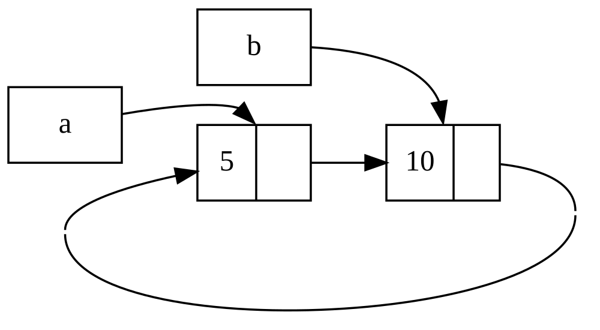

<!-- Old headings. Do not remove or links may break. -->

<a id="reference-cycles-can-leak-memory"></a>
<a id="referans-döngüleri-bellek-sızıntısına-yol-açabilir"></a>
<a id="referans-donguleri-bellek-sizintisina-yol-acabilir"></a>

## Referans Döngüleri Bellek Sızıntısına Neden Olabilir

Rust'ın bellek güvenliği garantileri, yanlışlıkla asla temizlenmeyen bellek alanları oluşturmayı (_bellek sızıntısı (memory leak)_ olarak bilinir) zorlaştırır, ancak imkânsız kılmaz. Bellek sızıntılarını tamamen önlemek Rust'ın sunduğu garantilerden biri değildir; başka bir deyişle, Rust'ta bellek sızıntıları bellek açısından güvenlidir. `Rc<T>` ve `RefCell<T>` kullanarak Rust'ın bellek sızıntılarına izin verdiğini görebiliriz: Öğelerin döngü oluşturacak biçimde birbirine başvuruda bulunduğu referanslar oluşturmak mümkündür. Döngüdeki her bir öğenin referans sayısı hiçbir zaman `0`'a ulaşmayacağı ve değerler asla düşürülmeyeceği için bu durum bellek sızıntılarına yol açar.

<!-- Old headings. Do not remove or links may break. -->

<a id="creating-a-reference-cycle"></a>
<a id="referans-dongusu-olusturmak"></a>

### Referans Döngüsü Oluşturmak

Liste 15-25'teki `Liste` enum'ının ve `kuyruk` metodunun tanımıyla başlayarak bir referans döngüsünün nasıl oluşabileceğine ve bunun nasıl önlenebileceğine bakalım.

<Listing number="15-25" file-name="src/main.rs" caption="`Dugum` varyantının neye başvurduğunu değiştirebilmemiz için bir `RefCell<T>` tutan cons listesi tanımı">

```rust
{{#rustdoc_include ../listings/ch15-smart-pointers/listing-15-25/src/main.rs:here}}
```

</Listing>

Burada Liste 15-5'teki `Liste` tanımının bir başka çeşidini kullanıyoruz. `Dugum` varyantındaki ikinci eleman artık `RefCell<Rc<Liste>>` türündedir; bu da Liste 15-24'te yaptığımız gibi `i32` değerini değiştirebilmek yerine, bir `Dugum` varyantının işaret ettiği `Liste` değerini değiştirmek istediğimiz anlamına gelir. Ayrıca elimizde bir `Dugum` varyantı olduğunda ikinci öğeye erişmemizi kolaylaştırmak için bir `kuyruk` metodu ekliyoruz.

Liste 15-26'da, Liste 15-25'teki tanımları kullanan bir `main` fonksiyonu ekliyoruz. Bu kod, `a` içinde bir liste ve `a` içindeki listeye işaret eden `b` içinde başka bir liste oluşturur. Ardından `a` içindeki listeyi `b`'ye işaret edecek şekilde değiştirerek bir referans döngüsü oluşturur. Bu sürecin çeşitli noktalarında referans sayılarının kaç olduğunu göstermek için yol boyunca `println!` deyimleri yer almaktadır.

<Listing number="15-26" file-name="src/main.rs" caption="Birbirine işaret eden iki `Liste` değerinden oluşan bir referans döngüsü oluşturmak">

```rust
{{#rustdoc_include ../listings/ch15-smart-pointers/listing-15-26/src/main.rs:here}}
```

</Listing>

`a` değişkeninde başlangıçta `5, Bos` listesine sahip bir `Liste` değeri tutan bir `Rc<Liste>` örneği oluşturuyoruz. Ardından `b` değişkeninde, `10` değerini içeren ve `a` içindeki listeye işaret eden başka bir `Liste` değeri tutan bir `Rc<Liste>` örneği oluşturuyoruz.

Bir döngü oluşturmak üzere `a`'yı, `Bos` yerine `b`'ye işaret edecek şekilde değiştiriyoruz. Bunu, `a` içindeki `RefCell<Rc<Liste>>` değerine bir referans almak için `kuyruk` metodunu kullanarak yapıyor ve bu referansı `baglanti` değişkenine koyuyoruz. Ardından `RefCell<Rc<Liste>>` üzerinde `borrow_mut` metodunu kullanarak içerideki değeri, `Bos` değeri tutan bir `Rc<Liste>` örneğinden `b` içindeki `Rc<Liste>` örneğine çeviriyoruz.

Son `println!` satırını şimdilik yorum satırı olarak bırakıp bu kodu çalıştırdığımızda şu çıktıyı alırız:

```console
{{#include ../listings/ch15-smart-pointers/listing-15-26/output.txt}}
```

`a` içindeki listeyi `b`'ye işaret edecek şekilde değiştirdikten sonra hem `a` hem de `b` içindeki `Rc<Liste>` örneklerinin referans sayısı `2` olur. `main` fonksiyonunun sonunda Rust önce `b` değişkenini düşürür; bu işlem `b`'deki `Rc<Liste>` örneğinin referans sayısını `2`'den `1`'e indirir. Referans sayısı `0` değil `1` olduğu için bu noktada `Rc<Liste>` örneğinin öbekte sahip olduğu bellek serbest bırakılmaz. Ardından Rust `a` değişkenini düşürür; bu da `a`'daki `Rc<Liste>` örneğinin referans sayısını aynı şekilde `2`'den `1`'e indirir. Diğer `Rc<Liste>` örneği hâlâ ona başvurduğu için bu örneğin belleği de serbest bırakılamaz. Listeye ayrılan bellek bir daha asla serbest bırakılmayacaktır. Bu referans döngüsünü görselleştirmek için Şekil 15-4'teki diyagramı oluşturduk.



<span class="caption">Şekil 15-4: Birbirine işaret eden `a` ve `b` listelerinin oluşturduğu referans döngüsü</span>

Son `println!` satırını yorumdan çıkarıp programı çalıştırırsanız Rust, `a`'nın `b`'ye, `b`'nin tekrar `a`'ya işaret ettiği bu döngüyü _yığın taşması (stack overflow)_ gerçekleşene dek yazdırmaya çalışacaktır.

Gerçek dünyadaki bir programla karşılaştırıldığında, bu örnekte bir referans döngüsü oluşturmanın sonuçları çok vahim değildir: Referans döngüsünü oluşturduktan hemen sonra program sona erer. Ancak daha karmaşık bir program bir döngü içinde çok miktarda bellek ayırıp bunu uzun süre elinde tutarsa, ihtiyaç duyduğundan daha fazla bellek kullanır ve sistemi zorlayarak kullanılabilir belleğin tükenmesine neden olabilir.

Referans döngüleri oluşturmak kolayca yapılan bir şey değildir, ama imkânsız da değildir. İçinde `Rc<T>` değerleri barındıran `RefCell<T>` değerleriniz ya da içsel değiştirilebilirlik ile referans sayımına sahip türlerin benzer iç içe bileşimleri varsa, döngü oluşturmadığınızdan emin olmanız gerekir; bunları yakalaması için Rust'a güvenemezsiniz. Bir referans döngüsü oluşturmak programınızda bir mantık hatası olur; bu tür hataları en aza indirmek için otomatik testlerden, kod incelemelerinden ve diğer yazılım geliştirme pratiklerinden yararlanmalısınız.

Referans döngülerinden kaçınmanın bir diğer çözümü de veri yapılarınızı, bazı referanslar sahipliği ifade ederken bazıları etmeyecek biçimde yeniden düzenlemektir. Sonuç olarak, bir kısmı sahiplik ilişkilerinden ve bir kısmı sahiplik dışı ilişkilerden oluşan döngüler kurabilirsiniz; böylece bir değerin düşürülüp düşürülemeyeceğini yalnızca sahiplik ilişkileri etkiler. Liste 15-25'te `Dugum` varyantlarının her zaman kendi listelerinin sahibi olmasını istediğimizden veri yapısını yeniden düzenlemek mümkün değildir. Sahiplik dışı ilişkilerin referans döngülerini önlemek için ne zaman uygun bir yöntem olduğunu görmek üzere ebeveyn düğümler ve çocuk düğümlerden oluşan grafları kullanan bir örneğe bakalım.

<!-- Old headings. Do not remove or links may break. -->

<a id="preventing-reference-cycles-turning-an-rct-into-a-weakt"></a>
<a id="preventing-reference-cycles-using-weakt"></a>
<a id="weakt-kullanarak-referans-döngülerini-önlemek"></a>
<a id="weakt-kullanarak-referans-dongulerini-onlemek"></a>

### `Weak<T>` Kullanarak Referans Döngülerini Önlemek

Şimdiye dek `Rc::clone` çağrısının bir `Rc<T>` örneğinin `strong_count` değerini artırdığını ve bir `Rc<T>` örneğinin yalnızca `strong_count` değeri `0` olduğunda temizlendiğini gösterdik. Ayrıca `Rc::downgrade` fonksiyonunu çağırıp argüman olarak `Rc<T>` örneğine bir referans geçirerek `Rc<T>` örneği içindeki değere zayıf bir referans da oluşturabilirsiniz. _Güçlü referanslar (strong references)_, bir `Rc<T>` örneğinin sahipliğini paylaşma yönteminizdir. _Zayıf referanslar (weak references)_ ise bir sahiplik ilişkisi ifade etmez ve sayıları bir `Rc<T>` örneğinin ne zaman temizleneceğini etkilemez. Zayıf referanslar bir referans döngüsüne yol açmaz; çünkü zayıf referanslar içeren herhangi bir döngü, ilgili değerlerin güçlü referans sayısı `0` olduğunda kırılacaktır.

`Rc::downgrade` çağırdığınızda `Weak<T>` türünde bir akıllı işaretçi elde edersiniz. `Rc::downgrade` çağrısı, `Rc<T>` örneğindeki `strong_count` değerini `1` artırmak yerine `weak_count` değerini `1` artırır. `Rc<T>` türü, tıpkı `strong_count` gibi kaç tane `Weak<T>` referansının var olduğunu takip etmek için `weak_count` sayacını kullanır. Aradaki fark, `Rc<T>` örneğinin temizlenmesi için `weak_count` değerinin `0` olması gerekmemesidir.

`Weak<T>` örneğinin başvurduğu değer düşürülmüş olabileceğinden, bir `Weak<T>` işaretçisinin gösterdiği değerle herhangi bir işlem yapabilmek için değerin hâlâ var olduğundan emin olmanız gerekir. Bunu, bir `Weak<T>` örneği üzerinde `Option<Rc<T>>` döndüren `upgrade` metodunu çağırarak yaparsınız. `Rc<T>` değeri henüz düşürülmemişse `Some`, düşürülmüşse `None` sonucu alırsınız. `upgrade` metodu bir `Option<Rc<T>>` döndürdüğü için Rust hem `Some` durumunun hem de `None` durumunun ele alınmasını güvence altına alır ve geçersiz bir işaretçi oluşmaz.

Örnek olarak, öğeleri yalnızca bir sonraki öğeden haberdar olan bir liste kullanmak yerine, öğeleri hem çocuk öğelerinden _hem de_ ebeveyn öğelerinden haberdar olan bir ağaç oluşturacağız.

<!-- Old headings. Do not remove or links may break. -->

<a id="creating-a-tree-data-structure-a-node-with-child-nodes"></a>
<a id="creating-a-tree-data-structure"></a>
<a id="ağaç-veri-yapısı-oluşturmak"></a>
<a id="agac-veri-yapisi-olusturmak"></a>

#### Ağaç Veri Yapısı Oluşturmak

Başlangıç olarak, çocuk düğümlerinden haberdar olan düğümlere sahip bir ağaç oluşturacağız. Kendi `i32` değerinin yanı sıra çocuk `Dugum` değerlerine yönelik referansları da tutan `Dugum` adında bir struct oluşturacağız:

<span class="filename">Dosya adı: src/main.rs</span>

```rust
{{#rustdoc_include ../listings/ch15-smart-pointers/listing-15-27/src/main.rs:here}}
```

Bir `Dugum` örneğinin kendi çocuklarının sahibi olmasını ve ağaçtaki her bir `Dugum` örneğine doğrudan erişebilmemiz için bu sahipliği değişkenlerle paylaşmayı istiyoruz. Bunu sağlamak adına `Vec<T>` öğelerini `Rc<Dugum>` türündeki değerler olarak tanımlıyoruz. Ayrıca hangi düğümlerin başka bir düğümün çocuğu olduğunu değiştirebilmek istediğimizden `cocuklar` alanında `Vec<Rc<Dugum>>` etrafında bir `RefCell<T>` bulunduruyoruz.

Ardından Liste 15-27'de gösterildiği gibi struct tanımımızı kullanarak `3` değerine sahip ve çocuğu olmayan `yaprak` adında bir `Dugum` örneği ile `5` değerine sahip ve çocuklarından biri olarak `yaprak` düğümünü barındıran `dal` adında başka bir örnek oluşturacağız.

<Listing number="15-27" file-name="src/main.rs" caption="Çocuğu olmayan bir `yaprak` düğümü ve çocuklarından biri `yaprak` olan bir `dal` düğümü oluşturmak">

```rust
{{#rustdoc_include ../listings/ch15-smart-pointers/listing-15-27/src/main.rs:there}}
```

</Listing>

`yaprak` içindeki `Rc<Dugum>` örneğini klonlayıp `dal` içinde saklıyoruz; bu da `yaprak` içindeki `Dugum` örneğinin artık `yaprak` ve `dal` olmak üzere iki sahibi olduğu anlamına gelir. `dal.cocuklar` aracılığıyla `dal`'dan `yaprak`'a ulaşabiliriz, ancak `yaprak`'tan `dal`'a ulaşmanın hiçbir yolu yoktur. Bunun nedeni, `yaprak` düğümünün `dal` düğümüne bir referansı olmaması ve aralarında bir ilişki bulunduğunu bilmemesidir. `yaprak` düğümünün, `dal` düğümünün kendi ebeveyni olduğunu bilmesini istiyoruz. Şimdi bunu yapacağız.

<!-- Old headings. Do not remove or links may break. -->

<a id="adding-a-reference-from-a-child-to-its-parent"></a>
<a id="cocuktan-ebeveyne-referans-eklemek"></a>

#### Çocuktan Ebeveyne Referans Eklemek

Çocuk düğümün ebeveyninden haberdar olmasını sağlamak için `Dugum` struct tanımımıza bir `ebeveyn` alanı eklememiz gerekir. Buradaki güçlük, `ebeveyn` alanının türünün ne olması gerektiğine karar vermektir. Bunun bir `Rc<T>` içeremeyeceğini biliyoruz; çünkü öyle olsaydı `yaprak.ebeveyn` alanının `dal`'a, `dal.cocuklar` alanının da `yaprak`'a işaret etmesiyle bir referans döngüsü oluşur ve bu durum her ikisinin `strong_count` değerlerinin hiçbir zaman `0` olmamasına yol açardı.

İlişkileri başka bir açıdan düşünürsek, bir ebeveyn düğüm çocuklarının sahibi olmalıdır: Bir ebeveyn düğüm düşürülürse çocuk düğümleri de onunla birlikte düşürülmelidir. Ancak bir çocuk düğüm ebeveyninin sahibi olmamalıdır: Bir çocuk düğümü düşürürsek ebeveyn düğüm var olmaya devam etmelidir. Bu tam olarak zayıf referanslara uygun bir durumdur!

Bu nedenle `Rc<T>` yerine `ebeveyn` alanının türünü `Weak<T>` kullanan bir tür, daha açık bir ifadeyle `RefCell<Weak<Dugum>>` yapacağız. Artık `Dugum` struct tanımımız şöyle görünür:

<span class="filename">Dosya adı: src/main.rs</span>

```rust
{{#rustdoc_include ../listings/ch15-smart-pointers/listing-15-28/src/main.rs:here}}
```

Böylece bir düğüm kendi ebeveyn düğümüne başvurabilecek, ancak ebeveyninin sahibi olmayacaktır. Liste 15-28'de, `yaprak` düğümünün ebeveyni olan `dal` düğümüne başvurabilmesi için `main` fonksiyonunu bu yeni tanımı kullanacak şekilde güncelliyoruz.

<Listing number="15-28" file-name="src/main.rs" caption="Ebeveyn düğümü `dal`'a zayıf bir referansı bulunan `yaprak` düğümü">

```rust
{{#rustdoc_include ../listings/ch15-smart-pointers/listing-15-28/src/main.rs:there}}
```

</Listing>

`yaprak` düğümünü oluşturmak, `ebeveyn` alanı dışında Liste 15-27'dekine benzer görünür: `yaprak` başlangıçta ebeveynsiz olduğundan yeni ve boş bir `Weak<Dugum>` referans örneği oluştururuz.

Bu noktada `upgrade` metodunu kullanarak `yaprak` düğümünün ebeveynine bir referans almaya çalıştığımızda `None` değeri elde ederiz. Bunu ilk `println!` deyiminin çıktısında görürüz:

```text
yaprak ebeveyni = None
```

`dal` düğümünü oluşturduğumuzda, `dal` düğümünün bir ebeveyn düğümü olmadığı için onun `ebeveyn` alanında da yeni bir `Weak<Dugum>` referansı yer alacaktır. `yaprak` yine `dal` düğümünün çocuklarından biridir. `dal` içindeki `Dugum` örneğini elde ettikten sonra, `yaprak` düğümünü ebeveynine yönelik bir `Weak<Dugum>` referansı tutacak biçimde değiştirebiliriz. `yaprak` düğümünün `ebeveyn` alanındaki `RefCell<Weak<Dugum>>` üzerinde `borrow_mut` metodunu kullanır, ardından `dal` içindeki `Rc<Dugum>` örneğinden `dal`'a işaret eden bir `Weak<Dugum>` referansı oluşturmak için `Rc::downgrade` fonksiyonunu çağırırız.

`yaprak` düğümünün ebeveynini yeniden yazdırdığımızda bu kez `dal`'ı tutan bir `Some` varyantı elde ederiz: Artık `yaprak` kendi ebeveynine erişebilmektedir! `yaprak` düğümünü yazdırırken, Liste 15-26'da sonunda yığın taşmasıyla sonuçlanan döngüden de kaçınmış oluruz; `Weak<Dugum>` referansları `(Weak)` olarak yazdırılır:

```text
yaprak ebeveyni = Some(Dugum { deger: 5, ebeveyn: RefCell { value: (Weak) },
cocuklar: RefCell { value: [Dugum { deger: 3, ebeveyn: RefCell { value: (Weak) },
cocuklar: RefCell { value: [] } }] } })
```

Sonsuz bir çıktının oluşmaması, bu kodun bir referans döngüsü oluşturmadığını gösterir. Bunu `Rc::strong_count` ve `Rc::weak_count` çağrılarından elde ettiğimiz değerlere bakarak da anlayabiliriz.

<!-- Old headings. Do not remove or links may break. -->

<a id="visualizing-changes-to-strong_count-and-weak_count"></a>
<a id="strong_count-ve-weak_count-değişimini-görselleştirmek"></a>
<a id="strong_count-ve-weak_count-degisimini-gorsellestirmek"></a>

#### `strong_count` ve `weak_count` Değişimlerini Görselleştirmek

Yeni bir iç kapsam oluşturup `dal` düğümünün oluşturulmasını bu kapsama taşıyarak `Rc<Dugum>` örneklerinin `strong_count` ve `weak_count` değerlerinin nasıl değiştiğine bakalım. Bunu yaparak `dal` oluşturulduğunda ve ardından kapsam dışına çıkıp düşürüldüğünde neler olduğunu görebiliriz. Değişiklikler Liste 15-29'da gösterilmektedir.

<Listing number="15-29" file-name="src/main.rs" caption="`dal` düğümünü bir iç kapsamda oluşturmak ve güçlü ile zayıf referans sayılarını incelemek">

```rust
{{#rustdoc_include ../listings/ch15-smart-pointers/listing-15-29/src/main.rs:here}}
```

</Listing>

`yaprak` oluşturulduktan sonra onun `Rc<Dugum>` örneğinin güçlü referans sayısı `1`, zayıf referans sayısı ise `0` olur. İç kapsamda `dal` düğümünü oluşturup `yaprak` ile ilişkilendirdiğimizde ve sayıları yazdırdığımızda, `dal` içindeki `Rc<Dugum>` örneğinin güçlü referans sayısı `1`, zayıf referans sayısı ise (`yaprak.ebeveyn` alanının bir `Weak<Dugum>` ile `dal`'a işaret etmesinden dolayı) `1` olacaktır. `yaprak` içindeki sayıları yazdırdığımızda, `dal` artık `yaprak` düğümünün `Rc<Dugum>` örneğinin bir klonunu `dal.cocuklar` içinde sakladığı için güçlü referans sayısının `2` olduğunu, ancak zayıf referans sayısının hâlâ `0` kaldığını görürüz.

İç kapsam sona erdiğinde `dal` kapsam dışına çıkar ve `Rc<Dugum>` örneğinin güçlü referans sayısı `0`'a düşer; böylece içindeki `Dugum` düşürülür. `yaprak.ebeveyn` kaynaklı `1` olan zayıf referans sayısının `Dugum` değerinin düşürülüp düşürülmeyeceği üzerinde hiçbir etkisi yoktur; dolayısıyla herhangi bir bellek sızıntısı yaşamayız!

Kapsam sona erdikten sonra `yaprak` düğümünün ebeveynine erişmeye çalışırsak yeniden `None` elde ederiz. Programın sonunda `yaprak` değişkeni artık `Rc<Dugum>` örneğine yönelik tek referans olarak kaldığından, `yaprak` içindeki `Rc<Dugum>` örneğinin güçlü referans sayısı `1` ve zayıf referans sayısı `0` olur.

Sayaçları ve değerlerin düşürülmesini yöneten mantığın tamamı `Rc<T>` ve `Weak<T>` türlerinin içine ve bunların `Drop` trait'i uygulamalarına yerleşiktir. `Dugum` tanımında çocuktan ebeveyne olan ilişkinin bir `Weak<T>` referansı olması gerektiğini belirterek, bir referans döngüsü ve bellek sızıntısı oluşturmadan ebeveyn düğümlerin çocuk düğümlere ve çocuk düğümlerin de ebeveyn düğümlere işaret etmesini sağlayabilirsiniz.

> Not: Bu bölümdeki iki temel kavramı kendi veri yapılarınızı tasarlarken şu
> pratik kurallarla özetleyebilirsiniz:
>
> - **Bellek sızıntısı Rust'ta neden `unsafe` değildir?** Rust'ta _bellek
>   güvenliği_, serbest bırakılmış belleğe erişim (*use-after-free*), çift
>   serbest bırakma (*double free*), sarkan işaretçi ve veri yarışı gibi
>   tanımsız davranışları (*undefined behavior*) engellemek anlamına gelir.
>   Öbekte ayrılan bir belleğin hiç serbest bırakılmaması kaynak tüketimini
>   artırsa da geçersiz bir bellek erişimine yol açmaz. Referans döngülerini
>   her durumda derleme zamanında yakalamak mümkün olmadığından, Rust dil
>   modelinde bir değerin `Drop::drop` yıkıcısının çalışmaması bellek
>   güvenliğini ihlal etmez; bu nedenle standart kütüphanedeki bir değeri
>   düşürmeden unutan `std::mem::forget` fonksiyonu ve öbekteki bir kutuyu
>   `'static` referansa dönüştüren `Box::leak` metodu `unsafe` gerektirmeyen,
>   tamamen güvenli API'lerdir.
> - **Kim `Rc<T>`, kim `Weak<T>` tutmalı?** Çift yönlü yapılarda yönü
>   belirlemek için şu soruyu sorun: _“A nesnesi, B nesnesini hayatta tutmaktan
>   sorumlu mu?”_ Yanıt **evet** ise A'dan B'ye güçlü sahiplik (`Rc<T>`),
>   yanıt **hayır** ise A'dan B'ye sahiplik iddia etmeyen gözlemci bağlantısı
>   (`Weak<T>`) kullanın. A'nın düşürülmesi B'yi ancak başka güçlü sahibi
>   kalmamışsa düşürür. Döngüdeki sahiplik iddia etmeyen geri bağlantılar için
>   de `Weak<T>` tercih edilir:
>   - **Ağaç ve arayüz (DOM/UI) hiyerarşileri:** Ebeveynden çocuğa `Rc<T>`,
>     çocuktan ebeveyne `Weak<T>`.
>   - **Çift yönlü bağlı listeler (*doubly linked list*):** İleri bağlantı
>     (`sonraki`) `Rc<T>`, geri bağlantı (`onceki`) `Weak<T>`.
>   - **Gözlemci (*observer*) ve önbellek (*cache*) desenleri:** Verinin asıl
>     sahipleri `Rc<T>` tutarken, yalnızca veri hâlâ yaşıyorsa ona bildirim
>     göndermek veya onu önbellekten sunmak isteyen kayıt tablosu `Weak<T>`
>     tutar (`upgrade()` çağrısı `None` döndürdüğünde süresi dolan kaydı
>     temizler).
>   - Aralarında doğal bir üst-alt sahiplik yönü bulunmayan genel döngüsel
>     graflarda ise `Rc<T>` / `Weak<T>` yerine tüm düğümleri tek bir
>     `Vec<Dugum>` (veya arena) içinde tutup kenarları vektör indisleriyle
>     (`usize`) ifade etmek, döngü kaynaklı bellek sızıntılarını tamamen
>     ortadan kaldıran yaygın bir Rust desenidir.

<!-- Old headings. Do not remove or links may break. -->

<a id="summary"></a>
<a id="ozet"></a>

## Özet

Bu bölümde, Rust'ın normal referanslarla varsayılan olarak sunduğundan farklı güvenceler ve ödünleşimler (*trade-offs*) elde etmek için akıllı işaretçilerin nasıl kullanılacağını ele aldık. `Box<T>` türü bilinen bir boyuta sahiptir ve öbekte ayrılmış veriye işaret eder. `Rc<T>` türü, öbekteki verinin birden fazla sahibi olabilmesi için o veriye olan referansların sayısını takip eder. İçsel değiştirilebilirliğiyle `RefCell<T>` türü ise değiştirilemez bir türe ihtiyaç duyduğumuz ama o türün içindeki bir değeri değiştirmemiz gereken durumlarda kullanabileceğimiz bir yapı sunar; ayrıca ödünç alma kurallarını derleme zamanı yerine çalışma zamanında uygular.

Ayrıca akıllı işaretçilerin işlevselliğinin büyük bir kısmını mümkün kılan `Deref` ve `Drop` trait'lerini de ele aldık. Bellek sızıntılarına neden olabilen referans döngülerini ve bunları `Weak<T>` kullanarak nasıl önleyebileceğimizi inceledik.

Bu bölüm ilginizi çektiyse ve kendi akıllı işaretçilerinizi uygulamak istiyorsanız daha fazla yararlı bilgi için [“The Rustonomicon”][nomicon] kaynağına göz atabilirsiniz.

Sırada Rust'ta eşzamanlılık (*concurrency*) konusu var. Hatta orada birkaç yeni akıllı işaretçi daha öğreneceksiniz.

[nomicon]: https://doc.rust-lang.org/nomicon/index.html
