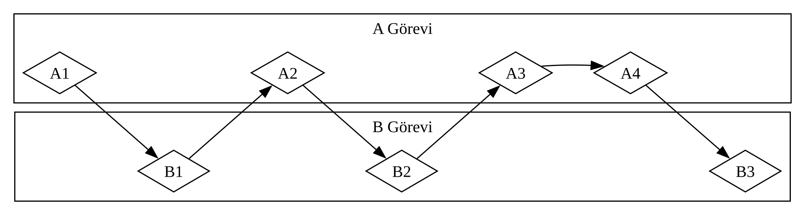
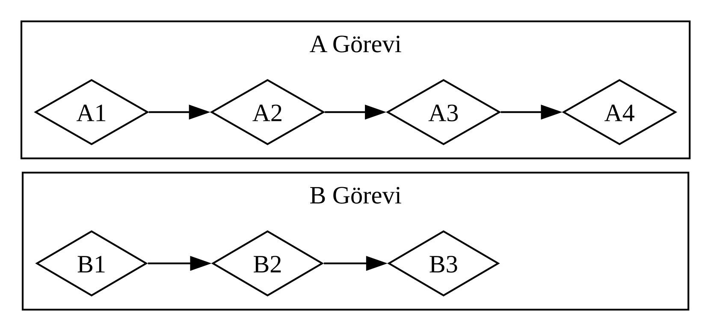
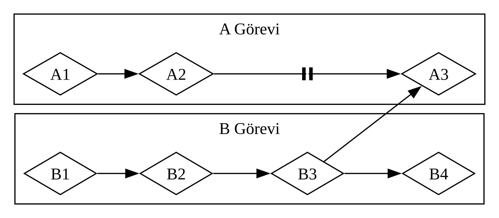

<!-- Old headings. Do not remove or links may break. -->

# Asenkron Programlamanın Temelleri: Async, Await, Futures ve Streams

Bilgisayardan gerçekleştirmesini istediğimiz pek çok işlemin tamamlanması biraz
zaman alabilir. Uzun süren bu işlemlerin bitmesini beklerken başka bir şeyler de
yapabilsek harika olurdu. Modern bilgisayarlar aynı anda birden fazla işlem
üzerinde çalışmak için iki teknik sunar: _paralellik (parallelism)_ ve
_eşzamanlılık (concurrency)_. Buna karşılık, programlarımızın mantığı çoğunlukla
doğrusal bir akışla yazılır. Programın gerçekleştirmesi gereken işlemleri ve
bir fonksiyonun duraklayıp onun yerine programın başka bir bölümünün
çalışabileceği noktaları, her kod parçasının tam olarak hangi sırayla ve nasıl
çalışacağını en baştan belirlemek zorunda kalmadan ifade edebilmek isteriz.
_Asenkron programlama (asynchronous programming)_, kodumuzu olası duraklama
noktaları ve nihai sonuçlar cinsinden ifade etmemizi sağlayan ve koordinasyon
ayrıntılarını bizim yerimize üstlenen bir soyutlamadır.

Bu bölüm, Bölüm 16'da paralellik ve eşzamanlılık için thread'leri kullanışımızın
üzerine inşa edilir ve kod yazmaya alternatif bir yaklaşım sunar: işlemlerin
nasıl asenkron olabileceğini ifade etmemizi sağlayan Rust _future_'ları ile
_akışları (streams)_, bunları destekleyen `async` ve `await` sözdizimi ve
_asenkron çalışma zamanlarını (asynchronous runtimes)_ —yani asenkron işlemlerin
yürütülmesini yönetip koordine eden kodu— sağlayan üçüncü taraf crate'ler.

Bir örnek ele alalım. Diyelim ki bir aile kutlamasından hazırladığınız videoyu
dışa aktarıyorsunuz; bu işlem dakikalardan saatlere kadar uzayabilir. Video dışa
aktarma işlemi, kullanabildiği kadar çok CPU ve GPU gücü tüketecektir. Yalnızca
tek bir CPU çekirdeğiniz olsaydı ve işletim sisteminiz bu dışa aktarmayı
tamamlanana kadar hiç duraklatmasaydı —yani dışa aktarma işlemini _senkron_
olarak yürütseydi— bu görev çalışırken bilgisayarınızda başka hiçbir şey
yapamazdınız. Bu oldukça can sıkıcı bir deneyim olurdu. Neyse ki
bilgisayarınızın işletim sistemi, aynı anda başka işlerinizi de
halledebilmeniz için dışa aktarma işlemini görünmez biçimde yeterince sık
kesintiye uğratabilir ve gerçekten de uğratır.

Şimdi de bir başkasının paylaştığı bir videoyu indirdiğinizi düşünelim; bu işlem
de biraz zaman alabilir ama o kadar fazla CPU süresi tüketmez. Bu durumda CPU,
ağdan verinin gelmesini beklemek zorundadır. Veri gelmeye başlar başlamaz
okumaya başlayabilseniz de tamamının ulaşması biraz vakit alabilir. Verinin
tamamı ulaştıktan sonra bile, video oldukça büyükse hepsini belleğe yüklemek en
az bir iki saniye sürebilir. Bu kulağa pek uzun gelmeyebilir, ancak her saniye
milyarlarca işlem gerçekleştirebilen modern bir işlemci için çok uzun bir
süredir. İşletim sisteminiz yine ağ çağrısının tamamlanmasını beklerken CPU'nun
başka işler yapabilmesine olanak tanımak için programınızı görünmez biçimde
kesintiye uğratacaktır.

Video dışa aktarma, _CPU bağımlı (CPU-bound)_ veya _hesaplama bağımlı
(compute-bound)_ bir işlem örneğidir. Böyle bir işlem, bilgisayarın CPU veya
GPU içinde veri işleyebileceği azami hızla ve bu hızın ne kadarını söz konusu
işleme ayırabildiğiyle sınırlıdır. Video indirme ise _G/Ç bağımlı (I/O-bound)_ bir
işlem örneğidir; çünkü bilgisayarın _girdi ve çıktı_ hızıyla sınırlıdır ve
yalnızca verinin ağ üzerinden gönderilebildiği hızda ilerleyebilir.

Bu örneklerin her ikisinde de işletim sisteminin görünmez kesmeleri bir tür
eşzamanlılık sağlar. Ne var ki bu eşzamanlılık yalnızca programın bütünü
düzeyinde gerçekleşir: işletim sistemi diğer programların iş yapabilmesi için
bir programı kesintiye uğratır. Pek çok durumda, programlarımızı işletim
sisteminin anlayabileceğinden çok daha ayrıntılı bir düzeyde anladığımız
için, işletim sisteminin göremediği eşzamanlılık fırsatlarını biz
yakalayabiliriz.

Örneğin, dosya indirmelerini yöneten bir araç geliştiriyorsak, programımızı bir
indirme başlatmanın kullanıcı arayüzünü kilitlemeyeceği şekilde yazabilmeliyiz
ve kullanıcılar aynı anda birden fazla indirme başlatabilmelidir. Ne var ki ağ
ile etkileşim kurmaya yönelik pek çok işletim sistemi API'si _bloklayıcıdır
(blocking)_; yani işledikleri veri tamamen hazır olana dek programın
ilerleyişini durdurur.

> Not: Üzerinde düşünürseniz, _çoğu_ fonksiyon çağrısı zaten bu şekilde çalışır.
> Ancak _bloklayıcı_ terimi genellikle dosyalarla, ağla veya bilgisayardaki
> diğer kaynaklarla etkileşime giren fonksiyon çağrıları için kullanılır; çünkü
> bir programın, işlemin _bloklamayan (non-blocking)_ olmasından fayda göreceği
> durumlar asıl bunlardır.

Her dosyayı indirmek üzere ayrı bir thread başlatarak ana thread'imizi
bloklamaktan kaçınabilirdik. Ancak bu thread'lerin tükettiği sistem
kaynaklarının ek maliyeti bir noktadan sonra sorun hâline gelirdi. Çağrının en
baştan hiç bloklamaması çok daha iyi olurdu: Bunun yerine programımızın
tamamlamasını istediğimiz bir dizi _görev (task)_ tanımlayabilir, bunları
çalıştırmak için en uygun sırayı ve yöntemi seçmeyi de çalışma zamanına
bırakabilirdik.

Rust'ın _async_ (_asynchronous_ yani _asenkron_ kelimesinin kısaltması)
soyutlamasının bize sunduğu şey tam olarak budur. Bu bölümde şu konuları ele
alırken async yapısını tüm yönleriyle öğreneceksiniz:

- Rust'ın `async` ve `await` sözdiziminin nasıl kullanılacağı ve asenkron
  fonksiyonların bir çalışma zamanı ile nasıl yürütüleceği
- Bölüm 16'da incelediğimiz zorluklardan bazılarını çözmek için async modelinin
  nasıl kullanılacağı
- Çoklu thread kullanımı (_multithreading_) ile async'in pek çok durumda bir
  arada kullanabileceğiniz tamamlayıcı çözümleri nasıl sunduğu

Ancak async'in pratikte nasıl çalıştığını görmeden önce, paralellik ile
eşzamanlılık arasındaki farkları ele almak için kısa bir parantez açmamız
gerekiyor.

<!-- Old headings. Do not remove or links may break. -->

## Paralellik ve Eşzamanlılık

Şimdiye kadar paralellik ve eşzamanlılığı çoğunlukla birbirinin yerine geçebilen
kavramlar gibi ele aldık. Artık aralarındaki ayrımı daha kesin biçimde yapmamız
gerekiyor; çünkü çalışmaya başladığımızda bu farklar karşımıza çıkacak.

Bir ekibin bir yazılım projesindeki işleri paylaşabileceği farklı yolları
düşünün. Tek bir ekip üyesine birden fazla görev verebilir, her üyeye tek bir
görev atayabilir ya da bu iki yaklaşımın bir karışımını kullanabilirsiniz.

Bir kişinin, elindeki görevlerden herhangi biri tamamlanmadan önce birkaç farklı
görev üzerinde çalışması _eşzamanlılıktır_. Eşzamanlılığı uygulamanın bir yolu,
bilgisayarınızda iki farklı projeyi hazır bulundurup bir projeden sıkıldığınızda
ya da bir noktada takıldığınızda diğerine geçmenize benzer. Yalnızca tek bir
kişisinizdir; dolayısıyla her iki görevde kelimenin tam anlamıyla aynı anda
ilerleme kaydedemezsiniz, ancak aralarında geçiş yapıp her seferinde biri
üzerinde ilerleyerek çoklu görev yürütebilirsiniz (bkz. Şekil 17-1).

<figure>

<figcaption>Şekil 17-1: A Görevi (Task A) ve B Görevi (Task B) arasında geçiş yapılan eşzamanlı bir iş akışı</figcaption>

</figure>

Ekip, bir grup görevi her üyenin tek bir görev alıp onun üzerinde tek başına
çalışacağı şekilde paylaştırdığında bu _paralelliktir_. Ekipteki her kişi
kelimenin tam anlamıyla aynı anda ilerleme kaydedebilir (bkz. Şekil 17-2).

<figure>

<figcaption>Şekil 17-2: A Görevi ve B Görevi üzerindeki çalışmaların birbirinden bağımsız gerçekleştiği paralel bir iş akışı</figcaption>

</figure>

Bu iş akışlarının her ikisinde de farklı görevler arasında koordinasyon
sağlamanız gerekebilir. Belki bir kişiye atanan görevin diğer herkesin işinden
tamamen bağımsız olduğunu düşünmüşsünüzdür, ancak gerçekte ekipteki başka bir
kişinin önce kendi görevini bitirmesini gerektiriyordur. İşin bir kısmı paralel
olarak yapılabilse de bir kısmı aslında _seridir (serial)_: Şekil 17-3'te olduğu
gibi yalnızca sırayla, bir görev bittikten sonra diğeri başlayacak biçimde
gerçekleşebilir.

<figure>

<figcaption>Şekil 17-3: A3 görevi B3 görevinin sonuçlarını bekleyerek bloklanana kadar A Görevi ve B Görevi üzerindeki çalışmaların bağımsız gerçekleştiği kısmen paralel bir iş akışı</figcaption>

</figure>

Benzer şekilde, kendi görevlerinizden birinin yine kendi görevlerinizden bir
diğerine bağımlı olduğunu fark edebilirsiniz. Artık sizin eşzamanlı çalışmanız
da seri hâle gelmiştir.

Paralellik ve eşzamanlılık birbiriyle kesişebilir de. Bir iş arkadaşınızın, siz
görevlerinizden birini bitirene kadar takılıp kaldığını öğrenirseniz, muhtemelen
iş arkadaşınızın “blokajını kaldırmak” (önünü açmak) için tüm çabanızı o göreve
odaklarsınız. Artık iş arkadaşınızla paralel çalışamazsınız ve kendi
görevleriniz üzerinde de eşzamanlı çalışamaz hâle gelirsiniz.

Aynı temel dinamikler yazılımda ve donanımda da devreye girer. Tek CPU
çekirdekli bir makinede CPU her seferinde yalnızca tek bir işlem
gerçekleştirebilir, ancak yine de eşzamanlı olarak çalışabilir. Thread'ler,
süreçler (_processes_) ve async gibi araçları kullanan bilgisayar, bir etkinliği
duraklatıp diğerlerine geçebilir ve sonunda döngüyü tamamlayarak yeniden o ilk
etkinliğe geri dönebilir. Birden fazla CPU çekirdeğine sahip bir makinede ise
işleri paralel olarak da yürütebilir. Bir çekirdek bir görevi yerine getirirken
başka bir çekirdek onunla hiçbir ilgisi olmayan bambaşka bir görevi yürütebilir
ve bu işlemler kelimenin tam anlamıyla aynı anda gerçekleşir.

Rust'ta async kod çalıştırmak genellikle eşzamanlı olarak gerçekleşir. Donanıma,
işletim sistemine ve kullandığımız asenkron çalışma zamanına (asenkron çalışma
zamanlarına birazdan daha ayrıntılı değineceğiz) bağlı olarak, bu eşzamanlılık
perde arkasında paralellikten de yararlanabilir.

> Not: Rust'ın asenkron tasarım felsefesi, başka dillerden gelen
> geliştiricilerin bilmesinde büyük fayda olan iki temel mimari karara dayanır:
>
> - **Çalışma zamanının (*async runtime*) ekosisteme bırakılması:** Rust
>   standart kütüphanesi yalnızca `std::future::Future` trait'ini ve
>   derleyicinin desteklediği `async`/`await` sözdizimini tanımlar; görevleri
>   çizelgeleyip yürüten bir asenkron çalışma zamanını bünyesinde barındırmaz.
>   Çünkü yüksek trafikli bir web sunucusunun ihtiyaç duyduğu çok thread'li iş
>   çalmalı (*work-stealing*) çalışma zamanı ile birkaç kilobayt belleğe sahip
>   bir mikrodenetleyicinin gereksinimleri birbirinden tamamen farklıdır.
>   Standart kütüphaneye tek tip bir çalışma zamanı dayatmamak (Rust'ın
>   "kullanmadığınız şeyin bedelini ödemezsiniz" ilkesinin bir uzantısı)
>   sayesinde; ağ ve sunucu uygulamalarında `tokio`, hafif ve
>   yalın projelerde `smol`, işletim sistemsiz (*bare-metal*) gömülü sistemlerde
>   ise `embassy` gibi hedefe özel çalışma zamanları seçilebilir. Bu bölümde de
>   öğrenme sürecini sadeleştirmek amacıyla, perde arkasında `tokio` ve
>   `futures` crate'lerini sarmalayan eğitim amaçlı `trpl` crate'ini
>   kullanacağız.
> - **Tembel (*lazy*) durum makineleri olarak future'lar:** JavaScript'teki
>   `Promise` veya C# dilindeki `Task` yapıları **heveslidir (*eager*)**; yani
>   oluşturuldukları anda arka planda çalışmaya başlarlar. Rust'ta ise bir
>   `async` fonksiyonu çağırmak tek başına hiçbir iş yürütmez; yalnızca
>   derleyicinin ürettiği **tembel bir durum makinesi** olan ve ek öbek (*heap*)
>   ayırması gerektirmeden oluşturulabilen bir `Future` değeri döndürür. Bir
>   future, yoklanmadıkça (*poll*) —yani üzerinde `.await` kullanılmadıkça ya da
>   bir çalışma zamanına teslim edilmedikçe— hiçbir adım ilerlemez. Bu tasarım,
>   future'ları çalıştırmadan önce birleştirmeyi ve henüz tamamlanmamış bir
>   future'ı yalnızca düşürerek (*drop*) iptal etmeyi mümkün kılar.

Şimdi, Rust'ta asenkron programlamanın gerçekte nasıl çalıştığına derinlemesine
bakalım.
