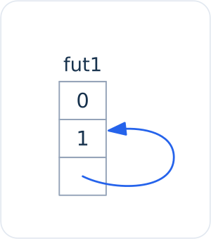
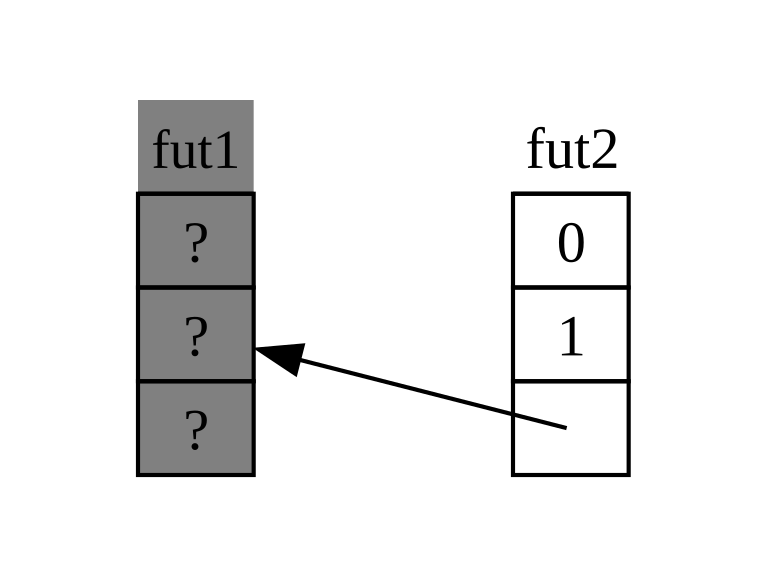
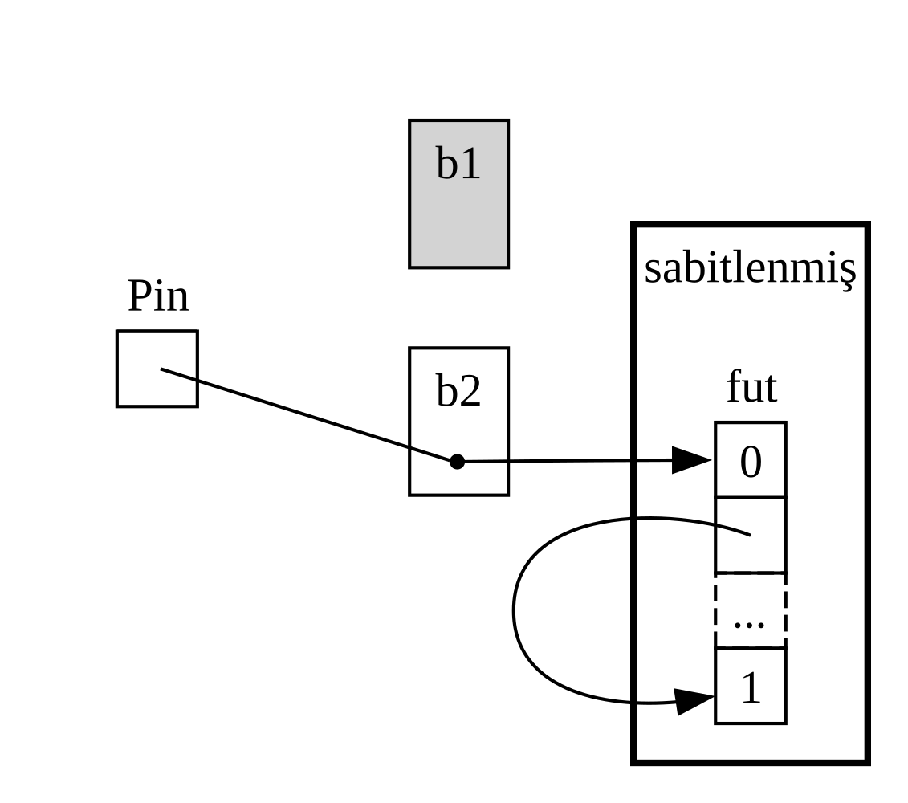
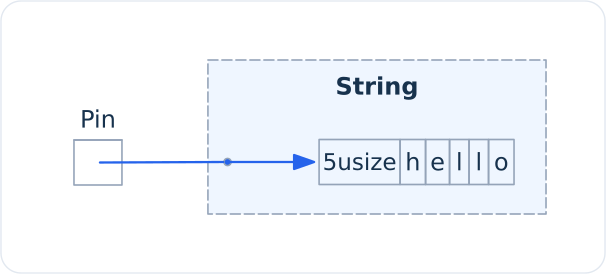
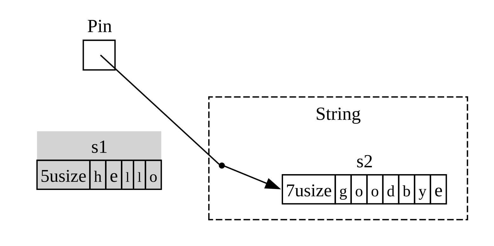

<!-- Old headings. Do not remove or links may break. -->

<a id="digging-into-the-traits-for-async"></a>
<a id="a-closer-look-at-the-traits-for-async"></a>
<a id="async-için-traitlere-daha-yakından-bakmak"></a>
<a id="async-icin-traitlere-daha-yakindan-bakmak"></a>

## Async Trait'lerine Daha Yakından Bakış

Bölüm boyunca `Future`, `Stream` ve `StreamExt` trait'lerini çeşitli biçimlerde kullandık. Ancak şimdiye dek bunların nasıl çalıştığına ya da birbiriyle nasıl bütünleştiğine dair ayrıntılara fazla girmekten kaçındık; günlük Rust çalışmalarınızda çoğu zaman bu kadarı fazlasıyla yeterlidir. Yine de zaman zaman `Pin` türü ve `Unpin` trait'i ile birlikte bu trait'lerin birkaç ayrıntısını daha anlamanız gereken durumlarla karşılaşırsınız. Bu alt bölümde, _gerçekten_ derinlemesine incelemeyi diğer belgelendirmelere bırakarak tam da bu tür senaryolarda size yardımcı olacak kadar derine ineceğiz.

<!-- Old headings. Do not remove or links may break. -->

<a id="future"></a>
<a id="the-future-trait"></a>

### `Future` Trait'i

İşe `Future` trait'inin nasıl çalıştığına daha yakından bakarak başlayalım. Rust onu şöyle tanımlar:

```rust
use std::pin::Pin;
use std::task::{Context, Poll};

pub trait Future {
    type Output;

    fn poll(self: Pin<&mut Self>, cx: &mut Context<'_>) -> Poll<Self::Output>;
}
```

Bu trait tanımı bir dizi yeni tür ve daha önce görmediğimiz bazı sözdizimleri içeriyor; gelin tanımı parça parça inceleyelim.

İlk olarak, `Future` trait'inin ilişkili türü olan `Output`, future'ın hangi değere çözüleceğini belirtir. Bu, `Iterator` trait'indeki `Item` ilişkili türüne benzer. İkinci olarak `Future`, `self` parametresi için özel bir `Pin` referansı ve `Context` türüne değiştirilebilir bir referans alan, karşılığında da bir `Poll<Self::Output>` döndüren `poll` metoduna sahiptir. `Pin` ve `Context` hakkında birazdan daha fazla konuşacağız. Şimdilik metodun ne döndürdüğüne, yani `Poll` türüne odaklanalım:

```rust
pub enum Poll<T> {
    Ready(T),
    Pending,
}
```

Bu `Poll` türü bir `Option` türüne benzer: değer taşıyan bir varyantı (`Ready(T)`) ve değer taşımayan bir varyantı (`Pending`) vardır. Ancak `Poll`, `Option`'dan oldukça farklı bir anlama gelir! `Pending` varyantı, future'ın hâlâ yapacak işi olduğunu, dolayısıyla çağıran kodun daha sonra tekrar kontrol etmesi gerektiğini belirtir. `Ready` varyantı ise `Future`'ın işini bitirdiğini ve `T` değerinin kullanıma hazır olduğunu gösterir.

> Not: Doğrudan `poll` çağırmanız nadiren gerekir; ancak çağırmanız gerekirse
> çoğu future için, future `Ready` döndürdükten sonra çağıran kodun `poll`
> metodunu tekrar çağırmaması gerektiğini unutmayın. Pek çok future, hazır hâle
> geldikten sonra yeniden yoklanırsa panikler. Tekrar yoklanması güvenli olan
> future'lar bunu belgelendirmelerinde açıkça belirtir. Bu davranış,
> `Iterator::next` metodunun davranışına benzer.

`await` kullanan bir kod gördüğünüzde, Rust bunu perde arkasında `poll` çağıran bir koda derler. Çözüldüğünde tek bir URL için sayfa başlığını yazdırdığımız Liste 17-4'e geri dönüp bakarsanız, Rust onu kabaca (birebir aynı olmasa da) şuna benzer bir yapıya derler:

```rust,ignore
match sayfa_basligi(url).poll() {
    Ready(sayfa_basligi) => match sayfa_basligi {
        Some(title) => println!("{url} için başlık {title} idi"),
        None => println!("{url} için başlık yoktu"),
    }
    Pending => {
        // Peki buraya ne gelecek?
    }
}
```

Future hâlâ `Pending` durumundaysa ne yapmalıyız? Future nihayet hazır olana dek tekrar, tekrar ve tekrar denemenin bir yoluna ihtiyacımız vardır. Başka bir deyişle, bir döngüye ihtiyacımız vardır:

```rust,ignore
let mut sayfa_basligi_fut = sayfa_basligi(url);
loop {
    match sayfa_basligi_fut.poll() {
        Ready(deger) => match deger {
            Some(title) => println!("{url} için başlık {title} idi"),
            None => println!("{url} için başlık yoktu"),
        }
        Pending => {
            // devam et
        }
    }
}
```

Ancak Rust kodu tam olarak buna derleseydi, her `await` bloklayıcı olurdu — ki bu da ulaşmak istediğimiz hedefin tam tersidir! Bunun yerine Rust, bu döngünün denetimi başka bir yapıya devredebilmesini sağlar: Bu yapı, söz konusu future üzerindeki çalışmayı duraklatıp diğer future'larla ilgilenebilir ve daha sonra bu future'ı yeniden kontrol edebilir. Gördüğümüz üzere bu yapı bir asenkron çalışma zamanıdır ve bu zamanlama ile eşgüdüm işi onun temel görevlerinden biridir.

[“Mesaj İletimiyle İki Görev Arasında Veri Gönderme”][message-passing]<!-- ignore --> bölümünde `alici.recv` çağrısını beklemekten bahsetmiştik. `recv` çağrısı bir future döndürür ve future'ı `await` ile beklemek onu yoklar. Çalışma zamanının, future ya `Some(mesaj)` ile ya da kanal kapandığında `None` ile hazır olana dek onu duraklatacağını belirtmiştik. `Future` trait'ine ve özellikle `Future::poll` metoduna dair edindiğimiz bu daha derin kavrayışla bunun nasıl çalıştığını artık görebiliriz. Çalışma zamanı, `Poll::Pending` döndürdüğünde future'ın henüz hazır olmadığını anlar. Tersine, `poll` çağrısı `Poll::Ready(Some(mesaj))` veya `Poll::Ready(None)` döndürdüğünde ise future'ın _hazır olduğunu_ bilir ve onu ilerletir.

Bir çalışma zamanının bunu tam olarak nasıl yaptığının ayrıntıları bu kitabın kapsamı dışındadır; ancak asıl önemli olan future'ların temel mekaniğini görmektir: çalışma zamanı sorumlu olduğu her bir future'ı _yoklar_ ve henüz hazır olmadığında onu tekrar uykuya yatırır.

> Not: Peki çalışma zamanı, uyuttuğu bir future'ı yeniden yoklamanın zamanının
> geldiğini nasıl anlar? Bu sorunun yanıtı, `poll` metodunun ikinci parametresi
> olan `cx: &mut Context<'_>` değerinde gizlidir. `Context`, özünde bir
> `Waker` (*uyandırıcı*) taşır. Bir future `Pending` döndürdüğünde, ilerleme
> kaydedebileceği an geldiğinde (örneğin ağdan veri ulaştığında ya da bir
> zamanlayıcı dolduğunda) bu uyandırıcının `wake` metodunun çağrılmasını
> ayarlamakla yükümlüdür; `trpl::sleep` veya kanal alıcısı gibi hazır
> future'lar bu işi sizin yerinize yapar. Çalışma zamanı da future'ları
> körlemesine ve sürekli yoklamak yerine yalnızca uyandırıldıklarında yeniden
> yoklar. Bu sözleşme sayesinde binlerce uyuyan future, işlemciyi meşgul etmeden
> sırasını bekleyebilir.

<!-- Old headings. Do not remove or links may break. -->

<a id="pinning-and-the-pin-and-unpin-traits"></a>
<a id="the-pin-and-unpin-traits"></a>
<a id="the-pin-type-and-the-unpin-trait"></a>

### `Pin` Türü ve `Unpin` Trait'i

Liste 17-13'te üç future'ı beklemek için `trpl::join!` makrosunu kullanmıştık. Ancak sayısı çalışma zamanına kadar bilinmeyecek birtakım future'lar barındıran vektör gibi bir koleksiyona sahip olmak oldukça yaygındır. Gelin Liste 17-13'ü, üç future'ı bir vektöre koyan ve bunun yerine `trpl::join_all` fonksiyonunu çağıran Liste 17-23'teki koda dönüştürelim; bu kod henüz derlenmeyecektir.

<Listing number="17-23" caption="Bir koleksiyon içindeki future'ları beklemek" file-name="src/main.rs">

```rust,ignore,does_not_compile
{{#rustdoc_include ../listings/ch17-async-await/listing-17-23/src/main.rs:here}}
```

</Listing>

Tıpkı Bölüm 12'deki “`calistir` Fonksiyonundan Hata Döndürme” başlığında yaptığımız gibi, her bir future'ı _trait nesnelerine_ dönüştürmek için bir `Box` içine koyuyoruz. (Trait nesnelerini Bölüm 18'de ayrıntılı olarak ele alacağız.) Trait nesneleri kullanmak, bu ifadelerin ürettiği anonim future'ların tamamı `Future` trait'ini uyguladığı için hepsine aynı türmüş gibi davranabilmemizi sağlar.

Bu durum ilk bakışta şaşırtıcı gelebilir. Sonuçta async blokların hiçbiri bir değer döndürmez, dolayısıyla her biri bir `Future<Output = ()>` üretir. Ancak `Future`'ın bir trait olduğunu ve derleyicinin çıktı türleri birebir aynı olsa bile her bir async blok için benzersiz bir enum oluşturduğunu unutmayın. Tıpkı kendi yazdığınız iki farklı struct'ı aynı `Vec` içine koyamayacağınız gibi, derleyicinin ürettiği farklı enum'ları da bir arada karıştıramazsınız.

Ardından future koleksiyonunu `trpl::join_all` fonksiyonuna geçiriyor ve sonucu bekliyoruz. Ancak bu kod derlenmez; hata mesajlarının ilgili kısmı aşağıdadır.

<!-- manual-regeneration
cd listings/ch17-async-await/listing-17-23
cargo build
copy *only* the final `error` block from the errors
-->

```text
error[E0277]: `dyn Future<Output = ()>` cannot be unpinned
  --> src/main.rs:48:36
   |
48 |         trpl::join_all(gelecekler).await;
   |                                    ^^^^^ the trait `Unpin` is not implemented for `dyn Future<Output = ()>`
   |
   = note: consider using the `pin!` macro
           consider using `Box::pin` if you need to access the pinned value outside of the current scope
   = note: required for `Box<dyn Future<Output = ()>>` to implement `Future`
note: required by a bound in `futures_util::future::join_all::JoinAll`
  --> file:///home/.cargo/registry/src/index.crates.io-1949cf8c6b5b557f/futures-util-0.3.30/src/future/join_all.rs:29:8
   |
27 | pub struct JoinAll<F>
   |            ------- required by a bound in this struct
28 | where
29 |     F: Future,
   |        ^^^^^^ required by this bound in `JoinAll`
```

Bu hata mesajındaki not, değerleri bellekte taşınmayacaklarını garanti eden `Pin` türünün içine koymak —yani değerleri _sabitlemek (pin)_— için `pin!` makrosunu kullanmamız gerektiğini söyler. Hata mesajı, `dyn Future<Output = ()>` türünün `Unpin` trait'ini uygulaması gerektiği hâlde şu anda uygulamadığını, bu yüzden de sabitlemenin zorunlu olduğunu belirtir.

`trpl::join_all` fonksiyonu `JoinAll` adında bir struct döndürür. Bu struct, `Future` trait'ini uygulamakla sınırlandırılmış bir `F` türü üzerinden jeneriktir. Bir future'ı `await` ile doğrudan beklemek, o future'ı örtük olarak sabitler. Future beklemek istediğimiz her yerde `pin!` kullanmak zorunda kalmamamızın nedeni budur.

Ancak burada bir future'ı doğrudan beklemiyoruz. Bunun yerine, `join_all` fonksiyonuna bir future koleksiyonu geçirerek yeni bir future olan `JoinAll` struct'ını oluşturuyoruz. `join_all` fonksiyonunun imzası, koleksiyondaki öğelerin türlerinin tamamının `Future` trait'ini uygulamasını gerektirir ve `Box<T>`, yalnızca sarmaladığı `T` türü `Unpin` trait'ini uygulayan bir future olduğunda `Future` trait'ini uygular.

Sindirmesi gereken epey bilgi var! Bunu gerçekten anlayabilmek için `Future` trait'inin özellikle sabitleme etrafında nasıl çalıştığına biraz daha derinden bakalım. `Future` trait'inin tanımına tekrar göz atın:

```rust
use std::pin::Pin;
use std::task::{Context, Poll};

pub trait Future {
    type Output;

    // Gerekli metot
    fn poll(self: Pin<&mut Self>, cx: &mut Context<'_>) -> Poll<Self::Output>;
}
```

`cx` parametresi ve onun `Context` türü, bir çalışma zamanının tembelliğini korurken belirli bir future'ı ne zaman yeniden kontrol etmesi gerektiğini nasıl bildiğinin anahtarıdır (yukarıdaki `Waker` notuna bakın). Yine bunun nasıl çalıştığının ayrıntıları bu bölümün kapsamı dışındadır ve genellikle bu konuyu yalnızca özel bir `Future` uygulaması yazarken düşünmeniz gerekir. Biz bunun yerine `self` parametresinin türüne odaklanacağız; çünkü `self` parametresinin tür bildirimine sahip olduğu bir metodu ilk kez görüyoruz. `self` için yazılan tür bildirimi diğer fonksiyon parametrelerindeki tür bildirimleri gibi çalışır, ancak iki temel farkı vardır:

- Metodun çağrılabilmesi için `self` değerinin hangi türde olması gerektiğini
  Rust'a bildirir.
- Herhangi bir tür olamaz. Metodun üzerinde uygulandığı türle, o türe yönelik
  bir referans ya da akıllı işaretçiyle veya o türe yönelik bir referansı (ya da
  akıllı işaretçiyi) sarmalayan bir `Pin` ile sınırlandırılmıştır.

Bu sözdizimi hakkında daha fazlasını [Bölüm 18][ch-18]<!-- ignore -->'de göreceğiz. Şimdilik bir future'ın `Pending` mi yoksa `Ready(Output)` mu olduğunu kontrol etmek üzere onu yoklamak istiyorsak, türe yönelik `Pin` ile sarmalanmış değiştirilebilir bir referansa ihtiyacımız olduğunu bilmek yeterlidir.

`Pin`; `&`, `&mut`, `Box` ve `Rc` gibi işaretçi benzeri türler için bir sarmalayıcıdır. (Teknik olarak `Pin`, `Deref` veya `DerefMut` trait'lerini uygulayan türlerle çalışır; ancak bu, pratikte yalnızca referanslar ve akıllı işaretçilerle çalışmakla eşdeğerdir.) `Pin` başlı başına bir işaretçi değildir ve `Rc` ile `Arc`'ın referans sayımıyla yaptığı gibi kendine özgü bir davranış barındırmaz; tamamen derleyicinin işaretçi kullanımı üzerindeki kısıtlamaları zorunlu kılmak için kullanabileceği bir araçtır.

`await` ifadesinin `poll` çağrıları cinsinden uygulandığını hatırlamak daha önce gördüğümüz hata mesajını açıklamaya başlar; ancak o mesaj `Pin` değil `Unpin` üzerindendi. Peki `Pin` tam olarak `Unpin` ile nasıl ilişkilidir ve `Future`, `poll` çağrısı yapabilmek için `self` değerinin neden bir `Pin` türü içinde olmasına ihtiyaç duyar?

Bu bölümün önceki kısımlarından hatırlayacağınız üzere, bir future içindeki bir dizi `await` noktası bir durum makinesine derlenir ve derleyici bu durum makinesinin ödünç alma ve sahiplik dahil olmak üzere Rust'ın güvenlikle ilgili tüm normal kurallarına uymasını sağlar. Bunu gerçekleştirmek için Rust, bir `await` noktası ile bir sonraki `await` noktası ya da async bloğun sonu arasında hangi verilere ihtiyaç duyulduğuna bakar. Ardından derlenmiş durum makinesinde buna karşılık gelen bir varyant oluşturur. Her varyant, ister verinin sahipliğini devralarak ister ona değiştirilebilir ya da değiştirilemez bir referans alarak kaynak kodun o bölümünde kullanılacak verilere ihtiyaç duyduğu erişimi elde eder.

Buraya kadar her şey yolunda: belirli bir async blokta sahiplik veya referanslar konusunda bir hata yaparsak ödünç alma denetleyicisi bize bildirir. Ancak o bloğa karşılık gelen future'ı taşımak istediğimizde —örneğin `join_all` fonksiyonuna geçirmek üzere bir `Vec` içine taşıdığımızda— işler biraz daha çetrefilleşir.

Bir future'ı taşıdığımızda —ister `join_all` ile iteratör olarak kullanmak üzere bir veri yapısına ekleyerek ister bir fonksiyondan döndürerek olsun— bu aslında Rust'ın bizim için oluşturduğu durum makinesini taşımak anlamına gelir. Ve Rust'taki diğer çoğu türün aksine, Rust'ın async bloklar için oluşturduğu future'lar, Şekil 17-4'teki basitleştirilmiş çizimde gösterildiği gibi herhangi bir varyantın alanlarında kendilerine yönelik referanslar barındırabilir.

<figure>



<figcaption>Şekil 17-4: Kendine referanslı bir veri türü</figcaption>

</figure>

Ne var ki kendisine referans barındıran herhangi bir nesneyi taşımak varsayılan olarak güvenli değildir; çünkü referanslar her zaman başvurdukları şeyin gerçek bellek adresine işaret eder (bkz. Şekil 17-5). Veri yapısının kendisini taşırsanız, bu içsel referanslar eski konuma işaret eder hâlde kalır. Ancak o bellek konumu artık geçersizdir. Birincisi, veri yapısında değişiklik yaptığınızda oradaki değer güncellenmeyecektir. İkincisi —ve daha da önemlisi— bilgisayar artık o belleği başka amaçlar için yeniden kullanmakta özgürdür! Daha sonra tamamen alakasız veriler okuyabilirsiniz.

<figure>



<figcaption>Şekil 17-5: Kendine referanslı bir veri türünü taşımanın güvenli olmayan sonucu</figcaption>

</figure>

Kuramsal olarak Rust derleyicisi bir nesne her taşındığında ona yönelik tüm referansları güncellemeyi deneyebilirdi; ancak özellikle koca bir referans ağının güncellenmesi gerekiyorsa bu durum ciddi bir performans yükü ekleyebilirdi. Bunun yerine söz konusu veri yapısının _bellekte taşınmadığından_ emin olabilirsek hiçbir referansı güncellememiz gerekmez. Rust'ın ödünç alma denetleyicisi tam olarak bunun içindir: güvenli kodda, kendisine etkin bir referans bulunan herhangi bir öğeyi taşımanızı engeller.

`Pin`, tam da ihtiyacımız olan güvenceyi bize sunmak için bu temelin üzerine inşa edilir. Bir değere yönelik işaretçiyi `Pin` içine sararak o değeri _sabitlediğimizde_, değer artık taşınamaz. Dolayısıyla elinizde `Pin<Box<BirTur>>` varsa, `Box` işaretçisini _değil_, gerçekte `BirTur` değerini sabitlersiniz. Şekil 17-6 bu süreci göstermektedir.

<figure>


<figcaption>Şekil 17-6: Kendine referanslı bir future türüne işaret eden bir `Box` değerini sabitleme</figcaption>

</figure>

Aslına bakarsanız `Box` işaretçisi hâlâ serbestçe taşınabilir. Unutmayın: bizim önemsediğimiz şey, nihayetinde başvurulan verinin yerinde kalmasını sağlamaktır. Bir işaretçi taşınırsa _ama işaret ettiği veri_ Şekil 17-7'deki gibi aynı yerde kalırsa ortada olası bir sorun yoktur. (Bağımsız bir alıştırma olarak, ilgili türlerin yanı sıra `std::pin` modülünün belgelendirmesine göz atın ve bir `Box` sarmalayan `Pin` ile bunu nasıl yapacağınızı çözmeye çalışın.) Kilit nokta, kendine referanslı (*self-referential*) türün kendisinin hâlâ sabitlenmiş olduğu için taşınamamasıdır.

<figure>



<figcaption>Şekil 17-7: Kendine referanslı bir future türüne işaret eden bir `Box` değerini taşıma</figcaption>

</figure>

Bununla birlikte çoğu türün, bir `Pin` işaretçisinin arkasında bulunsa bile taşınması tamamen güvenlidir. Sabitlemeyi yalnızca öğeler içsel referanslar barındırdığında düşünmemiz gerekir. Sayılar ve mantıksal (`bool`) değerler gibi ilkel değerler açıktır ki hiçbir içsel referans barındırmadıkları için güvenlidir. Rust'ta normalde çalıştığınız çoğu türde de durum böyledir. Örneğin bir `Vec` değerini endişelenmeden taşıyabilirsiniz. Şimdiye dek gördüklerimize bakılırsa, elinizde bir `Pin<Vec<String>>` olsaydı her işi `Pin` tarafından sunulan güvenli ama kısıtlayıcı API'ler üzerinden yapmak zorunda kalırdınız; oysa kendisine başka hiçbir referans olmadığı sürece bir `Vec<String>` değerini taşımak her zaman güvenlidir. Bu gibi durumlarda öğeleri taşımanın sorun olmadığını derleyiciye söylemenin bir yoluna ihtiyacımız vardır — işte `Unpin` tam burada devreye girer.

`Unpin`, Bölüm 16'da gördüğümüz `Send` ve `Sync` trait'lerine benzer bir _işaretleyici trait'tir (marker trait)_ ve dolayısıyla kendine ait hiçbir işlevselliği yoktur. İşaretleyici trait'ler yalnızca derleyiciye ilgili trait'i uygulayan türün belirli bir bağlamda kullanılmasının güvenli olduğunu bildirmek için vardır. `Unpin`, ilgili türün söz konusu değerin güvenle taşınıp taşınamayacağına ilişkin herhangi bir sabitleme güvencesini sürdürmesine gerek _olmadığını_ derleyiciye bildirir.

<!--
  The inline `<code>` in the next block is to allow the inline `<em>` inside it,
  matching what NoStarch does style-wise, and emphasizing within the text here
  that it is something distinct from a normal type.
-->

Tıpkı `Send` ve `Sync` trait'lerinde olduğu gibi derleyici, güvenli olduğunu kanıtlayabildiği tüm türler için `Unpin` trait'ini otomatik olarak uygular. Yine `Send` ve `Sync`'e benzer özel bir durum ise `Unpin` trait'inin bir tür için _uygulanmamasıdır_. Bunun gösterimi <code>impl !Unpin for <em>BirTur</em></code> şeklindedir; burada <code><em>BirTur</em></code>, kendisine yönelik bir işaretçi `Pin` içinde her kullanıldığında güvenli olabilmek için bu güvenceleri koruması _gereken_ bir türün adıdır.

Başka bir deyişle, `Pin` ile `Unpin` arasındaki ilişki hakkında akılda tutulması gereken iki nokta vardır. Birincisi, `Unpin` “normal” durumdur; `!Unpin` ise özel durumdur. İkincisi, bir türün `Unpin` ya da `!Unpin` uygulaması _yalnızca_ o türe yönelik <code>Pin<&mut <em>BirTur</em>></code> gibi sabitlenmiş bir işaretçi kullandığınızda önem taşır.

Bunu somutlaştırmak için `"merhaba"` metnini tutan bir `String` düşünün. Bu metin 7 ASCII karakterden oluşur ve uzunluğu 7 bayttır. Şekil 17-8'de görüldüğü gibi bir `String` değerini `Pin` içine sarabiliriz. Ancak `String`, Rust'taki diğer çoğu tür gibi `Unpin` trait'ini otomatik olarak uygular.

<figure>



<figcaption>Şekil 17-8: Bir `String` değerini sabitleme; kesikli çizgi, `String` türünün `Unpin` trait'ini uyguladığını ve dolayısıyla sabitlenmediğini gösterir</figcaption>

</figure>

Sonuç olarak, `String` bunun yerine `!Unpin` uygulasaydı geçersiz sayılacak şeyleri yapabiliriz; örneğin Şekil 17-9'daki gibi `"merhaba"` değerini bellekteki aynı konumda `"selam"` değeriyle değiştirebiliriz. Yeni metin 5 ASCII karakterden oluştuğu için uzunluğu 5 bayttır. Bu işlem `Pin` sözleşmesini ihlal etmez; çünkü `String`, taşınmasını güvensiz kılacak hiçbir içsel referansa sahip değildir. `!Unpin` yerine `Unpin` uygulamasının tam nedeni de budur.

<figure>



<figcaption>Şekil 17-9: Bellekteki 7 baytlık `"merhaba"` değerini 5 baytlık `"selam"` değeriyle değiştirme</figcaption>

</figure>

Artık Liste 17-23'teki `join_all` çağrısı için bildirilen hataları anlayacak kadar bilgi sahibiyiz. Başlangıçta async bloklar tarafından üretilen future'ları bir `Vec<Box<dyn Future<Output = ()>>>` içine taşımaya çalışmıştık; ancak gördüğümüz gibi bu future'lar içsel referanslara sahip olabileceğinden `Unpin` trait'ini otomatik olarak uygulamazlar. Onları sabitlediğimizde, ortaya çıkan `Pin` türünü future'ların altındaki verilerin _taşınmayacağından_ emin olarak `Vec` içine geçirebiliriz. Liste 17-24, üç future'ın her birinin tanımlandığı yerde `pin!` makrosunu çağırarak ve trait nesnesi türünü uyarlayarak kodun nasıl düzeltileceğini göstermektedir.

<Listing number="17-24" caption="Future'ları vektöre taşıyabilmek için sabitleme">

```rust
{{#rustdoc_include ../listings/ch17-async-await/listing-17-24/src/main.rs:here}}
```

</Listing>

Bu örnek artık derlenir ve çalışır; çalışma zamanında vektöre future ekleyip çıkarabilir ve hepsini birleştirebiliriz.

> Not: Derleyici hata mesajında hem `pin!` makrosunun hem de `Box::pin`
> fonksiyonunun önerildiğine dikkat etmiş olabilirsiniz. `std::pin::pin!`
> makrosu, ek bir öbek (*heap*) tahsisi yapmadan değeri bulunduğu yerde
> sabitler ve `Pin<&mut T>` üretir. Buna _yerel sabitleme_ demek daha doğrudur:
> async kodda `.await` boyunca tutulan yerel değerler, dış future'ın
> durumunun parçası olabilir; o future'ın saklandığı yer yığın da öbek de
> olabilir. Liste 17-24'teki gibi yerel kullanım için `pin!` yeterlidir. Sabitlenmiş
> bir future'ı mevcut kapsamın dışına döndürmeniz, bir struct alanında
> saklamanız veya sahipliğini başka bir göreve taşımanız gerektiğinde ise değeri
> öbekte sabitleyerek sahipliği taşınabilen `Pin<Box<T>>` üreten `Box::pin`
> tercih edilir.

`Pin` ve `Unpin`, günlük Rust kodundan ziyade daha alt seviyeli kütüphaneler ya da bizzat bir çalışma zamanı geliştirirken önem kazanır. Yine de bu trait'leri hata mesajlarında gördüğünüzde artık kodunuzu nasıl düzelteceğiniz konusunda çok daha net bir fikriniz olacak!

> Not: `Pin` ve `Unpin`'in bu birleşimi, kendine referanslı oldukları için aksi
> takdirde uygulanması çok zor olacak koca bir karmaşık tür sınıfını Rust'ta
> güvenli biçimde uygulamayı mümkün kılar. `Pin` gerektiren türler günümüzde en
> yaygın olarak asenkron Rust kodunda karşımıza çıkar, ancak nadiren de olsa
> başka bağlamlarda da onları görebilirsiniz.
>
> `Pin` ve `Unpin`'in çalışma ayrıntıları ve uymaları gereken kurallar,
> `std::pin` için hazırlanan API belgelendirmesinde kapsamlı biçimde ele
> alınmaktadır; dolayısıyla daha fazlasını öğrenmek isterseniz başlamak için
> harika bir yerdir.
>
> İşlerin perde arkasında nasıl yürüdüğünü çok daha ayrıntılı anlamak
> isterseniz [_Asynchronous Programming in Rust_][async-book] kitabının
> [2.][under-the-hood]<!-- ignore --> ve [4.][pinning]<!-- ignore -->
> bölümlerine göz atabilirsiniz.

<!-- Old headings. Do not remove or links may break. -->

<a id="the-stream-trait"></a>

### `Stream` Trait'i

Artık `Future`, `Pin` ve `Unpin` trait'lerini daha derinden kavradığınıza göre dikkatimizi `Stream` trait'ine çevirebiliriz. Bölümün başlarında öğrendiğiniz gibi akışlar, asenkron iteratörlere benzer. Ancak `Iterator` ve `Future`'ın aksine, bu satırlar yazılırken `Stream` trait'inin standart kütüphanede bir tanımı yoktur; bunun yerine ekosistem genelinde kullanılan ve `futures` crate'inden gelen çok yaygın bir tanım mevcuttur.

Bir `Stream` trait'inin bunları nasıl bir araya getirebileceğine bakmadan önce `Iterator` ve `Future` trait'lerinin tanımlarını kısaca hatırlayalım. `Iterator` trait'inden ardışık öğe dizisi fikrini alırız: onun `next` metodu bir `Option<Self::Item>` sunar. `Future` trait'inden ise zaman içinde hazır olma fikrini alırız: onun `poll` metodu bir `Poll<Self::Output>` sunar. Zaman içinde hazır hâle gelen bir öğe dizisini temsil etmek için bu özellikleri bir araya getiren bir `Stream` trait'i tanımlarız:

```rust
use std::pin::Pin;
use std::task::{Context, Poll};

trait Stream {
    type Item;

    fn poll_next(
        self: Pin<&mut Self>,
        cx: &mut Context<'_>
    ) -> Poll<Option<Self::Item>>;
}
```

`Stream` trait'i, akış tarafından üretilen öğelerin türü için `Item` adında bir ilişkili tür tanımlar. Bu yönüyle sıfır veya daha fazla öğenin bulunabileceği `Iterator`'a benzer; birim türü `()` olsa bile her zaman tek bir `Output` üreten `Future`'dan ise ayrılır.

`Stream` ayrıca bu öğeleri almak için bir metot da tanımlar. Tıpkı `Future::poll` gibi yoklama yaptığını ve tıpkı `Iterator::next` gibi bir öğe dizisi ürettiğini açıkça belirtmek için ona `poll_next` adını veririz. Dönüş türü `Poll` ile `Option`'ı birleştirir. Dıştaki tür `Poll`'dur, çünkü tıpkı bir future'da olduğu gibi hazır olup olmadığının kontrol edilmesi gerekir. İçteki tür ise `Option`'dır, çünkü tıpkı bir iteratörde olduğu gibi daha fazla mesaj kalıp kalmadığını bildirmesi gerekir.

Bu tanıma çok benzeyen bir yapı büyük olasılıkla ileride Rust'ın standart kütüphanesinin bir parçası hâline gelecektir. O zamana kadar çoğu çalışma zamanının araç setinin bir parçası olduğundan ona güvenebilirsiniz ve bundan sonra ele alacağımız her şey genel olarak geçerli olacaktır!

Bununla birlikte, [“Akışlar (Streams): Sıralı Future'lar”][streams]<!-- ignore --> bölümünde gördüğümüz örneklerde `poll_next` _veya_ `Stream` kullanmadık; bunun yerine `next` ve `StreamExt` kullandık. Elbette tıpkı `poll` metotları üzerinden future'larla doğrudan çalışabileceğimiz gibi, kendi `Stream` durum makinelerimizi elle yazarak doğrudan `poll_next` API'si üzerinden de çalışabilirdik. Ancak `await` kullanmak çok daha hoştur ve `StreamExt` trait'i tam da bunu yapabilmemiz için `next` metodunu sunar:

```rust
{{#rustdoc_include ../listings/ch17-async-await/no-listing-stream-ext/src/lib.rs:here}}
```

<!--
TODO: update this if/when tokio/etc. update their MSRV and switch to using async functions
in traits, since the lack thereof is the reason they do not yet have this.
-->

> Not: Bölümün önceki kısımlarında kullandığımız gerçek tanım bundan biraz
> farklı görünür; çünkü henüz trait'ler içinde async fonksiyon kullanımını
> desteklemeyen Rust sürümlerini de desteklemektedir. Sonuç olarak tanım şöyle
> görünür:
>
> ```rust,ignore
> fn next(&mut self) -> Next<'_, Self> where Self: Unpin;
> ```
>
> Buradaki `Next` türü, `Future` trait'ini uygulayan bir `struct`'tır ve `await`
> anahtar kelimesinin bu metotla çalışabilmesi için `Next<'_, Self>` aracılığıyla
> `self` referansının ömrünü adlandırmamıza olanak tanır.

`StreamExt` trait'i aynı zamanda akışlarla kullanılabilecek tüm ilginç metotların da yuvasıdır. `StreamExt`, `Stream` trait'ini uygulayan her tür için otomatik olarak uygulanır; ancak topluluğun temel trait'i etkilemeden yardımcı API'ler üzerinde geliştirme yapabilmesini sağlamak amacıyla bu trait'ler ayrı ayrı tanımlanmıştır.

`trpl` crate'inde kullanılan `StreamExt` sürümünde trait, yalnızca `next` metodunu tanımlamakla kalmaz; aynı zamanda `Stream::poll_next` çağrısının ayrıntılarını doğru şekilde ele alan varsayılan bir `next` uygulaması da sunar. Bu da kendi akış veri türünüzü yazmanız gerektiğinde bile _yalnızca_ `Stream` trait'ini uygulamanızın yeterli olduğu ve ardından veri türünüzü kullanan herkesin `StreamExt` ile onun metotlarını otomatik olarak kullanabileceği anlamına gelir.

Bu trait'lerin alt seviye ayrıntıları için ele alacaklarımız bu kadar. Bölümü tamamlamak üzere, şimdi future'ların (akışlar dahil), görevlerin ve thread'lerin birbiriyle nasıl bütünleştiğine bakalım!

[message-passing]: ch17-02-async-ile-eszamanlilik.html#iki-görev-arasında-mesaj-iletimiyle-veri-göndermek
[ch-18]: ch18-00-nyp.html
[async-book]: https://rust-lang.github.io/async-book/
[under-the-hood]: https://rust-lang.github.io/async-book/02_execution/01_chapter.html
[pinning]: https://rust-lang.github.io/async-book/04_pinning/01_chapter.html
[first-async]: ch17-01-futures-ve-async.html#ilk-async-programımız
[any-number-futures]: ch17-03-daha-fazla-future.html#herhangi-bir-sayıda-future-ile-çalışma
[streams]: ch17-04-akislar.html
