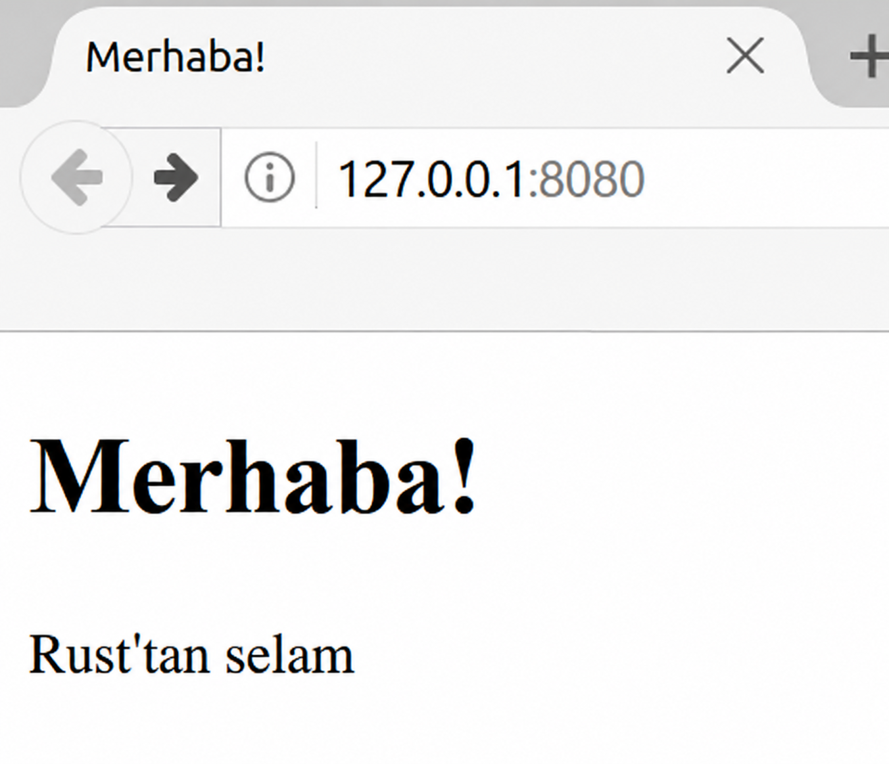

# Final Projesi: Çok Kanallı (Multithreaded) Web Sunucusu Geliştirme

Uzun bir yolculuk oldu ama kitabın sonuna ulaştık. Bu bölümde, son bölümlerde öğrendiğimiz kavramların bir kısmını uygulamalı olarak göstermek ve daha önceki bazı dersleri pekiştirmek için birlikte son bir proje daha geliştireceğiz.

Bu final projesinde, “Merhaba!” diyen ve bir web tarayıcısında Şekil 21-1'deki gibi görünen bir web sunucusu oluşturacağız.

Web sunucusunu şu planla geliştireceğiz:

1. TCP ve HTTP hakkında biraz bilgi edinmek
2. Bir soket üzerinden TCP bağlantılarını dinlemek
3. Az sayıda HTTP isteğini ayrıştırmak
4. Geçerli bir HTTP yanıtı oluşturmak
5. Bir thread havuzu (*thread pool*) ile sunucumuzun işleme kapasitesini (*throughput*) artırmak

Şekil 21-1: Birlikte geliştireceğimiz final projesi (ekran görüntüsünde İngilizce örnek çıktı yer almaktadır; kendi sunucumuz Türkçe “Merhaba! Rust'tan selam” yanıtını üretecektir)

Başlamadan önce iki ayrıntıya değinelim. Birincisi, kullanacağımız yöntem Rust ile bir web sunucusu geliştirmenin en iyi yolu olmayacaktır. Topluluk üyeleri, [crates.io](https://crates.io/) üzerinde bizim geliştireceğimizden çok daha eksiksiz web sunucusu ve thread havuzu uygulamaları sunan, üretime hazır pek çok crate yayımlamıştır. Ancak bu bölümdeki amacımız kolay yolu seçmek değil, öğrenmenize yardımcı olmaktır. Rust bir sistem programlama dili olduğundan, çalışmak istediğimiz soyutlama düzeyini kendimiz seçebilir ve diğer dillerde mümkün ya da pratik olandan daha alt bir seviyeye inebiliriz.

İkincisi, burada `async` ve `await` kullanmayacağız. Bir asenkron çalışma zamanı kurmayı işin içine katmadan, yalnızca bir thread havuzu geliştirmek bile tek başına yeterince büyük bir uğraştır! Yine de bu bölümde göreceğimiz bazı problemlere `async` ve `await`'in nasıl uygulanabileceğine değineceğiz. Sonuçta Bölüm 17'de de belirttiğimiz gibi, pek çok asenkron çalışma zamanı kendi işlerini yönetmek için arka planda thread havuzları kullanır.

Bu nedenle temel HTTP sunucusunu ve thread havuzunu elle yazacağız; böylece gelecekte kullanabileceğiniz crate'lerin arkasındaki genel fikirleri ve teknikleri öğrenmiş olacaksınız.

> Not: Gerçek dünya üretim sistemlerinde Rust ile web sunucusu veya HTTP servisi geliştirirken genellikle `tokio` asenkron çalışma zamanı üzerinde yükselen `axum` ya da `actix-web` gibi çatılar (*frameworks*) tercih edilir. Bu bölümde `TcpListener`, `TcpStream`, kanallar (`mpsc`), `Arc<Mutex<T>>` ve `Drop` trait'ini doğrudan kullanarak kendi sunucunuzu sıfırdan inşa etmeniz, bu modern çatıların kaputun altında bağlantıları, görev kuyruklarını ve zarif kapanışı (*graceful shutdown*) nasıl yönettiğini somut olarak kavramanızı sağlayacaktır.
